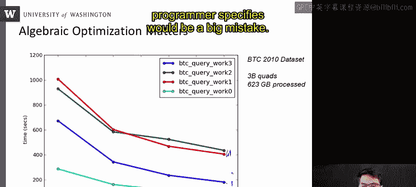
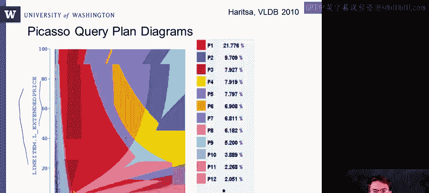
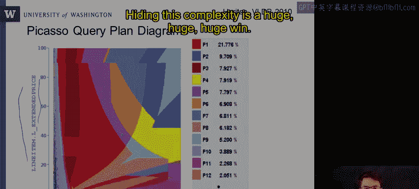

# 杜克大学《大规模数据科学（大数据操作，第1课／共3课有视频）｜Data Science at Scale》 - P42：41_优化：选择物理计划.zh_en - GPT中英字幕课程资源 - BV12s421T7tJ

。

Now， what I want you to notice though， is that when I explain this query。

 I get a different physical plan， the logical plan looks the same， it's still got scan。

 scan and a join， but the algorithm to compute the join has changed and now it's this thing called nested loops。

 and that nested loops corresponds exactly to this pseudocode here。

That's why they call it nested loops， the outer loop and the inner loop。So exactly the same thing。

And so it chose to do this nested loops plan。Even though we argued that it was an in squared algorithm and it probably wouldn't be chosen very often。

 so why was it in this case， So if you think about it。

The one of the sides of this join is only dealing with those terms or with occurrences of the term parliament in a document。

Which is a very small relation。 And so it's a very small relation。

 And this nested loops algorithm could be very， very efficient and。

Faster than dealing with the overhead of actually constructing this hash table or constructing some data structure。

So the main takeaway here， as opposed to the details are is that。

Different physical algorithms are appropriate at different times and that this declarative language and thanks to the decorative languages and thanks to algebraic optimization。

 the programmer doesn't have to worry about any of that。 they don't have to make that choice Okay。

 so this is a very， very powerful idea。 you just express the query and the database does the rest And just to point out this is not just something you need to。

SQL server， you can generate these kind of algebraic plans and Postgres by using explain。And in fact。

 they look kind of nicer and here's these。Haash joins again， this actually shows you， excuse me。

This shows you where it's building the hash table。As the step one and then probing it with the step two and same thing here。

 and this is another operator that we didn't talk about。

Where you are say you're going to count all the members of some group。

 I'll put it that way and so the hash here is on group ID and you can apply aggregate functions to the rest of it。

 but I shouldn't give such a high level view of that without talking about it more。

 so let me skip that all。So fine， so the algebra really does exist。

 you can look at it directly just by using the keyword explain。

 and I advise you to do so if you work with databases。

 you should be using and explain all the time to try to understand what's going on。All right。

 another point I'll make is just that this matters。

 this is not from directly from SQL and in fact it's not from a commercial database。

 it's from some research that we do in my group。But the point is the same here。

 These are actually different physical plans。For the exact same query and in fact here I'm doing something in parallel so this is actually number of processors being applied and so。

As you go from four to 16 processors， things go down a little bit， not as much as we'd like。

 actually， they should be sort of going down quite a bit。

But the point is that each one of these plans is doing a very different amount of time。 Well。

 these two of these were kind of the same， but the difference is。Pretty important。

 so ignoring these opportunities and sticking with only the plan that the programmer specifies would be a big mistake。

 And then another illustration of this that's a little bit hard to stare at。

 but let me let me give it a whirl to try to explain what's going on here。

 This is by some very nice work by Hea at all VLDB 2010。

 but there's a whole series of papers on this work。

 But they try to visualize the space of possible query plans。 And so what the two axes are here。

 This is all for a single query。

But the parameters to that query are changing。And so this， in fact。

 says something about the supplier account balance。

And this is a parameter on the sort of extended price。

 and they change the value of these parameters in the query， so imagine the same syntax。

 the same select star from something something。Where some condition equals。

Extended price and some other condition equals account balance and just by varying those。2 knobs。

You get this really rich tapestry of different plans。Being selected by the optimizer。

 So each color in this space represents a different query plan。

 a different algebraic query plan selected by the optimizer。Okay。

 and so I think that the takeaway here is just that it's a very complex decision being made by the databases and necessarily so they actually you know these different plans actually matter。

 they don't show that here， but you can actually show that this choice of plan databases tend to do a pretty good job of finding the right plan。

And that I argued in the last slide that this can actually matter。

 that the difference in the time can be pretty significant。

Leaving this kind of complexity up to the programmer。Is。

It can be a big source of loss， right hiding this complexity is a huge， huge， huge win。

