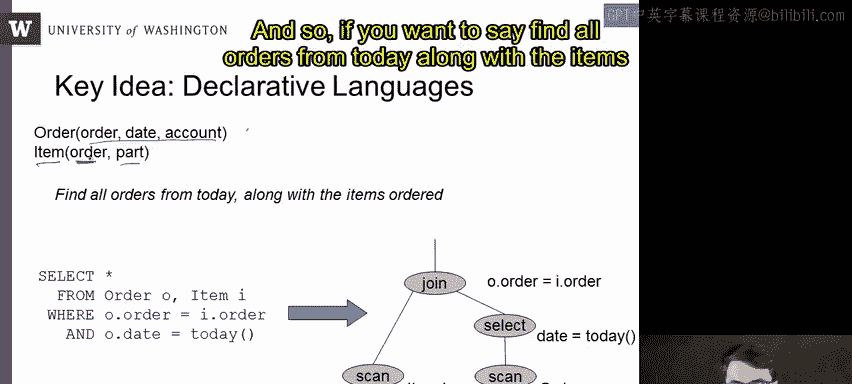
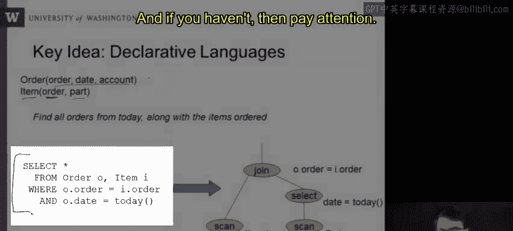
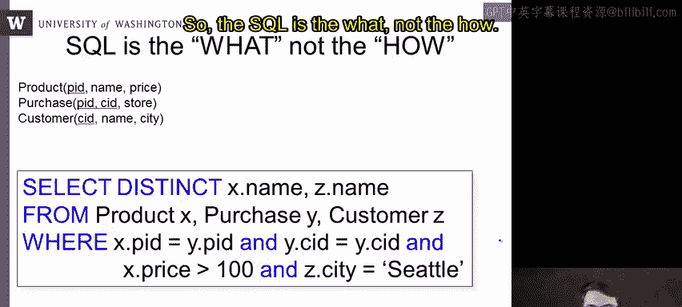
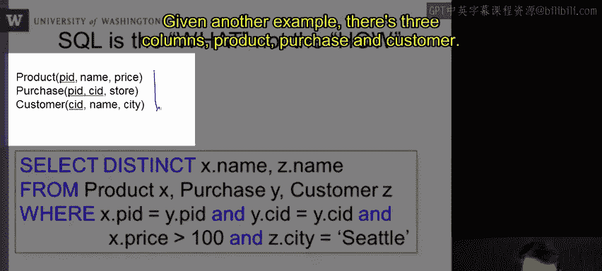
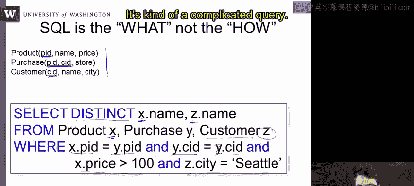

# 杜克大学《大规模数据科学（大数据操作，第1课／共3课有视频）｜Data Science at Scale》 - P43：42_声明式语言.zh_en - GPT中英字幕课程资源 - BV12s421T7tJ

。

Okay， last time we talked about algebraic optimization， and I argued that all three of these。

Expressions without going into a lot of detail。 But I argued that all three of these were equivalent and they differed only in the order in which things were evaluated。

 Here you evaluate this join first and this join second and in this expression。

 you evaluate this join first and this join second。 and here you sort of。

Find all possible combinations of tuples and then filter that and so if you don't understand exactly what's going on these expressions that's okay。

 you're not going to know that yet we'll talk about it in this in this segment I think。

 but the idea the takeaway here is that there's three equivalent expressions and we don't know necessarily which one is the fastest one you to evaluate but the database can figure this out and does every time you write a query and that's this notion of algebraic optimization。

We don't， you know， even if you're familiar with databases。

 you may or may not be familiar with the relational algebra。

 which should be strange because I've argued that it's you know the hallmark of databases and totally fundamental so why don't we think about programming。

databases in terms of writing relation algebra expressions， Well， another good idea。

 another key idea that's associated with the relational databases is this notion of decorative languages and what we mean by decorative languages is that you specify the answer that you want。

 but you do not specify anything about how to get it。And so。A relational algebra expression。

Actually does specify an order right as I showed on this slide here's three different expressions that's indicating exactly which order to do every operation。

 that means that you know if you write an expression like this， you're instructing the computer。

 look do it in this particular order。OkayAnd so these decorative languages say， look。

 we're just going to describe the properties that must be true of the result。

 and we're going to let the database figure out the right order in which to do this。

And so here's a quick example。So imagine you have two tables， one is order with three columns， order。

 date and account， and another table with item with two columns order in part and the semantics here is that this。

Column indicates which order that item should be associated with。ok。

And so if you want to say find all orders from today along with the items ordered。

Then you might write this query， and if you've seen SQL plenty of times before。

 bear with me and if you haven't， then。

Pay attention， so。Select star giving all possible columns from the table。Order。

And all possible columns from the table item。But I only want records such that this condition is true where the order。

Column from the order table matches the order column from the item table。RightAnd then further。

 I only want orders from today where order at date equals today。

So this is just conditions expressed over the results。

Without any kind of idea of what how to actually get this answer so what automatically happens is that this query is translated into a relational algebra expression along the lines of what we've already seen you know here I've sort of just done a cartoon where you can say scan the item table。

 scan the order table， select the records such that date equals today。

 and then perform the join find all the records in order that correspond to the that have you know for each record and order。

 find the corresponding records and item that match on。On order。Okay。

So this is happening every time you run a query again。So the sQL is the what not the how。

 given another example。

Here's three columns， product， purchase and customer。

And the underlining here we haven't talked about， but this is the indicating what makes the table。

 well what makes these record unique， and so here the PID makes the product unique。

 the CID makes the customer unique， and the combination of PID and CID makes the purchase unique。

Okay， so here's another SQL query we say select distinct。Product name。

 why don' I knows the product name because I see an x here and I see an X here。And the customer name。

 and I know it's the customer name because I see a Z here and I see a Z here。

 This is an alias for the for the。Relation customer。From these three tables。Where the product I。

In the product table matches the product I D in the purchase table。

 and the customer Id in the purchase table matches the customer I D in the。Customer table。

 and that's a typo， it looks like that should be Z。And then we want it， we， but now we want only the。

Products for which the price is greater than 100。 And we only want the。

Customers whose city is Seattle。All right， so what does this say in English？好 I me。

Combinations of products and customers， unique print combinations of products and customers where the customers in Seattle and they paid for a product worth more than 100。

So it's clear what we want， but it's unclear how to get it。 It's kind of a complicated query。

