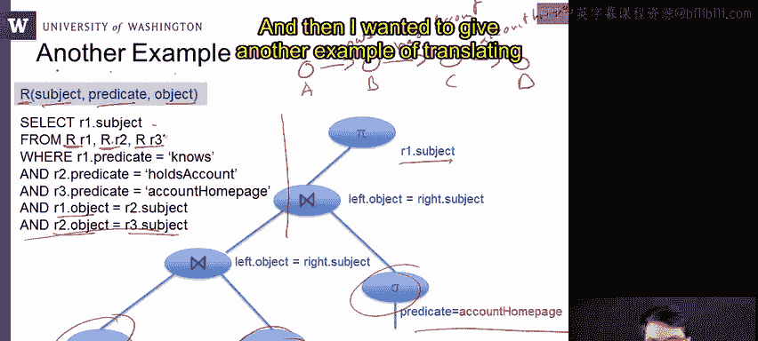

# 杜克大学《大规模数据科学（大数据操作，第1课／共3课有视频）｜Data Science at Scale》 - P44：43_声明式语言更多示例.zh_en - GPT中英字幕课程资源 - BV12s421T7tJ

。

So translating this into relational algebra。We have this。

So at the bottom we have product and purchase and now we do this join where we say for every product。

 find me the corresponding records in purchase， then we do another join for every record in the result of this join。

Find me the corresponding records in customer。Right。Now filter out all those records such that。

Where price is not greater than 100， we only want the ones where price is greater than 100 and we only want the ones where city equals Seattle。

And then we want to in this case， project。嗯。Down onto these two columns。

 what going to mean by project is get rid of all the other columns except for the two we're interested in。

And then finally take the final answer。So the two points here is that the execution order is now clearly specified。

 but there are a lot of physical details are still left open。

 you know this is a very high level indication of what's going on。Order of operations is clear。

 but that's about it。 We don't know how we're going to do the join。Exactly。

 and there's multiple ways you can do it。 I've indicated that， you know。

 we're going to take for every record and product。 we're going to look up a corresponding record and purchase。

But we haven't said precisely what that means。Okay。I'll give。

 I'll give an example of this in a second。So another example here。

Here we only have a single relation called R， and it's got three columns， subject。

 predicate and object， and you see this kind of schema when you hear about when you work with RDF data。

 the resource description framework。And RDF is a。Language and formalism and software stack for。

Managing what is called linked to data and here sort of everything is。

It's a set of all facts any kind of fact you can come up with， you can encode an RDF， you can say。

 you know， the instructor of this course is Bill Howe。Right。So。Here the subject might be this course。

The predicate is has instructor and the object is Bill howe。And so， this is a。

People use this formalism as a very general way of encoding any information from any source。

 and we might touch on this much later in the course。Okay。

 so here's just kind of a complicated query。But what it says is I'm going to have three instances of the same relation and I'm going to join each。

I'm going to join them all up。And I'm going to look for。A sequence of。Tups， such that。We have。

A person who knows another person who holds the account of a。Company。

Who has an account homep page of a particular value， right？ So you're looking for this sequence of。

Where this。Edge is。Noose。And this edges holds account。And this edge is。Account homepage。

So find me all possible combinations in this table where I've got。You know， finding all A。

The all instantiations of A， B， C， and D， such that this pattern matches。

And the joins are specified by these conditions。The object of the first relation must be equal to the subject of the second relation。

And the object of the second relation must be the subject of the third relation。

So I'm looking for patterns in the graph that look like this。And in relational algebra。

You see this query gets translated into this form， there's a selection。To find predicate equals nos。

 there's a selection to find predicate equals holds account。

 and there's a selection to find predicate equals account home page。And then， you join。

And then a sequence of joins， and finally a projection just to pull out the final answer that we're interested in。

 which is a slight clause。Okay， so。Perhaps a kind of complicated example。

 but I think the takeaways here， I wanted to mention RDF because they might come come across it again。

And I also want to demonstrate that you can access the same relation more than one time in a single query。

And then I wanted to give another example of translating even complicated queries into relational algebra expressions。

