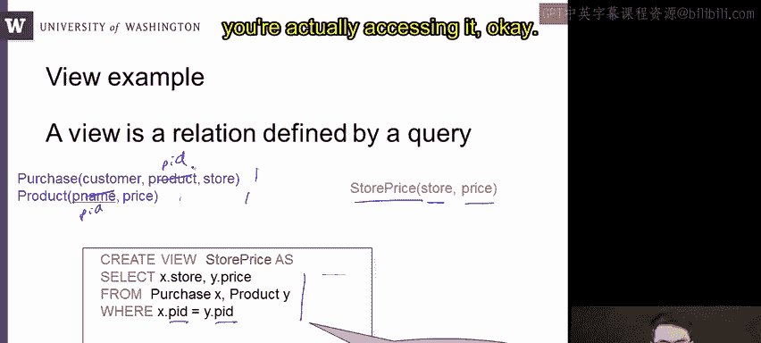

# 杜克大学《大规模数据科学（大数据操作，第1课／共3课有视频）｜Data Science at Scale》 - P45：44_视图：逻辑数据独立性.zh_en - GPT中英字幕课程资源 - BV12s421T7tJ

。

Okay， so we talked about。Physical data independence。 And we talk about algebraic optimization。

 I want to talk about another kind of data independence， which is logical data independence。

And so we argued that physical data independence was this ability to insulate applications and protect applications from changes in the physical organization of the data。

So if things were rearranged on disk， we don't want to have to rewrite all the code in the application。

 and this is what databases provide and relational database in particular do a great job of providing this。

But if you go back to Ted Cods。First paper and the quoteta even the quote I gave you。

 he talks about you know， insulating applications from the internal changes in changes to the internal representation。

 but also insulating applications。From changes to some forms of external representation。

 and what it means by external is things like adding a column to a table。

So this isn't an internal shuffling of the bits on the disk。

 it's actually a logical change to the table， there's more data there than there was before。

But you know， if you think about it， if your code doesn't care about that new column。

 you shouldn't have to rewrite it just because there is a new column。Okay。

So the ability to provide this logical data independence is provided by this concept of views and all relational databases have this concept。

And。Somewhat surprisingly， I find them to be somewhat underused in practice。Right， and while。Okay。

So if you're using them right now， if you know what they are great， if you're using them even better。

 if you use databases but I've never heard of views。

 then this is a great time to learn about them okay so what is a view a view is just a query with a name so I write a query。

 I give it a name and I put it in the database。Now。

 I can then access that view as if it was a table in the underlying database itself。

 as if it was a physical table。 So why can we do this？ Well。

 I talked about this notion of algebraic closure before。

here and this is exactly what empowers what allows us to do this。

 so we know that every query returns a table right we take tables on the input。

 we do some manipulation of them and we produce tables so we say that the language is algebraically closed。

And so any result of a view will always be something that we can then add other queries on so we can stack queries on top of queries on top of queries on top of queries okay。

So why might we want to do this？ So one reason is to protect。The underlying data。

 you can assign permissions to tables。 So for example。

 if you only want a particular user to see data associated with their account。

 you can write a view that filters everything out except for their account。

And then in grant them access to that view。 The most direct benefit of this is that it。

It allows you to expose data according to a logical organization that makes sense for the user。

 so even things as simple as hiding some join， if you decide to reorganize your data into two tables。

 requiring that programmers use joins to link them back up again。

 you can simply write a view that hides that join and let everyone access the result of it。Now。

Maybe this may sound expensive。But the cool trick here is that。Because of this algebraic closure。

 what happens is the user's query gets composed with your query that defines the view and the whole thing gets sent as one big block to the database for evaluation。

 so the database simply doesn't care whether it came as a view in then your user query or whether it came all as one query directly from the programmer。

 it's going to optimize it the exact same way。Okay， so there's nothing but a benefit here。

So let's see an example。So given the schema， purchase and product。

Define a view called store price with two columns store and price that has this definition。So。Select。

 store and select price from purchase and product where。The product IDs are equal。

This is a little funny because we didn't put。 We didn't put kidss here。 So this is。

 this is a little bit wrong。So assume that each one of these has a。Let's assume that this is pied。

And assume that this is also good。And then it matches the query down here。ok。

So this result is now like a new table。 And just like I said a second ago。

 you've now hidden the join。From the users。 And so complexities like these column names。

 perhaps you can insulate your users from and you can name them whatever you want。

 And so this allows you to put this this is what this logical data independence means is that。

No matter how I want to logically organize my tables， I can expose a different。

A perspectivepective on the data than I want to have myself。

 and so this separates the people who are administering the data from the ones who are actually accessing it。

Logical data independence， key idea。