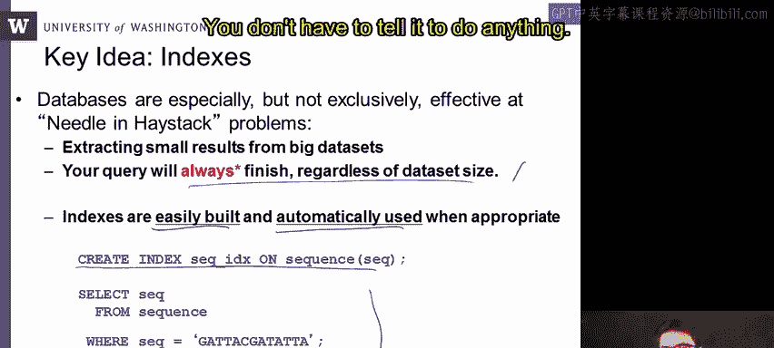

# 杜克大学《大规模数据科学（大数据操作，第1课／共3课有视频）｜Data Science at Scale》 - P46：45_索引.zh_en - GPT中英字幕课程资源 - BV12s421T7tJ

。

All right， so how do we use these views well？GiveAn example of why you might want to do this a high end。

Let's define a high end store is a store that sold some product over for a price over 1000 so a high end boutique store then for each customer find all the high end stores that they visit and return a set of customer name high end store pairs。

In this case， this is a fairly complicated。Query， but now， you know。

 we've got a definition of high end store that others can use in their own queries。

 if they want to find， if they want to access。You know。

 I actually I didn't a very good job explaining to this。

 this is actually exercising the view we just defined in the previous slide。

So this is a new query that exercises this store price view。

I was actually going one step further and I wanted to define a new view that used where this is the definition because I thought the notion of a high end store might be something useful and of course you can do that you can just take views on top of views on top of views on top of views。

All right， so how do we use a view Well， as I've said， all you have to do is。

Reference the view in a query just like it's a table and so here if we wanted to define the notion of a high end store and we say。

 well， that's any store that has sold some product to over $1，000。And you know for each customer。

 we may want to find all the high end stores that they visited。Well。

Be being able to directly reference。The store price relation that we defined in the previous slide。

 this view helped simplify this query， right， And so you can just write a query that directly accesses。

That view is if it was a table。And。Okay， so how is this actually evaluated， Well， that's actuallys。

 that's actually what's。Really fantastic about。Databases is that this query will just be folded together with the view definition and pass to the database where the whole thing is optimized in one go。

 optimized in one go。So you don't need to worry about。

The difference between having a stack of five views。

And all being compiled are all being folded together as one query the database doesn't care。

 It's going to translate the whole thing into one big query。

Exchanged after an algebraic expression and then do the normal optimization procedure to come up with the best possible plan。

 So it's basically like free abstraction， right， It simplifies things for the for the programmer without any kind of。

Performance costs。 Okay， now you can actually get better performance than writing the whole thing by hand。

it's equivalent to writing the whole thing by hand。

 you don't pay a penalty but you can actually do better than that with views in some cases by materializing views。

 and we're not going to talk too much about that because it sort of is very specific to databases and we don't see it quite as often in this broader context of data science that we're trying to talk about。

But it's a good trick and once you have the mechanism to store views。

 you can essentially cache the results and that's what we call materialization。ok。

And so one final point I want to make， another key idea of databases is。Indexes。

And while indexes are certainly not unique to databases。

What I think databases have perhaps uniquely is a fantastic platform for building them and applying them and using them right so if you're in a general purpose programming language if you're working in Python or you're working in R and you come up with a pipeline to process some data and you decide。

 boy， it'd be a lot better if I。You know， sorted my data by customer last name before accessing it。

Because that would make things more efficient。 That's that's like building an index。

 But you have to rewire all your code in order to take advantage of that index。

 The key thing about databases is that indexes are easily built and automatically used by the optimizer when appropriate。

 So all you have to do is write an expression like this， createate index on。Some column of some。

T in here I've switched your schemas yet again on you。And。

The database now understands that this index exists and we'll use it whenever it's appropriate。

 and you can see this in those plans， you know I talked about using the explain to figure out the algebraic expression of the plan and actually look at it to reason about the performance。

 you'll see it selecting to use an index scan as opposed to a regular scan when these indexes exist。

Sort of。Going in reverse order here， this this top bullet is just saying that。

One of the areas where database is signed is sort of these needle and haystack problems for which indexes are。

Critical。You can ignore this point about sort of old style sc I sort of。Skpped that point。

 it's not quite as relevant for data science。So the last key idea I want to convey about databases is that of indexes so while indexes are certainly not unique to databases。

 databases are perhaps unique as a platform that can make them very easy to apply and deploy and automatically take advantage of and so databases are especially but not exclusively effective at sort of needle in the haystack problems looking up individual records or small amounts of records from large datas。

 they do other things very well too but this is one thing makes that they're quite good at and the reason is that they that you can apply indexes this second was a little bit of like context what I mean here is that if you're trying to write code to do this yourself。

In say some programming language like Python or C orR。You're going to be a slave to what？

Sizes of data fit into main memory， as we said before now。

 you can absolutely be clever and start bringing in one chunk of data at a time into memory。

 processing it。Putting it out to disk and bringing it in the next set and so on。

 But the code will very quickly become very， very complex。

 This is something that databases already know how to do。

 And so your query will always finish regardless of database size， as long as it fits on disk， right。

 It It doesn't matter how much memory you have available。 It'll eventually finish。

 They or may not be that fast， but it'll finish。 They already know how to take advantage of main memory in this optimal way。

And you know， it's not easy， right， it's a pain in the butt to try to code that yourself。

So effective use of of the memory hierarchy， effective use of indexes。

 These are things the databases can do。 Well。 It's a great platform for applying these these tricks。

 And so finally， you know， this， what I mean here is that the indexes are easily built and automatically used by the。

By the optimizer so to create an index you you can write a statement like this here I've changed the schema on you once again。

But here we're sort of filtering on genetic sequences。And if I create this index。

 then this query will。You know this very simple query is looking for all sequences that match a particular value。

 it will automatically take advantage of that index if it's there。

 you don't have to tell it to do anything， you write the exact same query。

