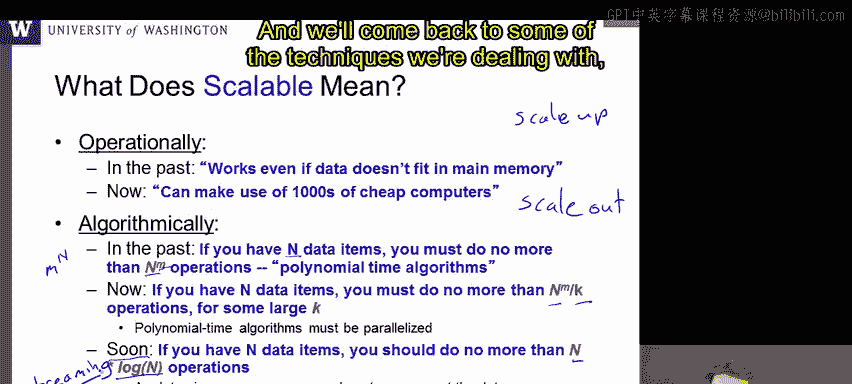

# 杜克大学《大规模数据科学（大数据操作，第1课／共3课有视频）｜Data Science at Scale》 - P47：46_可扩展性的含义.zh_en - GPT中英字幕课程资源 - BV12s421T7tJ

。Welcome back。 So this time， I want to talk about what this term scalable means。

 We made the point that working with really large data is important aspect of data science。

 And we've mentioned the word scalability before。 we haven't talked about really what that might mean。

 So a couple different ways to think about it。 I' want to talk about here on this slide are here。 So。

 you know， operationally。And in the past， one way to think about this was， look。

 it needs to work on data that doesn't fit in main memory on a single machine。 Okay。

 so maybe you still only have one machine to work with。 But this means that if it can。

 you need to be able to bring data off of disk in pieces。

 operate on it and then maybe write it out in pieces。 Okay。

 And so a bundle of algorithms that could work。On data in this fashion。

 by bringing in data piece by piece to memory， such that the memory footprint at any given point was。

Small， this is something the database is provided。 so you could write a query and you knew for sure that it was going to finish。

As long as the data was there on disk。And you had sort of a minimal amount of memory。

 at least to get started。And I might use the term out of core processing here。

 So out of core means it uses the disk to operate。 So in core means the entire everything you're doing it fit's entirely a main memory out of core means you need to sort of work with the disk appropriately。

 And so databases where the database community were specialists at out of core processing of large data sets。

 but increasingly this notion of scalability。Wasn't really enough。Okay。

And so you saw this pretty acutely with。Websites that were coming online in the 2000s where。

 you know， one big server， no matter how how big you bought that server。

You couldn't bring data off of disk fast enough to meet all the requests， and you had to start。

Being sure that things were in memory， and the only way to do that is start adding more machines。

Okay。And so increasingly， especially， you know， Google， especially is sort of known for this。

 although many of the。Large media companies do this is that scalable really kind of means being able to use up to thousands or maybe even more tens of thousands of cheap computers and and apply them all to the same problem。

 And so we might call this。啊。Scale out。While getting bigger and bigger and bigger main memory and more and more cores perhaps would be scale up。

Okay。Fine。Another way of looking at this that maybe a little bit more precise is to think about this kind in terms of algorithmic complexity that you may or may not be familiar with depending on how much computer science you've taken。

 but let me give you just a flavor of what's going on here。 So in the past。

You might call an algorithm scalable， if for。If given in date items。

Your algorithm does no more than into to the M operations on it。So this may in maybe one。

 in which case it's a linear time algorithm or it maybe be two。

 in which case it's a quadratic time algorithm and so on。 But this was deemed tractable。

 And so you'd prove properties about you would prove that you could find a polynomial time algorithm to solve some problem and it was sort of thought to be scalable or assumed you know well。

 assumed it was。That was the definition of what scalable was things that were non polynomial that took more than this。

 for example， exponential， where you might have。Him to the inn。Were。Exponential time algorithms。

 And they grew much， much faster， and they were。They didn't scale， Okay， but， you know。

 this isn't a very tight bound on scalability in practice， right。

 a quadratic time algorithm may be sort of feasible。 You start getting into the fourth and so forth。

 It becomes pretty difficult to。Do for， for very large data sets。 Okay。

 so now you would say that it really can't just be into the M。

 It's got to be into the M over K over for some pretty large K。 So you have to a lot of。

K being the number of computers you can apply to the problem， and you have to come with an algorithm。

 and they can really exploit this properly。And then one more point that I'm going to make now。

 but we're not going to return to in this segment but I hope to at the end of the course is that。

 you know， it could be that soon even this isn't good enough。 and for in date items。

 you really should do no more than in login operations。 And so the in here。Means for every。

 for every data item that comes in over the wire。 So this。

 this is applicable to sort of streaming applications。

 And the data is coming in so fast that you only get one pass at it。 So for every operation I have。

 I'm allowed to process that data item， and then I'm allowed to put it in some sort of a。Of an index。

 And that's this。Log in factor。Okay， and so whenever you see log， you should think trees。

 So I'm allowed to take each item， inspect it and work with it and then stick it into some tree data structure。

 but that might be about it。 It's just too big to make multiple passes at。 Okay。

 and so examples of this might be this large synoptic survey telescope that we。Heard about， you know。

 they're taking sort of 30  TBabyte tonight。 You can't sort of make too many passes on this data at one time。

 Okay， and so this whole area we think of as streaming data， which I guess I have written here。

 but I'll write it again。And we'll come back to some of the techniques for dealing with big data in a streaming。

Context。