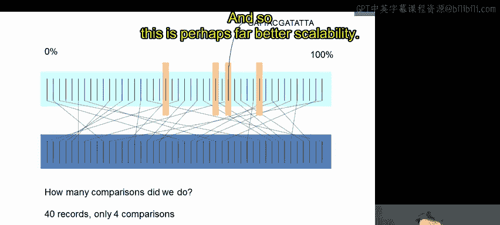

# 杜克大学《大规模数据科学（大数据操作，第1课／共3课有视频）｜Data Science at Scale》 - P48：47_算法复杂度概述.zh_en - GPT中英字幕课程资源 - BV12s421T7tJ

。

So two different views of what scalable might mean。

 and we're going to talk in this segment to give you some examples and some intuition for this。

 Can we make use of lots of computers？And there's an overk。Okay。All right。

 so here's a little example problem。That's。Admittedly somewhat oversimplified。

 So we want to find all the matching DNA sequences。

Where a set of sequence is a short string consisting of the letters G A T， and C。

 and you're given a short sequence， and you want to find all the ones that just exactly match that。

Okay， so find all the sequences that are exactly equal to this one that you're given。

So how might you do this？With this little cartoon， imagine that each one of these black lines is a sequence。

 I this black line corresponds to this sequence， and this black line corresponds to this sequence。

 and all the other black lines are other sequences。And。You know。Think to yourself for a minute。

 Pro an algorithm to， to。Find sequences matching。Your target sequence。Well。

 making no assumptions about the data whatsoever is just given to you as a list。

One thing you can do is。Do sort of a linear search。 And so we're going to。Inspect the first item。

And we're going to compare it。To our target sequence。 and if they're equal。Great， we found one。

 if they're not equal。呃。What do we do Well we move on to the next one。 So this is not equal。

 And is this all happens at time equals 0。And then we go over to the next one。

 And so a time equals one， we check another sequence and compare it for equality。

 And if it doesn't match， we keep moving on。And so so on and so on until we get to time 17。

 where we find a match。And here， I've said contains instead of equal。

 I guess I changed the the meaning here。 But so， yes， we found a match and we send it to the output。

 Okay， so how long does this take， How many operations do we do， Well， we did 40 records。We're sorry。

 we were given 40 records in this cartoon， and we made 40 comparisons。

And so within records and in comparisons， we say that the algorithmic complexity is order in。

so this is a linear time algorithm for this simple search and retrieval task。

So the question is can we do any better？And if you've。

Had some experience thinking about data structures or taking some data structures classes。

 you should be thinking， yes， we can。So one way to do this is to sort the sequences。

So how does this help？Well， certainly we could still do the linear time algorithm and inspect these guys one at a time。

But we can also do something a little bit smarter。What if we start in the middle？

So start in the middle and compare our target。Sequence to the sequence we found here。

 and they're not equal。 but we can see that this one that we found is less than。Our target sequence。

 Okay， so we know that the sequence we're on is to the left。Of our target sequence。

 we know the target sequence is to the right。It must be somewhere in this direction。

So we've just removed the need to check half of the data， 20 20 records。Okay。

 so now jump to the middle of this guy。And compare again。And now we see that， well， boy。

 we overshot This one is greater than this one。 Well， once again。Let's see。

 here we've removed half of these guys。On the first step， and here we now we've removed。

Half of these guys。And now we know it's in this range。Skpped in a half again。

And compare this one and now it's less than， so we're sort of bouncing back and forth around our target。

Let see if I can draw this a little better than I did， cross those out。Coross those out。

And now cross these out， and so we know it's somewhere on this side。And in the next step， we。

Find a match。Okay， and here if we have multiple copies of the same。Item， we know that they'll be。

 they'll appear next to each other so we could just walk through the records。

 gathering up all the ones that match if we needed to。 Okay， so how long did this take。Well。

Here we still had 40 records， but we only made four comparisons。So within records。

 we made login comparisons we navigated this sort of implicit binary tree。

 We did a binary search over this sortded data。Okay， and so this lookup。Was。Order log in。 Now。

 we did have to sort the data ahead of time。 And if you have to include that。

 then that's an in login operation that we're not going to necessarily talk about。

 But once you have that sorted data available to you， it's now。呃呃呃。

reallyally takes logging operations and so this is perhaps far better scalability。

