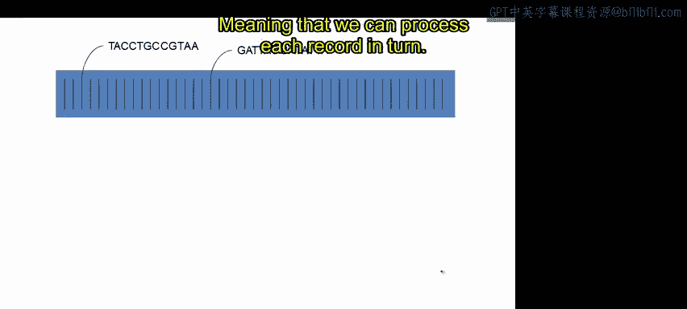
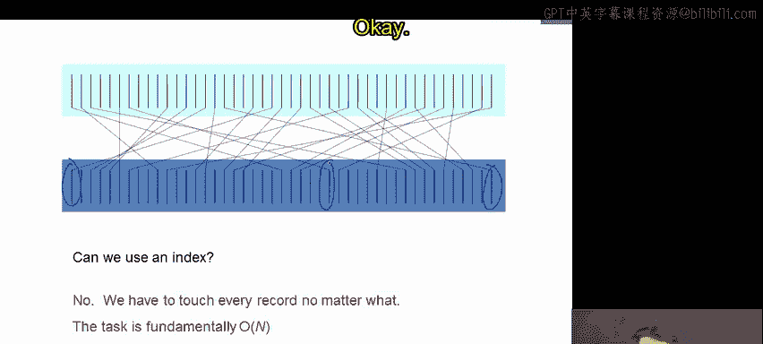
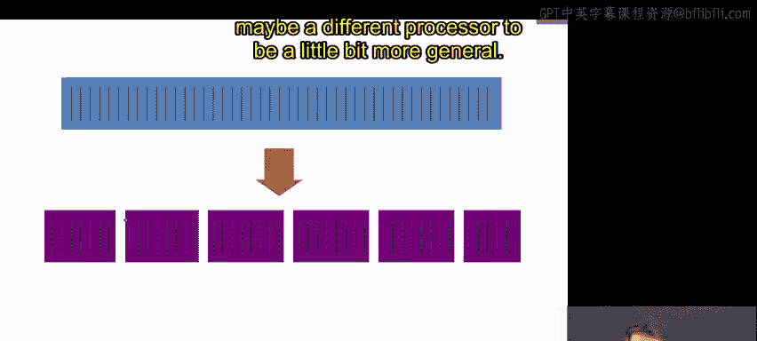
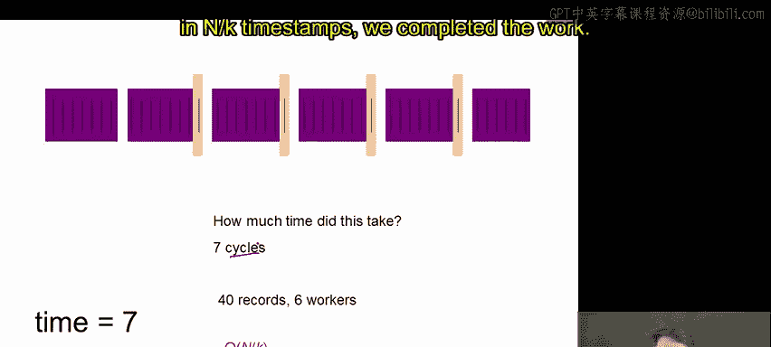

# 杜克大学《大规模数据科学（大数据操作，第1课／共3课有视频）｜Data Science at Scale》 - P49：48_数据并行算法概述.zh_en - GPT中英字幕课程资源 - BV12s421T7tJ

。

And this is a good trick， and it's such a good trick that it's been baked into many systems。

 especially I'll argue relational databases。 and we made this point before。

 but I want to make it again is that databases are good at these kinds of needle in the haystack problems。

 right， It's trackinging small results from big data sets。

They can transparently provide this sort of old style of scalability。

 What I mean by old style of scalability is that fits in main memory。

 As we've said a couple of times。 your query will always finish regardless of the size of your main memory。

In addition， you can。It makes an excellent sort of index platform。

 a platform for building and using and reusing indexes。 Okay。

 so relational databases are good at this old style scalability in the sense of of out of core algorithms。

 And they're also good at this old style scalability in the sense of finding logs。

 Find logarithmic time algorithms。 Okay so indexes are easily built and automatically used when appropriate。

 And we've talked a little bit about this。During relational databases。

 you can write a single statement， create index。啊。Give it a name。On a table and a column name。

 and it will。Sort records。According to that column。

The actual data on disk may or may not be physically sorted depending on the details of which system you're using in。

好ello。How this is working and typically in this statement。

 it would not actually be moving the physical records around， but it would build an auxiliary index。

 But regardless， you get to take advantage of this logarithmic time access pattern。 Okay。

 and so just by writing this one statement in one line of code。

 you can create the index and take advantage of it。Okay。

 and then every query that comes afterward that needs to use that。

That would benefit from using that index is able to。

 The optimizer automatically selects the correct index if it's appropriate to use。

 So this is much easier than you having to sort of rewrite your code by hand in order to either make it out of core right。

 or to take advantage of an index。 Okay， so when you're comparing relational databases to say scripts in R scripts in Python。

 there's a lot of。Algorithmic work that's already been done for you。

 that you're getting for free just by turning your problem into a SQL statement。Fine， so you're。

You know， buying into some buying into a lot of code。

 if you can tie one arm behind your back and write it as a SQL statement， it's not just。

SQL versus a much more expressive language like code。

 You're actually getting a lot of benefit out of doing so， okay。So let's look at another task。

callled read trimming So here we're given the same set of DNA sequences。

 but instead of searching for one particular sequence。

 we're going to trim the final few base pairs from each sequence so we're going to trim off a suffix and return the data set where each read is now just a prefix of a former read。

So fine so how do we do this and the reason why you need to trim off the suffix this actually comes up in practice and the reason is that the accuracy of the sequencer drops off fairly abruptly after a certain length of read。

And trimming off the last several base pairs from every single read is kind of a standard pre processing operation。

 How do we do this， Well， we can do the same trick that we that we tried the first time with the search task。

 meaning that we can process each record in turn。

One to time right， so at time zero， we can trim off the。

Suffix here and just return TCCT and in time1。We can trim off this suffix and so on。

 and in time of 17， there's our old friend that begins with GA， TTA， and so on。But here。

 unlike the search task， there's no index that's really going to help us， right？

Have to touch every single record and manipulate it。

 We have to take a prefix from it and remove the suffix。

 And so the operation is fundamentally order in。 There's not going to be an algorithm that is less than order in。

 You have to at least touch every single record。 but can we do any better。Well， yeah， right。

 processing the first task is completely independent from processing the last task。

 which is completely independent from processing。This I actually saying task processing the record。

 Okay， so while there's no index， we can break this data set into pieces and process each piece independently。

Okay， so imagine we。Take our single data set and break it into these chunks and assign each chunk to a different。

Machine or maybe a different processor to be a little bit more general。

Now， at time  zero， we can process one。Sequence。For each chunk all the same time， and at time1。

 we process the second sequence from each chunk all the same time and so on。And so here。

 how much work do we do while we do the same amount of work， we still process all 40 records。

 but how much time did it take， Well， it only took。Seven。

 I say cycles here are seven time units to be a little more。General。

 because we are given these six workers and so the complexity here is。In over K， right。

 for every item we can divide boom。We do on average， work。Freeen items we do。

In overca time steps were completed to work。

