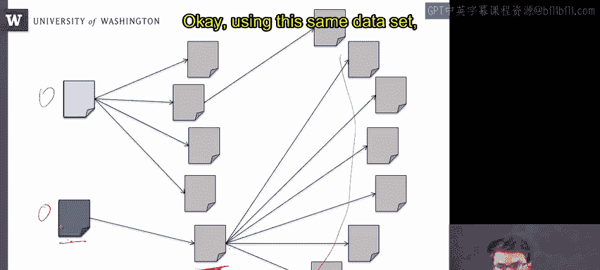
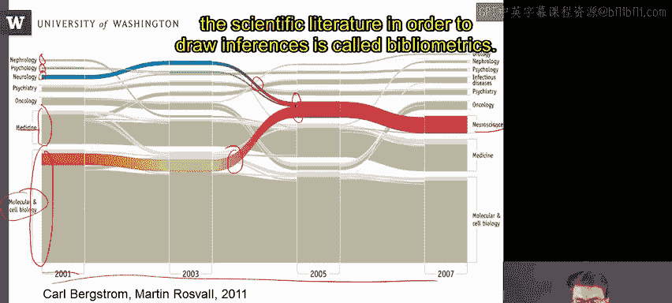

# 杜克大学《大规模数据科学（大数据操作，第1课／共3课有视频）｜Data Science at Scale》 - P4：3_激发胃口：文献计量学.zh_en - GPT中英字幕课程资源 - BV12s421T7tJ

。

So let's go through a few more examples。So if you were asked to。Decide how important。

A particular scientific paper was relative to other papers， how much you go about doing that？Well。

One way to decide between， say these two papers here。

I'll mark one with a blue circle and one with a red circle is to wait until other papers start to cite these。

And count up the number of citations so here， you know the paper mark of the blue circle has had four other papers。

B you know， authors have bother bothered to read this paper and cite it。

 so some therefore must have had more impact in the scientific community than the one marked with the red circle。

But if we wait even longer， and that's indicated here by this darker blue color if we wait even longer。

You might get。Even more people citing this intermediate。Paper。

 and so maybe we can conclude that well over time， ultimately。

 this one had more impact because it you know this。

This paper was influenced by this paper and all of these papers were influenced by this one。

So therefore， perhaps we change our answer and that this one is more。Important。

 so how do we decide between these two interpretations， Well， this problem。Looks a lot like。

The problem of judging the relative importance of。Pages on the web。

And so one thing you can do is say， well， look， you know。

A particular website is important if a lot of other important websites point to it。

 and so here you can say a scientific。Paper is important。

 if a lot of other important papers point to it。 and this method that Google proposed and implemented and ultimately LED to a。

A prettyty significant part of their success was this algorithm page rank。

And so Pageing did exactly this， you add up all the weights of your neighbors and give them to yourself and then pass on that weight to everybody that you link to and you keep going with this until you reach some convergence condition and you end up with the relative importance of these of these pages。

This is a method that comes up quite a bit whenever you have a graph。

 it makes sense to potentially run paid rank algorithm on it。

 even though it had nothing to do with ranking things on the web。

 for which it was originally designed。Using the same data set。

 you can Carll Bergstrom and Martin Rosewell。

Created this visualization。Ignore the importance question。

 Just think about the graph of the citation network and doing analytics on it。

 One kind of analysis you can do is judging importance。 Another kind of analysis you can do is this。

 And so what this is is over time。Run a clustering algorithm， which I haven't described what that is。

 but it groups clusters of similar documents。To and then map those clusters into the relative fields。

 And so you can determine。That problem with some confidence that this cluster represents medicine because it has the Lancet and it has other kinds of medical journals in it。

 and you can conclude that this cluster represents molecular and cell biology。

 but what's pretty striking is that if you lay this out in this timeline like this。

You can see that some fraction of the molecular and cell biology community and the neurology community。

Started to combine to form a brand new field of science called neuroscience。

 And so just by doing this kind of analytics on this graph。To do this data science on this graph。

 you can uncover the emergence of new fields of science。That's I found that。Pretty striking。

 And they've gone on to do many other kinds of analysis on this same data set in the overall field of this kind of meta field of studying the scientific literature in order to draw inferences is called。

Bigliometrics。

。