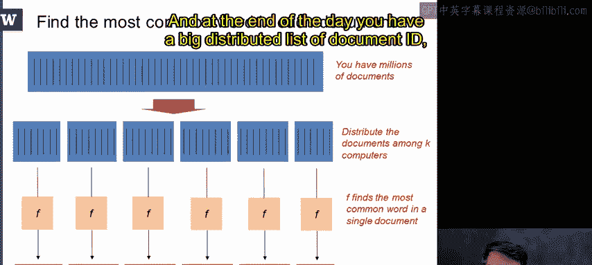
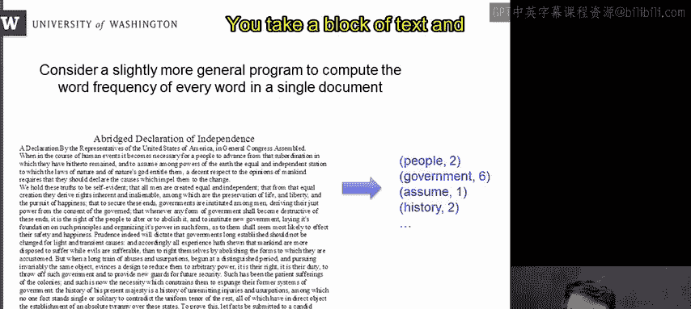
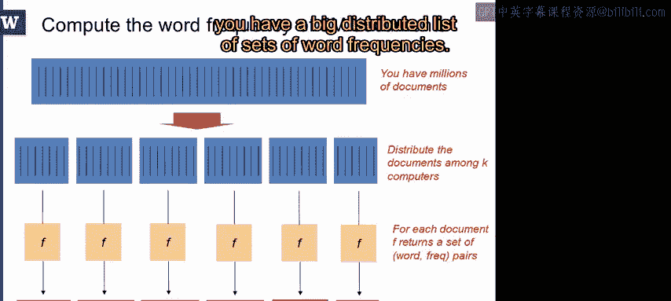
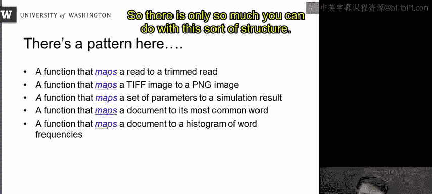

# 杜克大学《大规模数据科学（大数据操作，第1课／共3课有视频）｜Data Science at Scale》 - P50：49_令人愉悦的并行算法.zh_en - GPT中英字幕课程资源 - BV12s421T7tJ

。

We talked about scalability in terms of algorithmic complexity and we also talked about scalability in terms of data parallel processing。

 taking a large data set and splitting into chunks and performing independent computations on each chunk and for each task that we looked at。

 the same sort of pattern emerged。 So for the read trimming task we were given a bunch of short reads and we had to trim off the low- quality suffix of each read because the sequencer doesn't do a good job on longer reads and so the quality gets poor。

 the longer the longer it is， and this is a common task in genomic processing and we distributed the reads across k computers and then we applied dysfunction to trimmer read completely independently across each of these chunks。

And then we ended up with a big distributed set of trimmed reads。

 you can imagine converting file formats from TIF to PNG in the New York Times someone to the New York Times in 2008 went back and looked at their entire print archive and had to do this kind of processing and use Amazon Web services to do this in parallel quite quickly。

 you know on a weekend。And the same thing you're given a large set of TIF images。

 you distribute the images across K computers， you apply this function to convert the TIF to PNG。

 apply it to every item， but again completely independently， they don't need to communicate。

 and then you have a big distributed set of converted images。

If you wanted to run thousands of simulations， you might have a parameter space that you divide up。

 So for you know every different value of input conditions across a long range。

 you want to run the simulation and see what happens。

 So this what happens with these Monte Carlo simulations。

Divide the parameter space up across the K computers， run the simulation against those parameters。

 again completely in parallel， they're just completely independent simulations。

And what you end up with is a big distributed set of simulation results。

 If you want to find the most common word in a big set of documents for each document。

 you have millions of documents。 You distribute the documents across K computers。

 You provide a function that finds the most common word in that single document and they compute in parallel independently and at the end of the day。

 you have a big distributed list of document I word pairs。

 So this structure keeps coming up over and over。 If you want to do a slightly more general program than finding the most common word。

You might say instead of just producing the most common word。

 I want to find the frequencies of all words。 And so instead of。

Producing just a single word with its frequency， you would produce a set of words。

 each one with its frequency。 So for a single document， the function looks like this。

 you take a block of text and count up the occurrences of each word and produce that whole set as as the output what that look like。

 if you got millions of documents。

Distributed documents across the K computers， just like you did before。

 The function now is slightly different。 It returns a set of word frequency pairs。

 And at the end of the day， you have a big distributed list of sets of word frequencies。 Okay。

 so there's a pattern here。 that's pretty simple。 It's where you you know the programmer provides a function that maps a read to a trimmed read。

 a function that maps a T images to a P And G image。

 a function that maps a set of parameters to a simulation result。

A function that maps a document to its most common word。

 a function that maps a document to a histogram word frequencies and so on。

 And so any time you're talking about。Independent distributed computation across a large set。

 You've got this。 you've got this pattern。 And so it makes sense to kind of abstract this pattern and make it easier for programmers to do where they only need to provide the application specific function that they're working on and not have to worry about the mechanics of actually。

Farming this computation out across。Lots of machines。But。This is， you know。

 these are these pleasingly parallel computations or embarrassingly parallel computations that really don't have any communication between them at all。

 and so there's only so much you can do with this sort of structure。

So to illustrate that， you know， imagine that if you want to compute the word frequency across all documents where instead of。

For a particular document， how common is a word， I want to find how common that word is across all documents in the entire corpus。

 So now what we want to do is still provide word count pairs， people。

 you know 78 times across all three documents。 The word government appears 123 times across all three documents and so on。

 I need to aggregate all the information from each individual document。

 I still want to do this in parallel。