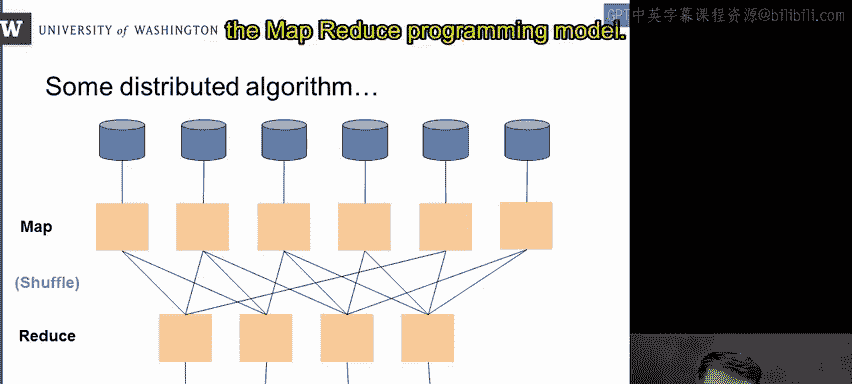

# 杜克大学《大规模数据科学（大数据操作，第1课／共3课有视频）｜Data Science at Scale》 - P51：50_更一般的分布式算法.zh_en - GPT中英字幕课程资源 - BV12s421T7tJ

。

Okay， so backing up one step， you still have millions of documents。

 you still distribute them across the K computers， you still provide a function that would map each document into a set of word frequency pairs。

 but then now what do you do， you've got this big distributor set across your cluster across a lot of computers and you need to collate all that information in to get the one histogram that you're looking for。

Okay， so you don't want a bunch of little histograms。

 you want one big histogram and the goal here in order to produce that one big histogram。

 you'll need to make sure that。Each single that a single computer has access to every occurrence of some word of the word is's going to produce。

 so it doesn't have to require any more communication with anybody else。

 You're trying to arrange for the fact that all occurrences of word of the word Parliament appears in a single computer so that it has enough jurisdiction to count them up and produce and produce the result。

 It doesn't have to go ask anybody else for input any further。

 So how do we arrange for that to happen。We've distributed the documents across K computers。

 we've applied the map function just as we did， now we have a big distributed list of word frequencies。

 and now we've got， let's say four computers that we're going to use to count out the words。

Aggreate the the results from the previous step。 So what' does this actually look like。

 Let's say there's Parliament is is a word that's going to be indicated by this red bar and government is a word indicated by the green bar and people is a word indicated by the blue bar。

 And we know that these words appear across all different documents。

 So they're all scattered over the cluster。 they might appear anywhere。

And so what we need is a function that will send。All occurrences of the red word to one particular computer。

 all occurrences of the green word to one particular computer。

 and all occurrences of the blue word to one particular computer。Okay。

 and that function is a hash function that drives a。One of these four。Computer IDs。

 let's say the number is0，1， two or three。From the value of the word itself。

 given the value of that red word， I need to know exactly where to send it。

 And that's what that that's what a hash function will provide for you。

 And it turns out the programmer doesn't have to write this hash function。

 It's generic enough that you can just build that into the system。

 So each computer that produced the output from the map phase may need to send data to all。

The computers that are going to do this final step in the computation。

So we have this big in byM distributed communication step that sprays the data out to computers that are going to perform the last step。

And now they have enough， again， jurisdiction to know for sure that they can just count the number of green words and know that there's no more anywhere else on any other computer and they can just produce the answer。

Okay， and so we have our distributed histogram spread out。

 everything happened in parallel so we know we can sort of scale out with lots and lots of computers and we should be happy。

And so the point here is that this pattern of applying a function to a distributed data。

Using a hash function to spray the data across the network。

And collate the similar values or the identical values。

This pattern comes up often enough that it's useful to push it down into the system and reduce the programmer's task to just writing these two simple functions。

 a map function to。Process an individual date item and this reduced function that will， in this case。

 count up all the words or do some other kind of combination of。Aggregation combination。Reduction。

Of a set of values that are associated with particular。Particular key。Okay and that shuffle step。

 the reason I' put it in parentheses here is that that's something that's generic enough that the system can provide itself。

 you don't even need to think about it， you just need to arrange your algorithm such as the map and reduced function。

 work in concert to produce the answer that you want and that's the nature of the MaRduce system and the Mared programming model and we'll talk about that in a little bit more detail next。

