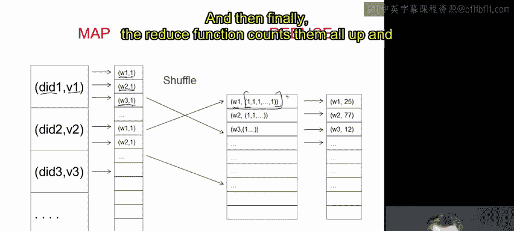

# 杜克大学《大规模数据科学（大数据操作，第1课／共3课有视频）｜Data Science at Scale》 - P52：51_MapReduce抽象.zh_en - GPT中英字幕课程资源 - BV12s421T7tJ

So last time we talked about parallel processing as a lead up to map reduce。

 and we ended up with this schematic here。In the context of this example where we're counting words across a set of documents。

 which is sort of a canonical example to start thinking about programming and map reduceuce and so each one of these vertical black lines represented a document。

And we split them into。Smaller sets and send each one of those sets to a separate machine。

 and then we applied our map function to each one of those documents in turn。

And so if the map function you recall， took a single document and produced a。Set of pairs。

 And each pair。Was ai。Word。Along with a。Count of the number of occurrences of that word in that document。

V variations on this that you can imagine。ok。Now， this word may have appeared in。Multiple documents。

 one here， one on this machine， one on this machine and so on。

 and so now we need to group them all together。On to a single machine so that we can count them。

 And that's exactly what this shuffle phase。Did。Okay。So。Here I've written。Four different tasks。

Processing sort of looking like it's processing a single group at a time， but you know。

I want you to think about how many map tasks do we are we going to have and how many reduced tasks are we going to have Well。

 the map tasks。A one per document， have we have to call the map function。

 how many implicationss are the map functions are going to be， well。

 we're going to call it once per document。How many implicationss are the reduced function？Well。

 it's the number of。Groups that are produced by the output of the map function。

 in this case it's once per unique word appearing in any document。And so in some sense。

 the number of machines we need to apply to this problem is maybe kind of predictable in the math phase。

Corresponds to the size of the input data set， which we presume to know。

But the number of reducers we're going to need is maybe not known ahead of time right it depends on the size of the map output here we might be able to reason about it because we maybe know how many words there are in the English language and we can assume that with a big enough set。

 all of those words will be represented。At least once， but in general。

 it's dependent on the output of the map so you don't really know。Okay。

 and so the only point I want to make is that we made a decision here to draw it as four different machines。

 but it may be the same six machines used the Mac phase， it may be a thousand machines。So on， know。

 nothing stopping you from sending。All of the word occurrences to a single machine。

And having this one machine process the green group， then process the red group。

 then process the blue group and so on， or maybe you would do four at a time because there's four cores in the machine。

O。But that wouldn't be as。Perhaps as efficient because it would be doing a lot of serial work。

At the other extreme， you might think， well， we're going to need。Millions of tasks。

 let's allocate hundreds of thousands of machines to process them。

So that each machine is doing very little work。And that might make sense。

 but then the trade off is perhaps sort of spinning up all these machines。

Preparing them to do the work， Okay， so there's a decision to make there and we'll come back to that。

ok。But let's talk a little more about mapreduce itself this is I'm belaboring this for a reason because what I want you to do is start thinking in terms of mapreduce every problem you have think what if the data set was。

Absolutely enormous way too for a machine。How we're going to split it into pieces and a very good way of thinking about how to split things into pieces to think about how youd write a map produced program to do whatever it is you're trying to do。

 And so this is yet again in the same example just drawn a different way。 So here the input is。

Document ID followed by a value and the value here is the entire text of the document and the map function。

 just to make this clear， produces。A set of things， not just one thing。

Then they're shuffled to produce this， so this is word one。with a account of one。

 word two with a account of one， word 3 with account of one and so on。

And then on the other side what we get is word one with a group。Of all the occurrences，1，1，1，1，1，1，1。

1，1。And then finally the reduced function， counts them all up and finds that there's 25 occurrences。

