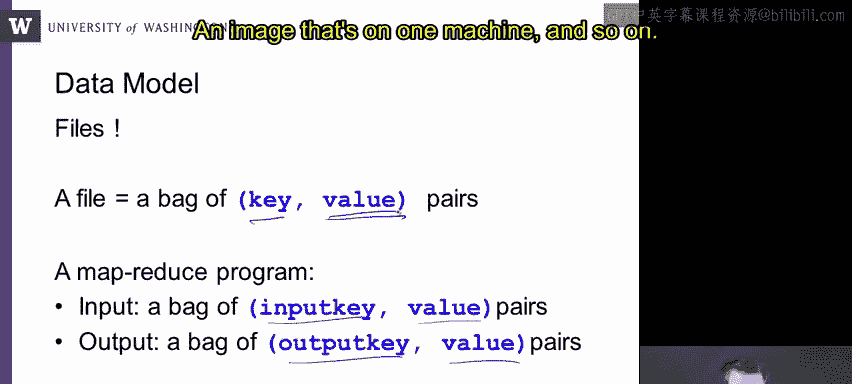

# 杜克大学《大规模数据科学（大数据操作，第1课／共3课有视频）｜Data Science at Scale》 - P53：52_MapReduce数据模型.zh_en - GPT中英字幕课程资源 - BV12s421T7tJ

。

So what is Mareduce well， that's the programming model we just described and there's a paper in 2004 that's on the reading list that describes this and there's a couple of key motivations for doing this in that paper that I think sometimes get lost when you hear about the popularity of Mareduce。

Today。And we'll talk about those two benefits in a moment。So。

So one thing to realize is that MaRuce refers to the abstraction and it's the name given to it by the authors of this 2004 paper。

 Heyoop is an implementation of mapRuce that came a few years later and was written by some people at Yahoo originally and then became an open source product that is。

Maned by the patchy and has lots of contributors。You know。

 the key idea for mapreduce was really this programming model。

 which it says here right now it had a system with it as well。

 but the programming model being able to express lots of different tasks and，You know。

Have some sort of implementation automatically turn that into a parallel job。

Turned out to be pretty powerful right， This was an attractive way to write parallel programs again。

 because you didn't actually have to worry about the parallel。

 All you did were write a serial map function and a serial reduce function and the parallel doesn't happened for free。

 And so the evidence that this is not so much about the system as it is the program model is that。

You see Mapreduce implementations appear in other contexts。

 there's people who implemented Mareduce over GPUs。

 there's Mareduce on multicore machines in shared memory there's people who implemented Mareduce on high performance computing platforms on groups of mobile phones and so on so this goes back to one of the motivations for this course where I want to focus on abstractions where possible as opposed to tools and so we're talking about Mareduce the programming model but we'll spend a little bit less time on the specific implementation Hadyoop。

 although you will have a chance and optional assignment to work with Hadoop directly okay。So fine。

 so what is the data model of Mareduce its this。Bag of key value pairs I mean by bag is a set that might have duplicates in it right and so we've seen that before the document ID with the value that's a key value pair sometimes on the input will be a little sloppy and not worry about precisely what the key and the value is。

 for example， if you're just given a record you can assume that it's say the entire record is the key。

Or a document， sometimes even we may not have a explicit document ID。

 but you can assume the URL or the file name or something is the key。嗯。The output of the mapper。

 though。The distinction between king value gets really。

 really important because that's what controls the shuffle， as we've seen in that example。

And so both the data model here is all about key value pairs and the input is going to be a set of key value pairs and the output is going to be a set of key value pairs。

 and the point is that。The set of key value pairers can get arbitrarily large right we're going to be able to process this set。

 no matter how big they get there is kind of an implicit assumption that the key。

And the value are small。And small here doesn't necessarily something mean very， very small。

 it just it needs to fit on one machine， there's no support for if value grows to be terabytes。

It's it's not going to work and so a document fits on one machine that's okay you know。

An image that's on machine。

好熟啊。