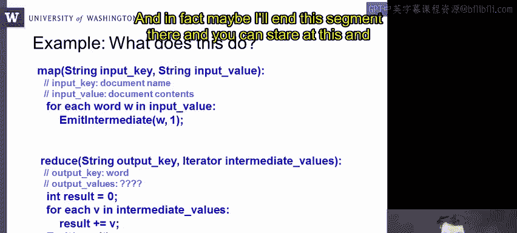

# 杜克大学《大规模数据科学（大数据操作，第1课／共3课有视频）｜Data Science at Scale》 - P54：53_Map和Reduce函数.zh_en - GPT中英字幕课程资源 - BV12s421T7tJ

。

So the map phase， as we've said， you provide a map function。

 the input is an input key and an input value and the output is a bag of intermediate keys and values。

 it doesn't have to just produce you know take in a single input to produce a single output it can produce a set of things and we saw this with a word count example。

 a single document came in but a set of things came out that's okay。And then the reduced phase。

What you're given is the intermediate key， this will be the same intermediate key that was produced by the map phase。

One instance of the same intermediate key produced by the map pairs。

And then a bag of values that were associated with that intermediate key and they may have and key the important thing here is that they may have come from any mapper whatsoever。

 the grouping into this bag all of everything that shares the same intermediate key is handled automatically by the system。

So the system will group all pairs with the same intermediate key and then pass that bag of values to the reduce function and the implementation details of whether this is actually can to you as a bag or whether it's an iterator。

 if you know that if you're familiar with that term that you could step over is implementation dependent。

But it's not important to think about， it's a collection of values。F， so here it is all in one slide。

The map function takes a。In key an in value and produces a list。

A bag of out key intermediate value pairs， and the reduce takes an out key and a list of intermediate values and produces a list of all values。

The one thing I will mention is that the terms map and reduce。

 I tried to motivate that in the last segment where you can think about converting a TIF image to a P andG image。

 you can think about a mapping。A function in maps。ever TF image into some P and G image and that's where the term came from and if you look back this kind of came from the functional programming community that use these term。

 it doesn't precisely mean the same thing， but it's inspired by that。All right， so。

Here's maybe the implementation for the example we have and a lot of times what I like to do is sort of ask。

You to pause and think and stare at this code a little bit and think about what it does here we've kind of gone through the example a lot so I'll reveal the secret but it's still instructive to work through this for a moment yourself and in fact maybe I'll end this segment there and you can stare at this and make sure that you understand what it does。

