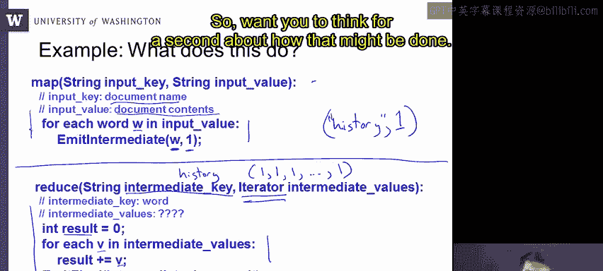

# 杜克大学《大规模数据科学（大数据操作，第1课／共3课有视频）｜Data Science at Scale》 - P55：54_MapReduce简单示例.zh_en - GPT中英字幕课程资源 - BV12s421T7tJ

。

Okay， last time we talked about map reduce and gave the abstraction and went through some examples。

 and we ended up on this slide， which is maybe the first time we've seen pseudocode or any kind of code that actually implements these map and reduce functions。

 And so I ask you to sort to take a look at this actually the end of the。Last segment。

There are a couple of。Changes mistakes that I fixed in this slide so you can compare the two and see if you can figure out what the mistakes are and why I change them so。

So let's walk through this。 So what does this code do， Well， as I sort of gave away last time。

 this implements this word count application that we went through。Schematically， you know。

 with with cartoons and you know， this is the pseudocode that actually implements that。 you know。

 example of pseudocode that could be they could implement that You can't execute this code since it is just。

Cuper code。What are we looking at here Well the input as we said the data model of mapprouces key value pairs and so the input is going to be a big set of key value pairs and the map function is going to operate on one of these key value pairs and in this case the key is the document name and the value is the document contents so it could be a big stream it maybe comes from PDF file or a text file or a web page or whatever and so this code is pretty simple it says well for each word W in the input value so this sort of assumes that somehow you can iterate over all the words in the input value in the text of the document。

Without always specifying how。Then emit a key value pair where the key is this first element。

 which is the word and the value is the number one。Okay。Lin。The magic shuffle phase。Takes over。

And groups， all the key value pairs that share the same key into a single group。

 and so all the occurrences of a particular word。will show up as a group and how that group is represented is as a key along with what we've called here an iterator over the intermediate values and if you're not familiar with the term iterator。

 you can think of this as just a collection of values Okay so as an example here if you have the word。

You knowThe map function will produce pairs like this。

Every time it sees the word history in any document， it'll produce this。And then finally。

On the reduced side， you'll have the word history here。And a sequence of。Number one。

And so what is this？Kdu。Well it initializes a final result to zero。

 and it says for each value in this list of intermediate values。

Add that value to the result and so here we just add them all up and then finally we emit a final key value pair。

 which is the intermediate key， the word itself and the final result and so maybe the output here is you know history。

25。And we walked through this a couple different times， so I'm hoping this is pretty clear by now。

Now。I claim that without changing this reduce function at all。

 you could make a change to this map function and。Get a significantly faster algorithm for computing this。

So。

I want you to think for a second about how that might be done。

