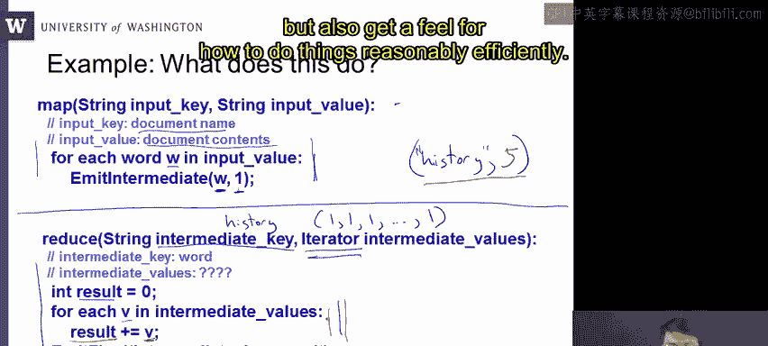

# 杜克大学《大规模数据科学（大数据操作，第1课／共3课有视频）｜Data Science at Scale》 - P56：55_MapReduce简单示例（续）.zh_en - GPT中英字幕课程资源 - BV12s421T7tJ

。

So the thing to look at here is that we're emitting a key value pair once for every occurrence of a particular word。

And each one of those key value pairs has to be shuffled across the network。And sent to the reducer。

 So if we see the word history 25 times in a single document。

 we're going to emit 25 key value pairs for that word and they're all going to get grouped up by the shuffle phase。

But we have access to the entire document here in this map function。

So why not precount all the occurrences of those words and produce a different key value pair。

 So here we say the word history appears five times in this particular document and appears。

Other times and other documents。 Okay， so now we have。Only one key value pair。

Emerging from this document for the word history as opposed to five different ones。 and overall。

 across all the documents across all the computers being applied to this problem。

 that's a significant。Savings。Okay， and then， you know。

 double check to make sure that you don't have to change this code here， but you know you。

Hopefully it's clear that you don't because you're adding。

The total value into the results and so here instead of adding the number one，25 or sorry five times。

Well， sorry， 25 times I guess in the reduced side， you're adding it。啊。Some number fewer times。

You're adding five plus 10 plus 3 plus。Four and so on to give 25。

So this loop is evaluated fewer times。So the reason I want to go through that example is to demonstrate that you know。

There's two things。 One is to try to think in terms of mapreuce and think about how you can cast a problem as。

Operating on a bunch of chunks。Emitting keys to define groups and then operating on those groups。

 but also that you know you actually have a lot of control over the performance of these algorithms by just modifying the map and reduced functions right so even though you aren't working on the system internals。

 you only have these two points of control， you can actually get very different algorithms。

 very different behavior and different amounts of intermediate results being created and so on。

Just with these two functions And so you want to get a feel for not just how to express it and map produceuce naively。

 but also get a feel for how to do things reasonably efficiently。 And in fact。

 this example sort of demonstrates one of the things you're going to be looking for is the bottleneck often not always is the amount of data going across the network。

 And so if you can reduce the。

Amount of output produced by the mappers， especially in terms of number of key value pairs。

You'll tend to improve performance again， not always。 And we'll see some more examples of this。

So I'm going to stop there and in the next segment we'll go through a variation of this problem has similar characteristics。

 but really just to drive home how to design these mapreduce algorithms on slightly varying problems。

