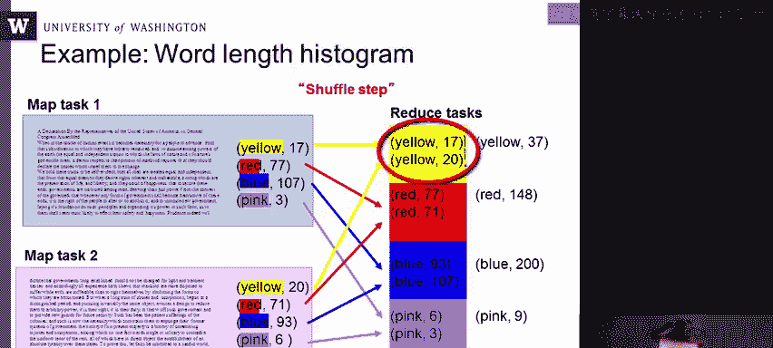
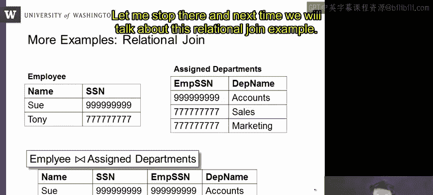

# 杜克大学《大规模数据科学（大数据操作，第1课／共3课有视频）｜Data Science at Scale》 - P58：57_MapReduce示例：倒排索引、连接.zh_en - GPT中英字幕课程资源 - BV12s421T7tJ

。

So now this top chunk gets assigned to Ma taskask1。And it produces。

This little histogram of accounts of yellow words， red words， blue words， and pink words。

 and we can imagine。You should think about how the code might look were if you had to write this。

 right， you would need to take the link to you know iterate over all the words in the document just like we did before。

 but now instead of admitting a key being the word itself， you would admit。

You would count its length and put in a case statement and figure out what color it is in this notation and add that to account so the output is these four key value pairs。

And in chunk 2， we do the same thing and produce a different set of four key value pairs。

And in the shuffle step。All the yellow。Key value pairs will be grouped together。

And there's two of them。

And all the red ones that get group together and so on， and then in the reduced phase。

 you'll add these two numbers together。To produce 37。Okay。

So the structure here is really identical to word count。 It's just basically a change to。

The map function。 And in fact， in this case， you could actually literally use the exact same reduce function。

Right for every key add up all the contributions of it， you would need to change reduce at all。

 and this is something else you'll see is that you know certain reduce certain functions are more general than others and you'll reuse them time and again。

 for example， counting things and adding things up is pretty common in these mapreduce algorithms and so reduce。

General reduced functions that add things and count things come up time and again。Okay， fine， so。

Word count。Generally the canonal place to start when thinking about mapreduce word length。

 very minor variation on that， so let's think of another sort of minor variation on that and this one in argu is even simpler than word count。

So here we want to build an inverted index and what an inverted index is when you have a corpus of documents。

 you can presumably efficiently access any given document by its name right so if you want to。

Look up a URL on the web， you can do so， but for a search engine。You know。

 a very primitive search engine you might want to look up。Documents that contain a particular word。

 and so building this index to support word lookup to provide a list of document that contain that word is called an inverted index and it's one of the primitive steps in doing any kind of text retrieval kind of system。

So now you， imagine we just had tweets instead of documents。Ao。

And the input here is that the keys are these tweet IDs that I've invented。

 and the value is the text of the tweet itself。And so the desired output here is the word。

 along with a collection of。Tweet Is。So how do we do this？Again。

 the code is actually simpler than it was。Before， because now on the reduced phase， instead of。Well。

 so we'll think about it for a moment。The map phase instead of producing each word。Pancake。

And one for an occurrence。We won't do that instead we'll put out。Pancake。And the document ID。Itself。

Right。And all of these guys will be produced， and so this tweet one。

 the map task that process this tweet one will put out pancake tweet one。Love， tweetwe1， and so on。

Okay。Further， you an optimization here is if you see the word。

 I guess I should have have an example of this in here。

 but if you see the word pancake twice in the same tweet， do you need to put it out。

 do you need to emitit the key value pair twice？Probably not to build this index because all you're trying to record is that the tweet contains the word pancake。

 not that it not how many times it appears。 So fine。

 So these key value pairs get shuffled across the network。And now the reduced task。What does it do。

 Well， it's going to get a key。Pancakes。M shouldt answer on， I guess。

And it's going to have an iterator over all the。Document ID that contain pancakes。

 which in this case is。Tweet1， and tweet。2。So do we need to do any processing on this key and group of values？

The answer in this case is no， the reduced function is complete is nonexistent。

 there's nothing to do right when the group is exactly what you want in this case。

And this pattern actually shows up somewhat often as well where you do want the map and you do want the shuffle phase to do the grouping。

 but you all you want to do is to perform the grouping。

 you didn't actually care about the reduce function So you're not counting these things。

 you're not adding them up in any way， you're not doing any processing on the tweets you you just want to admit that and that's perfectly fine because this group of values。

Is perfectly serviceable as a value itself。Okay。So if you are used to say relational databases。

 you know， nested structures， collections of values within a single cell and a cable in a single row are。

Generally disallowed right and this is actually first normal form if you're familiar with that。

But here we don't care， it's any key in any value， a key can have substructure and a value can have substructure。

Okay， fine， so that's how to build an inverted index in Mareduce。

Let me stop there and next time we'll talk about this relational joint example。

