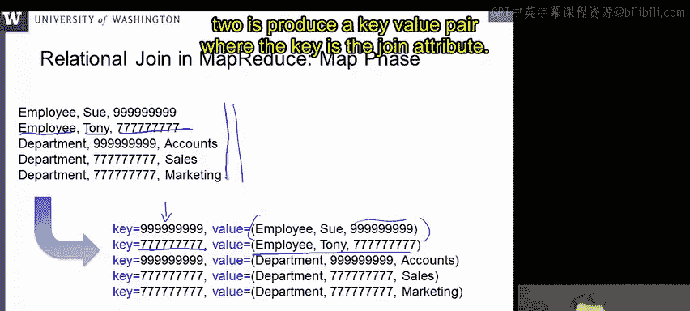

# 杜克大学《大规模数据科学（大数据操作，第1课／共3课有视频）｜Data Science at Scale》 - P59：58_关系连接：Map阶段.zh_en - GPT中英字幕课程资源 - BV12s421T7tJ

。

So let's look at an example that doesn't involve processing a corpus of documents。

So let's think about how to implement a relational the join operation that we learned from the relation algebra in map or use。

 Okay， so here recall that you're given。Two relations and relation is a set of tuples。

And you're trying to find every record in。One relation that corresponds。

To a record in the other relation。 right。 And so here we're going to join on。SSN equal to。Imp SSN。

And actually， it wasn't quite correct for me to leave this unspecified。

 There's a notion of a natural join that would match it up if the field names。

If they attribute to be named is matched， but here they don't。

 And so I need to be explicit about what I'm joining on Okay， and so the output here is。

These three records。This record joins with these two。And this recorder joins with this one， fine。Now。

 imagine that both of these relations are。Huge。O。So the map phase here。

He's going to process every tuple。In general。And we have a problem right off the bat。

That join is a binary operation， right， It has a two input relations。

The left relation and the right relation， you're trying to find corresponding tubs in one in the that match the other。

 but Mareduce is a unitary operation， it processes a single data set。So how can you you know？

At to a first approximation， you can't express join in Mareduce period。But that's okay。

 there's a bit of a trick here。 And the trick is， look， you know。

 it's okay that imagine the data set here is just a big jumble of tuples。

 It doesn't matter what table they came from。 We just lump them all together into a single data set called tus。

OkayAnd that'll be what we process with mapR。And so here I'm asking the question。

 you know what is this for， well， this is a label that we've attached to every tuple so that we can know where it came from and we'll see how that's used later。

Now， I'm not being specific about how where you get this label or how you do it in mapreduce。

 but I want you to think logically that it's necessary。 and in practice。

 it's not that difficult right because you know， for example， if you're processing。

You have distributed files。From this directory representing all the employee chunks。

 and you've got distributed files in this directory representing the assigned department's chunks。

 you can。Look at the file name to tell what table it is and so in the map function that you write you can determine that Aha。

 this has file name， you know this has the employee relation name in its file path and I'm going to go and attach that as part of the record。

And so we could write pseudocode for this。 and in fact， you might as。Part of an upcoming assignment。

So fine。So what's the map phrase look like of this relational join well？

For every record on the input。A。You're going to produce。A key value pairer。

 We know we have to produce key value pairs because that's how map produceuce works。

 So what's the key going to be well。I'm going to give you the key is going to be。The join attribute。

 the attribute that you're joining on。And the value is going to be sort of everything else， right。

 the rest of the two pool。And we can actually get away with removing this guy to save some space。

 but。Typically you typically wouldn't bother。Okay。So fine。

 so given a tuple that looks like this with three fields。We produce a key of 7，7，7，7，7，7 and so on。

 And the value is the entire tuple and so on。 And again， notice that both。

The tus from both relations are all lumped into the same input。IMaybe belabooring this。

 but I want to make sure that's clear。Okay， so so far we've done two tricks。

 one is lump everything together and two is produce a key value payer where the key is the joint attributes。

