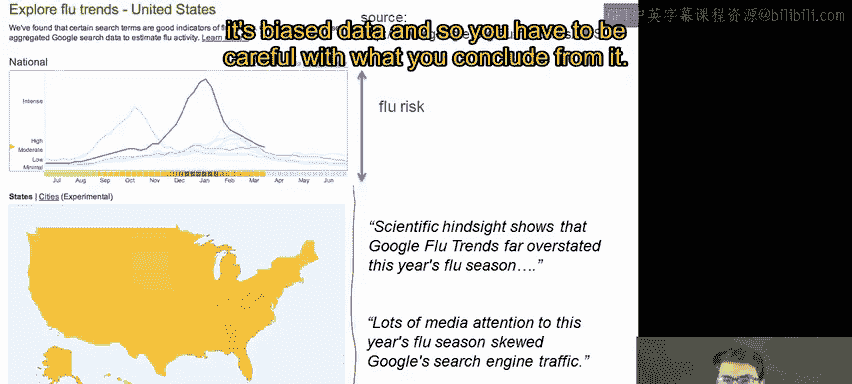

# 杜克大学《大规模数据科学（大数据操作，第1课／共3课有视频）｜Data Science at Scale》 - P5：4_激发胃口：食品、音乐、公共卫生.zh_en - GPT中英字幕课程资源 - BV12s421T7tJ

。

What is not amenable to data science， Well， you know， you might think。Food。

 and this is a paper in a fairly respectable journal that。Us。

Applied some data driven techniques to analyzing food pairing okay， and so what they did here is。

Pretty interesting right， so induce a graph on the ingredients。

By saying that if two ingredients appear together in a recipe， you draw an edge between them。

 a graph meaning vertices and edges。And if you never really if you're not familiar with graphs。

You will be by the end of the course， but bear with me right now。

So connect two ingredients if they appear together in some recipe。Build that big graph。

And now you can analyze it in ways that are similar to what we just talked about。

 you can look at the community structure， you can find the clusters within this graph。

And see if these clusters correspond to some of the well known methods of。嗯。Food bearings。

And in some cases they do and in some cases they don't。

 and the authors sort of show that they've uncovered things that were not necessarily known but appear to be there in the data right and so this data driven approach。

You know the fact that that there's websites full of recipes online has allowed us to put things on a more quantitative basis that were previously simply you know old wivestails essentially Okay so I thought that was kind of a fun example of。

An unusual use of data science again， in a respectable journal。Al right。

So another example this is from the last FM blog， they looked at the tags associated with the songs on last FM and used to do some simple analysis of the emergence of genres over time。

But you know， based on the popularity of the tags for songs coming from that time。

 and so you see things like， well， post punk in red here came after punk in purple， which you'd。

Hope the graph shows they'd expect you'd also see some a kind of a rise here in rock and roll over time。

 and then maybe a bit of a。A dip more recently。 And so that's kind of interesting。

 but the the other theme here we have is。That we didn in the previous segment is repurposing data right so this data was collected simply to help with search。

 you know find similar music and it's now being reused to sort of draw inferences about the emergence of entire genres。

So another example here that you may be familiar with。

 Google is able to show that by analyzing the search logs， the frequency of search terms。

 it could do a better job predicting。The severity and the scope of flu outbreaks then the centers for D Control and by better here。

 we mean essentially earlier right it was able to。嗯。Give more of a head start to。the， the。

Health community。Okay， and also it was sort of more accurate。So how do they do this， well。

 you know when you're getting the flu， it turns out that you want to search for flu symptoms。

Terms associated with flu symptoms more often， and by watching that uptick， you can。嗯m。

Predict that the flu outbreak is coming。So。That's great and they put in this work and they sort of publish a paper about it and then they put up this interactive visualization that allowed people to sort of analyze flu going forward。

 but just this year you know，Some folks showed that。It didn't do a very good job in this last year。

 So a scientific hindsight shows that the Google flu trends far overstated this year's flu season。

 and the reason they。Think explains this is that there was lots of media attention associated with this year's flu season because it was was a bit of an uptick。

 And so it got amplified。 And so this caused people to search for flu flu related terms more often。

 perhaps because they'。Worried about experiencing the symptoms perhaps because they are trying to understand more about the flu outbreak。

 perhaps because they're searching for articles， perhaps because they were worried about their kids more。

 but it all it was a second order effect based on the media attention on the problem。

Which LED to skewed results and ultimately a wrong answer。

 And so the point here is this is great that the repurposing data from the search engine to try to make predictions about something else。

 but it's's bys it is biased data。 And so you have to be careful with。What you conclude from it。

 okay， so there are limits here。

