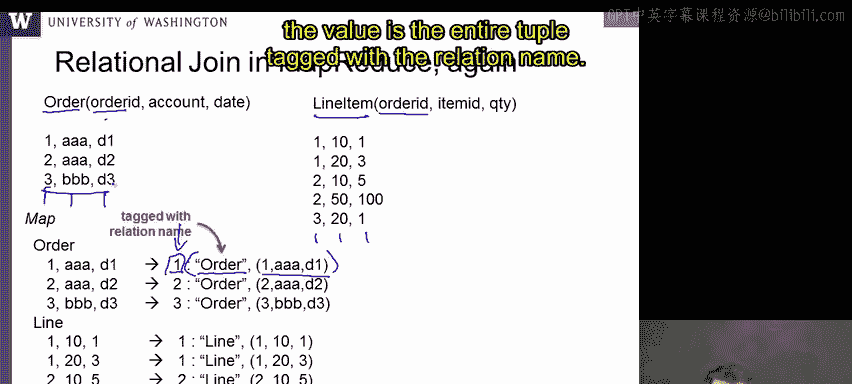

# 杜克大学《大规模数据科学（大数据操作，第1课／共3课有视频）｜Data Science at Scale》 - P60：59_关系连接：Reduce阶段.zh_en - GPT中英字幕课程资源 - BV12s421T7tJ

。

🎼What happens in the。Magic shuffle phase。 Well， everything with the same key gets lumped together as we。

 as we talked about。 And so now you get a reducer in vocation that has。You know。

 one reduced verification for every unique key。 So in this case， it'll be one for 9 and9。

 so on and  one for 7，7，7， so on。 And the list of values associated with that key will be all the tuples that。

Share the same join key Now it doesn't matter what relation they came from。

 they'll all be in this list， so in this case we get one tuple from the employee relation。

And we get one tuple from the department relation。 And here we get one tuple from the employee relation。

 and we get two tus from the department relation。Right， and so now。

In the context of a single computer， we have everything we need to compute the join。And further。

 each one of these。Reduce implications can be done on a separate machine。Okay。And that's。

How we scale。So now this reduced function that the program would have to write if。

 if you're implementing a join phase would have to。

Take this key and take all these tus and produce the joined tuple。

Where these two attributes came from employee。And these two attributes。Came from。Department。

And same thing here。Employee。Department。Now。If you want to think about what kind of operation you need to implement in this reduce function。

Well， you've got a set of tus from one relation， and you need to associate it with every possible tuple from the other relation。

 right， because we know they all join。 They're all， by definition， they all join。

 They all have the same key。 They all match。So if you have every member of a set paired with every possible member of another set。

If you remember， that's a cross product operation。And so here again。

We see relational algebra popping up sort of in a different context。

So I don't want to confuse you too much， but the overall operation we're trying to do is implement a parallel join。

 it happens to be that locally right here inside one reduced function。We recognize AhaA。

 that's another relational algebra operator across product。

But this is more for abstraction purposes than for algorithm purposes。

 Just just want to point that out。 All right， So again。

 you put on your relational algebra colored glasses in the whole world， you know。

 these operators start to pop up， pop up everywhere。Alright。So fine， so let's do this one more time。

 just make sure it's clear。 So I'm giving giving you two relations， order and line item。

 and they have these。Fielels， an order ID。An account and a date。And here there's an order ID。

 an item ID and a quantity。And we're going to join on order ID。

So what's the map phase look like well once again？The key will be the join key， in this case。

 order ID。And the value will be this pair。The relation name， along with the original tuple。

 And before we just sort of lump these together in one tuple， and it doesn't matter very much here。

 I've kind of structured it slightly differently。 But the point is that all the information is here。

 The key must be the join key， and the value is。The tuple。

 as well as some sort of indicator of what relation it came from。 In fact， maybe I'll ask real quick。

 why do I need that indicator of the relation。Well， in the reduced phase。

 I wouldn't be able to produce the joint tuples properly if I didn't know which tus went with which relations。

 if I just had a big bundle of tus and I couldn't really figure it out very easily。

 that would be a problem。Theoretically， you might be able to avoid tagging explicitly with employee and department because you could deduce that。

 well， the employee table is alone that has a string first， followed by the joint， know。

 followed by the join key and the。Department relation has the join key followed by some others train。

 but it's a little dangerous to rely on that kind of information because you could be joining two tables that have exactly the same schema and there wouldn't be any real obvious way to figure it out so an explicit tag is a little bit safer here。

So that's the map phase， process we lump all the records together。And produce key value pairs。

 where the key is the join key from their corresponding。Relation。

 joint attributes and corresponding relation， and the value is the entire two will tagged with the relation name。

