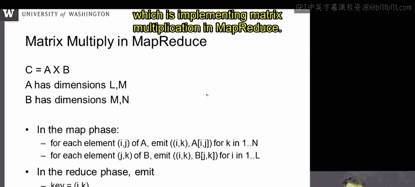

# 杜克大学《大规模数据科学（大数据操作，第1课／共3课有视频）｜Data Science at Scale》 - P61：60_简单社交网络分析：计算好友数.zh_en - GPT中英字幕课程资源 - BV12s421T7tJ

。

Okay， so what's the reducer look like， Well， now we've got all the。

Tups that have share the same key together。And it will produce these join tuples。

 it will join this order tuple with both of these line item tuples to produce these two join tuples。

Fine。So now let's go into a different example。And so here。

 maybe we're going to get started with analyzing the social network。 So here we have a。

Graph where every ad represents a， let's say， a friend relationship。

 Or if you're thinking about Twitter， you could have this be a follows relationship。

 And so the input here is a set of edges。With the semanttics of Jim is friends with Sue or follows Sue。

 and Sue is friends with Jim or follows Jim。And so on。

And so one point I'm making here is you'll notice that if if Lyn follow， if， ifin。

 if Lynn points to Joe， then Joe points to Lyn。 And so this is。There's a symmetric relationship here。

And I've done that for simplicity sake， to sort of avoid the confusion that can result from thinking about undirected graphs versus directed graphs。

so anytime you see an edge going one way you'll see the other edge coming back before I say what we're gonna to do me to make sure the task is clear。

 we're gonna count the friends， we want something very simple。

 we just want to say how many friends does Jim have and how many friends does Sue have and so on And so the desired output here is Jim with three because Jim has Sue as a friend and Jim has Ka as a friend and Jim has Lyn as a friend and we want to have Lynn equals two or Lynn has two friends because Joe and Jim。

And Kai is just one。Right here， Jim。And Joe is just one， which is right here， Lynn okay。So。

This should already look like something we've already done before。

 So it happens to be social network analysis and the records happen to be these， you know。

 pairs of people。 But the algorithm you're going to use。Should start to stand out to you okay。

And maybe you'll see why in a second if it's not clear。So in the map phase。

 how are we're going to do this， Well， for every。You know， friend on the left hand side。

 produce a key value pair where the key is the name of the friend or the name of the person。

 And the value is just the number one， indicating that there's。

Exactly one friend associated with that that we've encountered one friend associated with。

 say Jim in this case。All right， so this record gets turned into gym and one。

 and this record gets turned into Sux in one， and this record gets turned into linen one and so on。

And then。You knowThrough the magic of MaRduce， the shuffle phase。

Produces this intermediate result where we have Jim， the key associated with a list of occurrences。

 one，1 and1。And line associated with two occurrences and so on。

 And then the reduced phase just simply adds up all these occurrences。

 And so what does this remind you of， Well， it's a lot like the word count example， right。

 instead of documents。Producing words and counts。It's even simpler。

 it's for every record to just produce a single count for that person that the record represents person on the left hand side。

 and after that the reducer is literally exactly the same it'll add up all the occurrences and produce a single number。

So in the next segment， we'll talk about something's a little trickier。

 which is implementing matrix multiplication in Mapperd。

