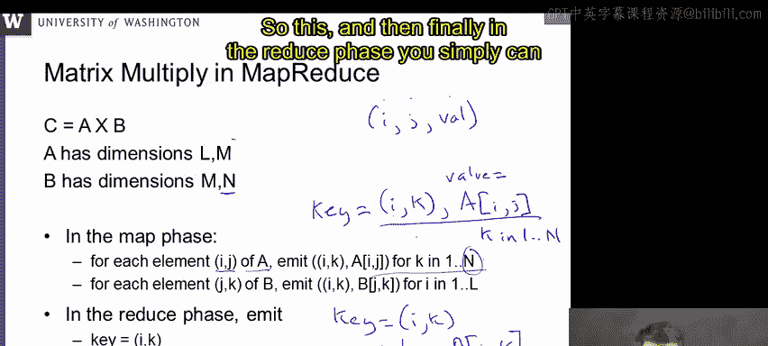

# 杜克大学《大规模数据科学（大数据操作，第1课／共3课有视频）｜Data Science at Scale》 - P62：61_矩阵乘法概述.zh_en - GPT中英字幕课程资源 - BV12s421T7tJ

。

Okay， so let's look at a simple matrix multiplication algorithm in Mare。So before we get there。

 just to remind you how to think about matrix multiplication。

 we've got a matrix with four columns and two rows multiplied by a matrix with two columns and four rows。

 and the output is going to have the number of rows from the first。

Mattrix and the number of column from the second matrix， so it's two by two in this case。And。Again。

 just refresh your memory here。What is？This result， well， it's。The first row。Of the first relation。

You know， the dog product with the with the first。Column of the second matrix。Right， so it's。

1 dot1 plus 3。t4。Plus4 dot negative 3。Plus， negative2。Got zero， and that should equal 1。And so on。

 So that's the i throw。So that's sorry， let's just say row1 and column1。

Dotted together gives you disposition， row2。And column 1。I you。Dis position and so on。All right， so。

I'm hoping that was intensely boring。All right， so in map reduce。

 how do we want to do this well what we're provided here。Is。

Two matrices representing sort of a sparse matrix format and a sparse matrix format。

He's going to look like this。So this is row ID， column ID and the value。

And the reason I call this a sparse matrix format is that it would be inefficient to represent a very。

 very large matrix this way if you had a value for every position。Right。

 so if you think about just a multidisional array in memory。

 you don't have to be explicit about the I and J coordinates。

 You only be you only have to provide the values。But if many of those values in that array are missing。

Then in this representation， I just can ignore them all together， I just don't put them in， right？

Okay。So anytime a value of0， just remove that tuple altogether。

So we're given two of these sparse matrices represented as tuples。You sets of tuples。

 and we're going to do the same trick。 matrixtri multiply as a binary。Relation。

 and so we need to lump them all together。And we need to tag them with the source。

And then we need to apply this kind of a trick in the map phrase for every element I J A。Emit。

Several things emit a tuple where the key。Equals I comma K。 And I'll tell you what K is in a second。

 And the value is。he。Os， sorry， value。Equals A I。Jy。

Now we're going to knit one key value pair of this form for every K。In one to N。

 which is what I've written down here。Now， what is in well。In is the number of。Columns。In B。

 in the right hand matrix。So A is an L by M matrix， and B is an M by n。Mattrix。So what is it saying。

 this is saying for every column of B。Amit a tuple with key i decay。And value the value at IJ。

So I have a diagram on the next slide that explains this。

 but what you're doing is you're going to replicate this value to every column。In in B。And then。

For B， you do the same kind of thing you say。The key is going to be equal to IK。And the value。

Is equal to B。JK。Okay， and you're going to emit one of these key value pairs for every eye。

The upside down， A for for all， for all I in。1 to L。Where L is the number of rows in a。

 so you have to replicate the values of B to all the corresponding rows of a。

And you have to replicate the values of A to all those corresponding columns of B。Okay， so this。

 and then finally in the reduced phase， you simply you can do the dot product。

And produce the output。

