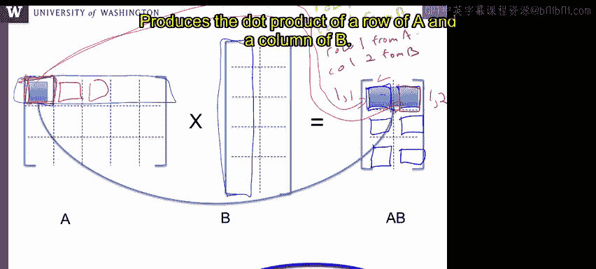

# 杜克大学《大规模数据科学（大数据操作，第1课／共3课有视频）｜Data Science at Scale》 - P63：62_矩阵乘法图解.zh_en - GPT中英字幕课程资源 - BV12s421T7tJ

。

Think about this sort of diagrammatically。The first the the you know the。The value I the value 1。

1 in a needs to be sent。Actually， let me back up one step。

First thing to recognize is that there's going to be one reducer per output cell in this algorithm。

So here we're going to have six reducers。And if you have really， really large matrices。

 which is why we're playing this game， is to imagine that we have， you know，10000 by 1000 matrices。

Sorry， matrixs with dimension 100 by 10，00。Then this starts to make more sense。

So one reducer per cell。InIn the output matrix。Okay。

 and think about what data does it need in order to compute its answer Well， it needs。

For the reducer 1，1 in the output， it needs all the values from。Row 1 in a。

 and it needs all the values from B1。sorry from the first column of B， right。

 all those need to be sent here。Now， fine。So maybe maybe I'll write that real quick。We need row。1。

From a。And we need。Column 1。😔，From B。Right， now let's think about this。Second position。Okay。

 so this is row 1。Column 2。Well， here we need。R。1 from a。And column 2。From B。Right。So that's fine。

 But the problem is we don't have data represented in terms of rows and columns in the input。

 We have every individual cell。 So we have to figure out。Where should this value a11 be sent。Well。

 it need to be sent to everybody that might need it。Which means it needs to be sent here。

Because we see row 1 from a。 Well， this isn' in row 1 from A。 Therefore， it needs to go here。

 And this second position is also involves row 1 from a。 So this guy needs to be sent to two places。

 which is what I was trying to draw here with these colors。 It gets sent。

I'll me draw some more errors here and see because it gets too cluttered， which I'm sure it will。

 but we'll try it anyway。It needs to be sent to both of those locations。So for every column of B。

 you need to have row， this value be sand。And similarly for this guy。

Right so to all the reducers that might appear in row that need the data for row1。

 you need to send to all of them。 And so this is the reason I'm sort of belaboring this is that this is kind of a nice trick that map producer can do。

 remember you can you can you can replicate right you can send a single value out of the mapper to many places And when I say send them many places。

 I don't mean literally sort of you know write it on the wire and。Send a packet across the network。

 What I mean is attach a value to multiple keys and then every individual key will go to a different place。

All right， to a different reducer。 Okay， and through this trick， we can sort of。

Arrange for matrix multiply to occur。 And this arguably scales pretty well， right， we've only。

 we've done some replication， but that replication is kind of necessary。

 and this whole thing can sort of happen in in parallel。And then finally。

 each producerr produces the sum。We produce the dot product of a row of A and a column B。

