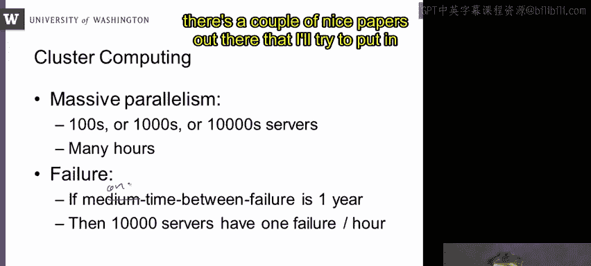

# 杜克大学《大规模数据科学（大数据操作，第1课／共3课有视频）｜Data Science at Scale》 - P64：63_无共享计算.zh_en - GPT中英字幕课程资源 - BV12s421T7tJ

。

So let's talk a little bit about what kinds of systems mapreduce is deployed on。

 So I don't spend too much time on the system internals since this is a data science course。

 not a distributed systems course， but it's good to have an intuition for what's going on under the hood。

 So there's three types of systems to be aware of architectures to be aware of， shared memory。

Shared disc， and shared nothing。All right。In these diagrams， these cylinders are the disc。

 these rectangles are the memory， and these circles are the processors。ok。

So shared memory means that every processor has access to all of the memory and all of the disk。

 And this is what you think about when you have sort of a laptop， if it has four cores。

 if you have a quad core system or nowadays， if you have6 or 12 cores in your laptop， is。

The model that's being used is the architecture that's being used。Shared disk is。Someone。

Less common in at least in these contexts that we're talking about。

 although certainly certainly common enough overall。

 where you'll have individual machines that all access a shared file system。 Now that setup is very。

 very common， but for' using that setup for parallel analytics。Is sort of the domain of。

High in commercial databases。 So， you know， your oracles and your IBMs will often use a shared disc。

Architecture， okay。And then shared nothing is really what we're focusing on here。

 and this is what map reduceuces designed for and what increasingly and largely parallel databases are designed for as well and shared nothing here means individual machines that are only connected by a network okay。

 no shared memory， no shared disk。The argument is that only the shared nothing architecture can scale to sort of thousands of computers and beyond。

 Okay， because eventually that the the sharing of memory or the sharing of disk eventually becomes a modelneck and limits how many computers you can attach the same。

Deevice sourcing， logical or physical device。Okay， and so learning how to program these massive shared nothing clusters is what mapreuce and parallel database are all about。

And the shared memory of machines。Are perhaps the easiest to program， but。

Are conventionally assumed to be pretty expensive。 I should point out that， you know。

 the costs are dropping fairly。Quickly， so it's getting more and more feasible to buy a pretty beefy machine with lots of main memory and lots of cores。

 And you know， your problem might fit inside。That one。So。You know。

 when you see people deploying Hadyoop and map reduceuce on fairly small clusters。

 on the order to say 10 nodes。You should see whether the data sizes they' processing are actually all that large。

 right， It could be that the data size of they processing or something that fits in main memory on。

A similarly priced amount of hardware。 So Hadduop and thatpreduce are designed for really。

 really large clusters。RightSo this is the context we're in a large number of commodity servers connected by a highpe commodity network and here you think about a data center。

 there's a rack that has a number of servers and there's a data center that has mini racks and this is how you organize your thousands or tens of thousands of computers。

All right， so you're looking for。Mass scale power parallelism that will run。

Jobs that will run for many hours， even on thousands or tens of thousands of servers。

 That's really the context we're in。 So when you're in this context。

An issue that comes up that does not come up all that often in a much smaller context is failures。

 right， So if you're running a job for a long time on thousands of computers。

 the chance of something going wrong during that job becomes。Essentially， you know，100% probability。

 right， There's going to be something that fails。 And so your system of processing。

Doing this sort of analytics。Half to tolerate this kind of failure。 You can't just you can't。

Roll back to the beginning and just restart every time there's a failure occurs or you would never get anything done okay。

So know even if the mean time between failure。啊。For say， a disk is a year if you've got 10。

000 servers with。Multiple disk or 1000 disks， let's say spread across 100 servers or any combination hereof。

 you're going to start to have failures。You know， once per hour and you can。

Look up the meantime of failure and actually do the math。

 but there's a couple of nice papers out there that I'll try to put in the readings if I remember。

