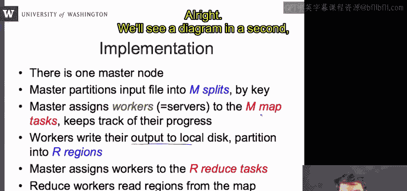

# 杜克大学《大规模数据科学（大数据操作，第1课／共3课有视频）｜Data Science at Scale》 - P65：64_MapReduce实现.zh_en - GPT中英字幕课程资源 - BV12s421T7tJ

。So failures are what we're concerned about here。So that's hardware popping up the stack one level is this distributed file system and you might see HDFS2。

 which is the Hadoop distributed file system， so remember the context here was that map producer proposed in a paper in 2004 by Google in Hadoop was the implementation of the ideas in that paper。

So we can almost use it interchangeably because the actual implementation at Google has certainly evolved since that paper and is not completely known right so when people are talking about map reduce。

 they're typically talking about Hadyoop or other implementations of the program model that have nothing to do with sort of scale out but。

Shared nothing that produce can be seen to be synonymous with Hadoop。Okay。

 so this is a file system for very large files and the idea here is that if you're going to take a single file on your own computer。

You can manipulate it as a single unit。 But if you're going to take a very。

 very large file in just and。You know。Put it on a file system that's on a cluster of machines。

 Then there has to be some layer of logic that knows how to split that into pieces and put those pieces in different machines and keep track of where they are。

 And that's what this distributed file system software does。

 So each file as you're uploading this data to the cluster。

 each file is partitioned into chunks that are say typically 64 megabytes。

 although this is configurable And so each chunk and this is critical is replicated several times so there's not just one copy of the chunk。

 there might be multiple copies on different machines。 Why， because if one of them goes down。

 you want to have access to the other chunks。 and you want to make sure these are spread across different racks in case the entire rack of computers goes dark。

 you still have another copy of it。And so the implementations here are GFS and HFS。 DFS is the。

Concept and the implementations are GFS and HGFS。Fine， so now。You know， one step up from HDFS or DFS。

Is the implementation of mappreduce itself？And so here， there's going to be one machine that' that's。

Dedicated to be the master， and the master is in charge of keeping track of where all these partitions are。

 So in the course of running a map reduced job。These。

Splits these chunks that are being accessed by the map produced job。

 workersers will be assigned to each one of those splits， so there'll be one worker。

For each chunk of an input file。Okay， now worker here may not be an individual server。

 you can have multiple workers per server， in fact。Sort of by default， it's good。

 It's reasonable to think about it as one per core。 So you have。A cluster of 20 machines。

 all of which have eight cores you might have about eight workers per server。Okay。

And so there's going to be exactly one map task for every。I'mSorry。

 map task for every split of a file。There will be one invocation of your map function for every record in that file。

Okay， so the difference between task and imvocation is the terminology I'm going to use。

 there's some confusion sometimes in the literature about whether task refers to one key value pair or whether an entire chunk of a file。

 and there's a diagram coming up a couple slides that may make this a little more clear。Okay。

 so these workers in the map phase write their output to local disk on that local machine。

 not to the HDFS file system where it gets replicated and so on。Okay。And they're partitioned into。嗯。

Our regions one for each。Key up to our regions。And then the master assigns workers to these R reduce tasks。

 so you can choose the number of reducers now。And then the reduced phase。

Pulls this data that was written out to local dis by the map phase across the network accordingly。

 So this is that shuffle operation that happens。Now。

Why does the map task write out to local disk while in case something goes wrong。

 it has a copy of it。it can restart where it left off。Fine。

 if something goes wrong in the reduced phase， it only has to roll back to the previous map phase and access the data from that local disk。

 Okay， so the whole the key idea to think about here is that at every step we're writing things out to disk so that it's safe in case the power goes out or something happens。

Now。That being said。You know， the mappers again， are writing to local disk only not taste GFS。

 so if that if that whole machine dies， you will have to rerun that map task from scratch。

 but it's just that map task。You just have to reprocess that one split。All right。

 we'll see if a diagram in a second maybe makes this a little more clear。

 I think the words are maybe a little bit hard to parse。

