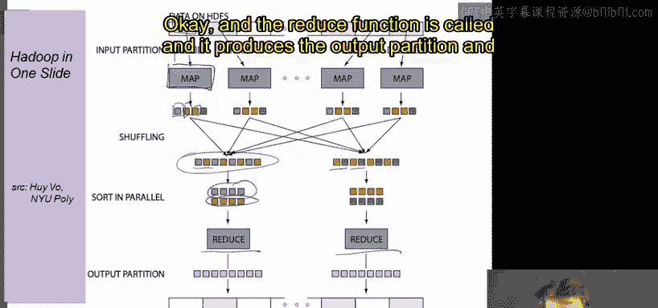
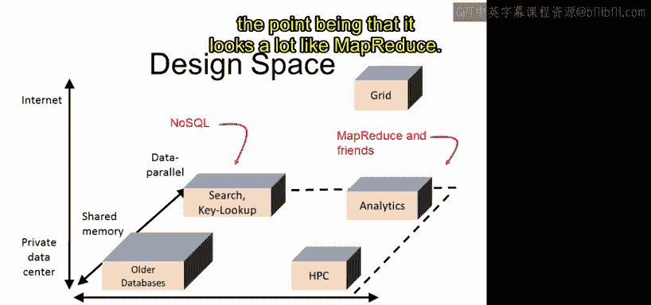

# 杜克大学《大规模数据科学（大数据操作，第1课／共3课有视频）｜Data Science at Scale》 - P66：65_MapReduce阶段.zh_en - GPT中英字幕课程资源 - BV12s421T7tJ

。

Here's the phases of mapRuce that's a little bit more。

Detailed in the abstract phases that we were talking about when we were talking about the programming model。

 Okay， so there's a file split here that's read from HDFS。And remember ACFS means is replicated。

 the chunks could be， there's multiple copies of every chunk。And。

There's a unit of code called the record reader that breaks that chunk into。

 I'm using chunk and splits sort anonymousonyly。 I'm not a big fan of the term split， because it's。

Sort of sounds too much like a verb to me。The record reader pares that splitter chunk into individual records。

 then the programmers， you know the user's map function is called on that individual record。

And then there's a step called Com that we haven't talked about， but I'll talk about in a moment。

Next， actually， okay， and then the output of these phases are written out to local storage on that node。

 as we said。So， then， these。Regions。In local storage。One per key。

Are pulled across the network by the reduced phase。

Then the regions from all the different map tasks that correspond to the same key are sorted together in parallel。

And finally， the user's reduced function can be called to produce whatever output it produces。

 and then the output of that step is actually written back out to HGFS so that it's replicated。

So again， if something goes wrong in the map phase， you have to rerun the mapper。

And if something goes wrong in the reduced phase， you have to rerun。

 you can pull the output from the local storage from the map phase。

And there's something that's running the overall job， you know， you know， you're safe because。

You don't lose data because the HFS are。A arere replicated and if you you know。

 if you lose a reducer and you lose corresponding mappers， that's fine。

 you can sort of rerun whatever you need to rerun fine so。When is it that you' you're。

Guaranteeeing for fault tolerance during job execution。So let's talk real briefly about the combiner。

So to think about why we need a combiner， go back to this word count example that we began with。

In each case， we produced a word and just the number one in the earliest version of this。

 we just produced the number one。Sending all of these occurrences of word1。

 So if word 1 appeared twice， then you're going to get a key value pair with W1 and a number1 and another occurrence of W1 and a number one。

 and you're going to send both of these guys across the network to be sorted and parallel and grouped in order to be processed by the reduce。

Well， that's sort of wasteful。 You'd like to combine these into a single record。W1。Comma too。

 And then just in that。Because it's smaller。 Well， you could rewrite your map function to to。Do this。

But it's such a common need。That you can that you have this capability called a combiner and so a combiner。

Identifies key value pairs with the same key and lumps them together before sending over to the reduced side。

 So it just saves the network traffic。 In many cases。

 the combiner function can be literally the same function as the reduced function。

 it all works out and。What needs to be true for this to work is that the function that you're applying needs to be associative and commutative。

But I'm not going to say， much more about that。So here's what it looks like in pseudocode。

 We saw the map function earlier， and we were emitting this key value pair of a word and account。

 and we saw the reduced function earlier。 But what we're adding new is a combiner function that has the same。

Type signature。As a reducer。And again， often in many cases。

 can literally be the same implementation as a reducer。

And the only point of this is that it's being applied before sending data across the network。

So here's sort of a summary of。A Haddu job that I like a lot。

 and this is from a Huvo who is at now at NYU Poly， I believe he's still at NYU Poly。

So the data begins on HDFS。And there are these chunks。And the in part partitions go to map tasks。

 Now， these are again， not invocations of the map function。 these are entire tasks。

Each individual map invocation may produce multiple key value pairs。 But regardless。

 the map task almost certainly does， right， So it's going to produce these。

Local sort of colored key regions。And the regions are going to be sent across pulled across the network to the reduce。

Servers， and here in this example， there's only two reduced servers now。Before we gave this example。

 we sort of showed all the blue ones going together and all the red ones going together。

 That was a bit of a simplification。 What actually is going to happen is that if you only have two servers。

 well all the hundreds of possible keys need to be mapped to just those two servers。

 so you're definitely going to get a mix。Going to the same place。

 and this is where we've been a little bit glib up until now。

 we've said that you specify the key and it hashes to a particular reducer。

Whi is which is true logically， but before that you have to actually get it to a machine where lots of reducing or lots of reduced tasks might be running or lots of reduced invocations might be running okay and so。

You know， in this case， the blue， the blue guys and the red guys both end up on the same machine and the green guys and the orange guys both ended up on the same machine。

 And then this parallel sort。Mages that right， so it puts all the red things together and puts all the blue things together。

 and then for each individual color， one reduced implication is called。Okay， and the reduce。

Function is called and it produces the output partition and then that output is then written back out to HDFS。

 Let me stop there and I'll pick up here and talk a little bit about parallel databases and how they do query processing with the point being that it looks a lot like Mapreduce。

