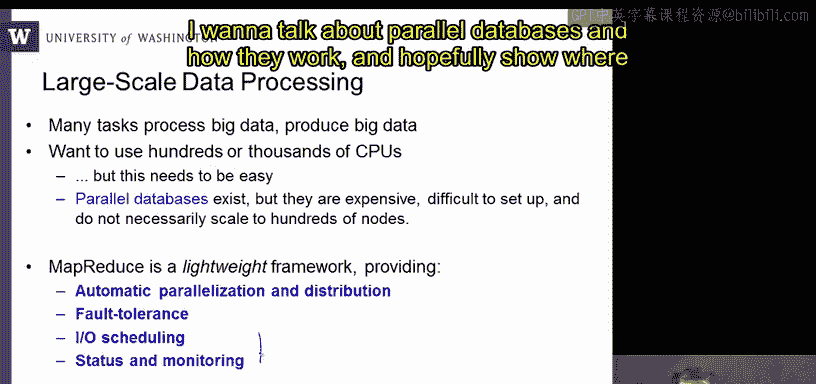
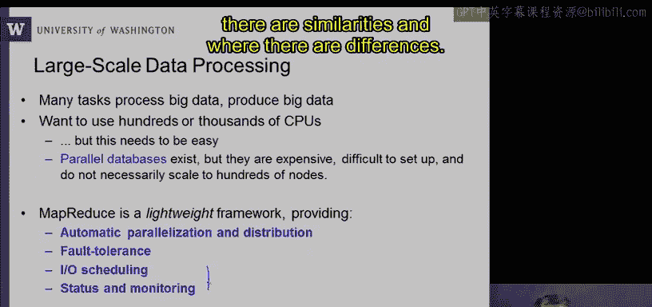

# 杜克大学《大规模数据科学（大数据操作，第1课／共3课有视频）｜Data Science at Scale》 - P67：66_大规模数据系统的设计空间.zh_en - GPT中英字幕课程资源 - BV12s421T7tJ

。

Okay， so let's talk a little bit about。啊。Other large scale data process system systems。

 besides map reduce。 And as a step to that， let's。Think about the design space of possibilities here。

 And so this is a breakdown that was。Proposed by Michael Azard。

 who's developed a system called dry add at Microsoft， which is a very nice。

System with the same sort of motivations as as map produce。 Okay。

 and so he divided this space into these three axes where you word about sort of low latency， very。

Interactive sort of speeds， quick turnaround time versus things that maximize kind of throughput。

 you know。Massive batch jobs operating on thousands and thousands of computers at once。Versus。

Another axis here is sort of whether it's in a private data center or whether they're scaled out widely across the internet。

And then maybe the third access is。Data parallel versus the shared memory。Okay， that we talked about。

So the areas that we're mostly concerned with they're going to be here。

 which is what we're talking about currently， and then in a couple of segments we're going to talk about these。

Low latency， smaller operations， which。You can think of as the the NosQL systems Okay。

 and then maybe where where Michael placed older relational databases。

 although he didn't label it the same way I have is down here in this quadrant where they're mostly in shared memory sort of space and low latency。

 I say older databases to try to。Point out that not all relational databases operate in a space。

 many are。Most， in fact， are data， most parallel databases are are data parallel as well。

 And so this is， you know， my SQl。And post rescuesqL， if you're familiar with those。Our。

Probably in this space。Shared memory， Sha disk。And here HPC means high performance computing where it's a private data center intos a big massive shared memory。

But there but it's a batch job submission system， right。

 You say you run your big compute intensive job and submit it to。嗯。

The machine and it processes it on it and eventually returns to the results。

 And then I'm not going to talk too much about this。

 but this notion of grid computing was really sort of focused on connecting up。

Cluss of computers from different universities and letting them all sort of talk to each other。

 and so that's why he's pushed this up in this other axis。Increasingly。

 you're seeing these systems also being pushed up in this access， Internet scale， planetary。You know。

 distributed hash tables。With different kinds of layers for guaranteeing certain kinds of semantics。

 So the spanner system from Google fairly recently is a nice example of this。Okay。So。

Sort of wrap up what we talked about last time， large scale data processing， you know， mini tasks。

You need to process big data and produce big data， and so you want to use hundreds of thousands of CPUs。

And hundreds of thousands or tens of thousands of computers。To solve these problems。

 but this needs to be much easier。 And so there are such things as parallel database。

 We talked about databases and we sort of extlled the virtues of programming in that model。

And they exist， but they're often expensive。 Well， they almost exclusively are expensive。

 and they're difficult to set up。 And it's actually not totally clear that many of the parallel databases scale to really hundreds or thousands of。

Of machines， okay。And so map reduce。Came around at a time as a bit of a response to this scenario。

 So it's more of a lightweight framework。Featuring know automatic parallelization distribution as we've been talking about。

 featuring fault tolerance， and I mentioned a couple other things here that are perhaps less important。

 but the IO scheduling the status of monitoring。So really sort of strip everything down to just parallel processing。

 not all the features that parallel databases offer， just parallel processing。

With the added benefit of all tolerance， okay， and this really seemed to scratch an inch with people。

I'll argue here and I'll probably mention this again at some point that it's not totally clear to me that Mareduce would have been quite so popular。

 had there been available a parallel open source relational database product。

 but all the open source databases were all not parallel。

 in fact they were even single threaded for query processing。

only a single thread was working on an individual degree at a time。啊。But that's speculation Well。

 actually I have a little bit of evidence for that， but that I'll lay out for you in a bit。Okay。

 so now I want to talk about maybe I guess I'm building up to that argument。

 I want to talk about parallel databases and how they work and hopefully show that there's some similarities show where there are similarities and where there are differences。

