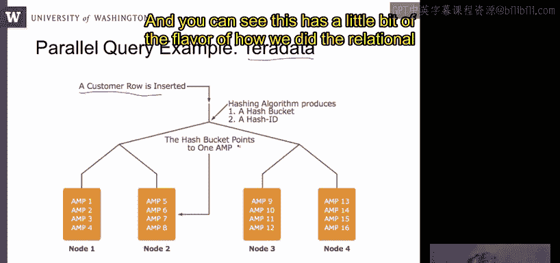

# 杜克大学《大规模数据科学（大数据操作，第1课／共3课有视频）｜Data Science at Scale》 - P68：67_并行和分布式查询处理.zh_en - GPT中英字幕课程资源 - BV12s421T7tJ

。

So recall that a key idea of relational databases was this notion of a relational algebra where you could write sort of plans like this and that this。

Top level language called SQL was the most common way of producing a relational algebra plan。

 right You wrote a query in SQL， and it was automatically turned into relational algebra plan by the system。

So this is kind of thrown out the window with。Map reduce。

 arguably in favor of sort of flexibility in providing the program with more。More control。But。

Let's go back to this model for a bit。Fine。Now we want to evaluate these queries。

 but we want to do it in parallel now， and so there's two different terms that I want you to be familiar with。

 one is distributed query and one is parallel query or distributed query processing and parallel query processing。

And so they're both ways of sort of。Taking advantage of more computing resources for the same query。

 but they behave a little differently so in a distributed query。What you're doing is taking。

A single large table and distributed it across a cluster， just like we talked about。

 and then you're breaking your query into individual pieces to operate。

On each of those partitions of the file。Okay， so this sounds like well。

 isn't that basically just the same thing as map produce？It is， except for the fact that。

All the results of those individual pieces are all sent back to the。

Head note to a single server to sort of finish processing。 So， for example。

 if you're doing a account。you want to count all the records that match some criteria。 Well。

 if you have a very large file that's split across several machines， these distributed query systems。

 Microsoft SQL Server in particular is an example of this is smart enough to break the query into a bunch of little pieces and run each of those pieces in parallel。

 But as they start to stream tuples out to be counted， they'll send them all back to the head node。

Actually， I guess that may not actually be true because maybe it's smart hard to figure out that you can just count things in parallel and add them up。

But it's not hard to construct a query where， where you have this bottleneck of sending everything back to a single server。

 So it's essentially， you can think of it as like having the map phase。

 but not really the reduced phase。 Now， parallel query， every individual。

Operator in the relation algebra is implemented in parallel。 So when you're doing joins。

 you're doing joins across a bunch of nodes when you're doing。Groupings。

 you're doing groupings across a bunch of nodes， and we've seen how to implement relation relational join in mapRuce。

 and it iss not too far off from how it's actually implemented inside databases。

So if we know how to implement join， that's usually the harder one。

Trust me that you can implement the other ones that way。 Well。

 now we have a way to do parallel query processing。With the relational algebra。You know。

 so why not do that well the answer is people do do that and we'll come back to that in one second。

Okay， so for a distributed query， I guess I was waving my hands a second ago try to explain this when it was on the next slide。

You can imagine。Constructing a view and we've talked about views， if you don't recall what that is。

 it's you know a named query that can then be accessed as a single table。So we。

Say that the sales table is really the union of a bunch of。Smaller sales tables， one for each month。

And in particular， you could put each one of these sales tables on a different disc。

Or even a different。Server altogether。Right， and then the the。

User who's querying the sales table doesn't have to care about the fact that this is actually distributed。

嗯。A distributed table， They don't have to go gather up all the results from January and then gather up all their drill in February and then gather up all the results from March and put them all together。

 That's done automatically by the system， however。嗯。

And so this is the create table statement that we didn't talk about。

For constructing the sales table for for individual mar， Okay， But again， however。

When you process this stuff in parallel that works great。

 but when you get the results and you just send them all back to the single node to finish processing and that's the limitation of distributed query so it's great that you get some parallelism。

 but it can't do everything in parallel and you can see this when you run performance experiments。

But a true parallel query example。Would be。For example， from a system called Terraadata。

 which is a database company that many folks haven't heard of because they've been selling very。

 very high end databases to very， very high end customers and so they don't sort of。

Need to have much word of mouth in the。Popular。News media。

But what's happening here is that as every individual row is inserted into the parallel database。

It will be assigned to some particular server using a hash function。Okay。

 so everything is automatically。Partitioned。More or less randomly across the cluster。

 And then whenever you're running queries on this。All the machines will access their data in parallel。

And you can see this has a little bit of the flavor of how we did the relational join。

In mapRuce and that should be become even more clear in a second。

