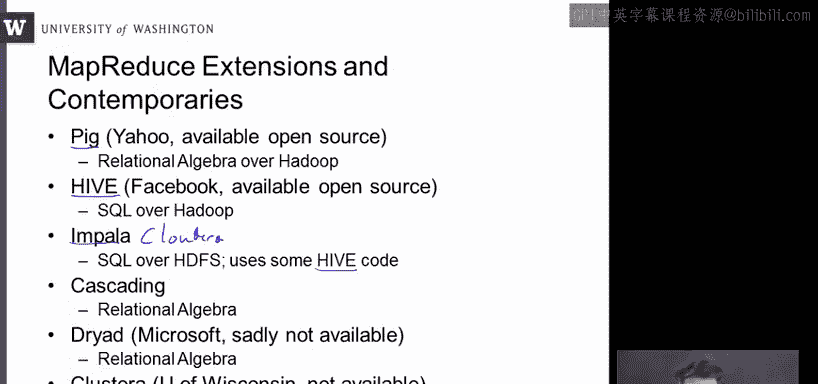

# 杜克大学《大规模数据科学（大数据操作，第1课／共3课有视频）｜Data Science at Scale》 - P69：68_Teradata示例：MR扩展.zh_en - GPT中英字幕课程资源 - BV12s421T7tJ

。So remember this is our query。Orders and line items。 And this is the plan that we're going to do。

 We're going to select some orders and then join the orders with the items。

So how this starts with these。Parallel processing unit is called amps interadata terms。

Will each contain a piece of the data？A chunk of the data。

 and the chunk was defined sort of randomly by hashing。

 And so they all in parallel begin to scan their， their individual chunk。

 And then they all in parallel apply the filtering condition to throw out certain records that they don't want。

And then they'll all in parallel hash on the this isn't right， this should be hash on the order ID。

 not the item ID。So this is the join key right， we're going to join on order。

 then the all in parallel hash on the join attribute， the order I。And that will shuffle it。

For like a better term to another set of amps， perhaps the same set of amps。

 but typically another set of amps。That will do the next step。Actually compute the join。

 And so this should look a lot like a mapreduce。Job， right。

 you've got a map function that's scanning and selecting。And， and then， and actually then hashing。

 And then we got a reduced function coming up to actually produce the join。

 And for the other relation， the same thing happens。 You scan the items and then hash on， again。

 this is order， order， order。so you're scanning scanning is selecting on the orders and just scanning on the items and then both are hash on the appropriate join attribute and lo and behold。

All the items and all the orders that correspond to the same order ID to the same join attribute。

 same join key， end up on the same machine and you can actually process the join。

 just like the map reduced example we saw。All right。

So then at the end of these two steps that I've shown you。

Amp 4 will have all the orders and all the line items where hash of order， goodness。Equals 1。

And this amp 5 will have all the orders and line items where hash of order equals 2。

 and this one will have all the orders and line items where hash of order equals three。

 and now it has enough information to individually and in parallel finish the join and actually produce the result。

And all these out of your orders as well。All right。

 so the point is that the same machinery already exists in these parallel databases and in MaRduce。

 you know if you're interested in doing a join， you're sort of implementing this yourself and so this observation was not lost on people that you know。

 hey， it might be nice if there was sort of a standard way of doing join in mapRduce and we didn't have sort of rewrite it ourselves every time。

And in fact， you， there' there's libraries on top of mapreduce that do this。

 And so there's a library called pig。From Yahoo， that encourage you to check out that。

Is recognizably relational algebra， right， There are operators called join。

 There are operators called group by。 It does have a bit of a funny data model where you're allowed to have kind of complicated nesting。

As opposed to just straight tus and straight relations。But the relational algebra is there。 And。

 in fact， this is sort of one of the points I want to make is that。It you know。

 it's important to sort of be able to modularize the concepts that come out of various communities and especially databases it tends to be true that。

You know， it's kind of all or nothing。 If you're interested in using databases。

 well then you have to take everything。 you have to take the whole package。 You know。

 it's all are nothing。 But increasingly， what you're finding is that these concepts are leaking out into other systems。

 which is why I'm really。Emphasizing this relational algebra piece a lot is that you can use these concepts independently of buying in to a strict。

Relational model。Okay。And certainly not a strict adherence to a particular implementation of it。 Now。

 another system called Hve is literally SQ L on top of Hadyduop。 So it goes one step even higher。

 instead of just stopping the relational algebra level， it actually provides a sQL interface。

 Inmpala is a more recent system from Cloudder， I should mention here。Claudero， by the way。

 is a company that has。Allign themselves pretty closely with the Hadoop stack。

 and so they have their own fork of the Hadoop system and a bunch of great tools for working with that。

Ecosystem， and IalL is a new system that they produce that is provides SQL over HDFS and actually uses a lot of the code from the hive system。

Cascading is another system that's maybe a little bit less common。

 but it's also very recognizably relational algebra。

 The dryad system I mentioned has nothing to do with mapreduce directly except for a similar motivation。

 but it very obviously has relational algebra there。

 the Ca system I mentioned it's a more of a research project and it's not clear to me that the code is available。

 but it's also very clearly relational algebra so。When you put your relational algebra goggles on。

 you start to see the world in this way。And it starts to come up everywhere。

So it's good to go back and understand those operations。

