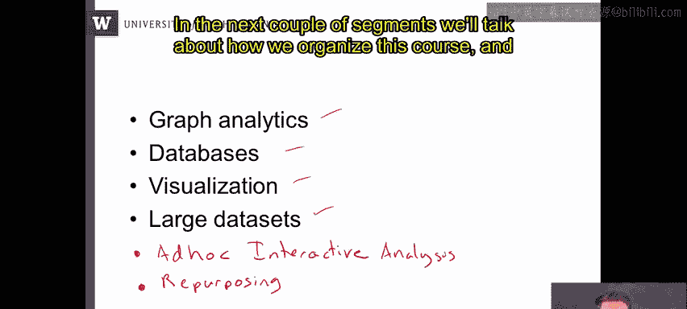

# 杜克大学《大规模数据科学（大数据操作，第1课／共3课有视频）｜Data Science at Scale》 - P6：5_激发胃口：公共卫生（续）、地震、法律.zh_en - GPT中英字幕课程资源 - BV12s421T7tJ

。

So another example， also also analyzing。Web search traffic。

That was done with perhaps a little bit more of a scientific。Ringer。

Was done by some folks at Microsoft' research。 And so here what you're looking for is。

Side effects associated with particular drugs。 and so these results are。

Pretty striking so what this graph is showing that is over time。

A set of users it was around about a million that they had permission to sort of monitor their web search。

Traffic。That。When you searched for this drug？In green。

What percentage of the time did you also search for terms associated with hyperglycemia symptoms？

And the answer is somewhere around 5%。For this other drug， it was somewhere around 4%。

In the background， for the average case， it was pretty close to 0%。

If you search for both of these drugs。The odds that you also searched for hyperglycemia symptoms went up to 10%。

Okay， so what's striking about this is that hyperglycemia is not a。Known side effect of these drugs。

 but it seems impossible to ignore from the web search。Data， right。

 there's just no reason to believe that。This could be explained by coincidence。

And they develop this argument more in the paper than I just have there。By。So fine。

 so repurposing data， this is another example of a large data set they had to use a web search。

And those are probably the two points I want to make about that， but a pretty fun one。Okay。

 so the last example I'll give。Is a different take more about。Prediction than data。

 but this from last October， if you recall， there were six Italian seismologists who were convicted of manslaughter for failing to predict。

A magnitude 6。3 earthquake in April 2009。 and so while the locals were concerned about the siteism activity。

 the researchers were deemed to be just too reassuring about the verdict。

 And so the point I want to make here is that you know there's liability。

 I mean so the scientific community was completely aghast that this happened and I'm completely aasst that this happened and pretty much everybody is that you can。

Imagine to hold researchers responsible for failing to predict something that is demonstrably and known to be impossible to predict right so there's no seismologist on the planet。

That would argue that earthquakes are even remotely predictable。

 and yet the courts sort of decided to somehow they。You know， because they got the wrong answer。

 it's bad， but it does sort of bring up the issue that when you make a prediction。

There's a certain amount of。Weight you're going to put behind it whether intentionally or not。

 and so understanding how confident you are about that prediction is sort of an important part of the game here。

So that was the last example。The themes that we saw come out here。

 we gave a couple examples of graph analytics， we showed the databases are sort of useful in the Obama grounding case。

 saw a lot of examples of visualization and communicating these results interpreting these results。

We saw some examples of using very large data sets， other examples that use very small data sets。

And not everything's about big data， a couple of bullets that aren't on here。

 we talked about you know ad hoc。Interactive。Analysis。Its sort of。Not just faster。

 but different and so supporting that is。Important。And then。We talked about repurposing data。

So data collected perhaps by someone else。For some other purpose。

 reusing that to draw inferences about something else， that's a pretty common theme here。

In the next couple of the segments， we'll talk about how we organized this course and some of the design decisions we made in creating the material。

