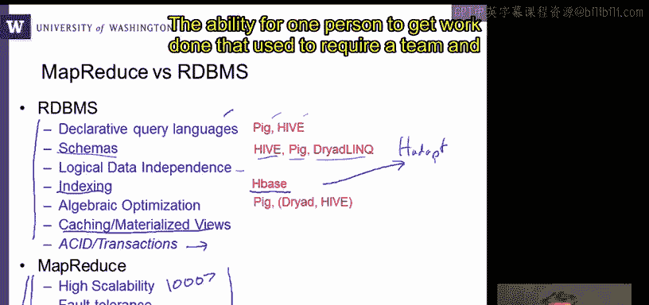

# 杜克大学《大规模数据科学（大数据操作，第1课／共3课有视频）｜Data Science at Scale》 - P70：69_RDBMS与MapReduce特性对比.zh_en - GPT中英字幕课程资源 - BV12s421T7tJ

。

So I want to spend a little bit more time on the details of mapRuce our versus relational databases beyond just the sort of how the query processing happens。

 we saw that parallel query processing，It is largely the same。

 I that many of the algorithms are sort of shared between and there's a ton of details here that I'm not going to have time to go over。

But the takeaway is that the basic strategy for performing parallel processing is the same between them。

 but there's other features that relational databases have and I've listed some of them here。

 so we've mentioned decorative query languages and we've mentioned that those start to show up in pair and especially hive。

Now， there's a notion of a schema in a relational database that we didn't talk too much about。

 but this is a， you know， structure on your data that is enforced at the time of data being presented to the system。

 So any data that does not conform to the schema can be rejected automatically by the database。

 This is a pretty good idea because it helps keep your data clean。

 It's not real feasible in many contexts because， you know， the data is fundamentally dirty。

 And so saying that you have to clean it up before you're allowed to process it。

Just isn't going to fly right And so this is one of the reasons why Ma reduceuce is attractive is it doesn't require that you enforce a schema before you're allowed to work with the data。

However， you know it doesn't mean that schemas are a bad idea when they when they're available and in fact。

 really you know even with MaRuce， a schema is really there。

 it's just that it's hidden inside the application right so when you read a record。

You're assuming that the first record， the first element in the record is going to be an integer and the second record is going to be a date。

 and the third record is going to be a string。 So that schema is really present。

 It's just present in your code as opposed to push down into the system itself。 And there's a lot of。

Great empirical evidence over the years that suggested it better to push it down into the data itself。

 when and where possible。 And， in fact， you're starting to see this。 So hive and pig again。

 have some notion of schema as does drive link， as does。Some， some emerging systems。 There's。

 there's a system called Hadappt that on。What' we talk about。Really at all。

 but combined sort of Hadoop level query processing for parallelism and then on the individual nodes there's a relational database operating and one of the reasons among many is to have access to schema constraints。

Fine， logical data independence， this actually you don't see quite so much so this is the notion of views right。

 does the system support views or not and you haven't seen quite as many instances of Hadoop like systems that support views。

 but I predict they'll be coming。Indexing is another one。

We talked about how to make things scalable that one way to do it is to drive these indexes to support sort of logarithmic time access to data。

 that's not available in vanilla Mareduce。 Every time you write a map reduced job。

 you're going to touch every single record on the input。

 You're not going to be able to zoom right in to a particular record of interest。That's wasteful。

 And it was recognized to be wasteful。 And so one of the solutions you see people adding indexing features to Hadoop and an H base。

Is an open source implementation of another proposal by Google for a system called Big Table。

That among other things， provides kind of quick access to individual records and ageB is designed to be sort of compatible with Hadoop。

 and so now you can design your system to get the best of both worlds。

So you can get some indexing along with your map reduced style programming interface， and once again。

 I'll mention adapt here as well one of the motivations for adapt to be able to provide。

Indexing on individual nodes， okay？Fine， so I'll skip cashching materialized views。

 So this is the same thing as logical data dependence， except you can actually。

Pre generaterate the views as opposed to evaluate them all at runtime。

 But we're not too much about that。 And then transactions。

 which I'll talk about in a couple of segments in the context of， of no SQL。 But while。

DaSo databases are very good at transactions， they were thrown out the window among other things in this kind of context of Mareduce and NoSQL。

 and they're starting to come back。But remember you know what Mappperd did provide was very。

 very high scalability， so this is thousands and ups， thousands of machines in up。

And it also provided this notion of fault tolerance。

 So relational databases didn't under didn't really treat fault tolerance this way。 They were。

Unbelievably good at you know， recovery， right， if you were because of this notion of transactions。

 if you were sort of operating on the database and everything went。put。啊。Given some time。

 it would figure everything out and recover。And you can be guaranteed to have lost no data。

That's fine， but that's not the same thing as saying during query processing while a single query is running。

 what if something goes wrong， do I always have to start back over from the beginning or not and sort of the implicit assumption with relational databases was that your queries aren't taking long enough for that to really matter。

But in the era of big data， of massive data analytics。

Of course you have queries that are running for many。

 many hours right and so having to restart those and of course they're running on many。

 many machines where failures are bound to happen。 and so that context is something that Mapper is sort of really motivated and now you see。

Modern parallel databases capturing some notion of fault tolerance in general。 Okay。

 so this is sort of a list of some kind partialistic contributions from racial databases and this of partialistic contributions。

 W， maybe maybe a complete list of contributions from ad。嗯。

And my point is that you see a lot of mixing and matching going on that the design space is being more fully explored。

 It used to be sort of all about relational databases with their choice their choice in the design space。

 and then Mare kind of rebooted that a little bit。 And now you see kind of a more。Fluid mix。

 People started cheering picking features。Okay， fine。

 and then the last one I guess I didn't talk about here is。What I think was really。

 really powerful about map produce is it turned。it turned the army of Java programmers that are out there into distributed systems programmers。

 right a mere mortal Java programmer could all of a sudden be productive。

 processing hundreds of terabytes without necessarily having to learn anything about distributed systems。

That was really， really powerful， right， the analog in databases was， I mean。

 you had to become a database expert to be able to use these things。Okay。

 and so I think that that impact is hard to。Overstate， right。

 the ability for one person to get work done that used to be require a massive team in six months of work was。

Significant。