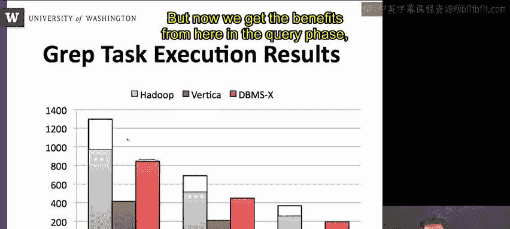

# 杜克大学《大规模数据科学（大数据操作，第1课／共3课有视频）｜Data Science at Scale》 - P71：70_RDBMS与Hadoop：grep.zh_en - GPT中英字幕课程资源 - BV12s421T7tJ

。

Okay， so just to wrap up。This discussion of map Red versus databases。

 I want to go over some results from a paper in 2009 that's on the reading list where they directly compared Hadyoop and a couple of different databases and see if we can maybe explain what some of these results tell us。

Andy Pablo and some other folks at MIT and Brown。Who did an experiment with this kind of a setup？

So the comparison was between three systems， heyoop， Verica。

 a which was a column oriented database and DBMS X， which shall remain unnamed。

 although you might be able to。Figure it out。 And so we haven't learned what a column or database is and what a row range database is。

But we may have a guest lecture later that we'll describe that in more detail。

 but for right now for the purposes， just think of these as two different。

Kinds of relational database or different two different relational databases with different techniques under the hoods。

In the， under the hood。Okay。And so there's two different。Facets to the analysis。

 one was sort of qualitative about their discussion around the programming model and the ease of setup and so on。

 And the other was quantitative， which was performance experiments for particular types of queries。

 Okay， so the first task they considered was what they call a Gr task。 And so this is。O。

Attaed to find a 3 byte pattern in a 100 byte record。And the data set was a very。

 very large set of 00byte records。Okay。So this was done this task was performed in the original map produced paper in 2004。

 which makes it a good candidate for a benchmark。And so the data set here is 10 billion records with totaling1  TBabyte spread across either 25。

50 or 100 nodes。 Okay， so you're just trying to find this record。 So this is much like this。

 you know， genetic sequence DNA search task that we describe as a motivating example for sort of describing。

Scalability。Fine。So over the results， just to load this data in。

This is what the story sort to look like。Heyo and this system called Vertica that they。Really。

 the theme here is they were the designers of the verticalica system。

And so most of these results are going to show Vertica doingwe。Quite well。For a variety of reasons。

 so we're not going to talk too much about those particular reasons we're mostly going to be thinking about。

DBMS Act， which is a conventional relational database and Hadyoop。ok。So here。

 loading is fast on Hadyoop while loading is slow in the deep on the relational database and again。

 it was sort of fast on vertical as well。 So why is it faster on Hadoop well。

There's not much to the loading right you have to put it into this HDFS system so it needs to be partitioned。

 but that's about it when you put things into a database。

 it's actually recasting the data from its raw form into internal structures in the database and that takes time。

Okay， and the process could be even worse because if you're building indexes over the data。

 you actually， you know， every time you insert。Data into the index。 it needs to sort of。

Maintain that data structure。Okay， and so load times are known to be bad so the takeaway here is remember that load times are typically bad in relational databases relative to Hadoop because it has to do more work。

 Now， once it's in the database， you actually get some benefit from that and we'll see that in a second even in these results。

 but it's actually you know we know that it conforms to a schema， for example。

 Hadyoop it's just a pile of bits， we don't know anything until we actually run a map reducedduce task on it。

And so how much faster well in their experiments？For the on 25 machines。You know。

 we're up here at 25，00， these are all seconds， by the way。嗯。You know， send00 seconds versus。25。

000 and a little bit less as we。Go to more servers。Okay。Now。

 actually running the Grep task to find things。This is what we see， again。

 maybe ignoring verticica for now。Because I haven't。

Explain to you what the difference about ver is that allows it to be so fast。

 but just think about a relation database from what we do understand。嗯。Heyduop is。Slower here。

And the primary reason is that。It doesn't have access to a。Index to search。So Hadoop is。

Slower than the database， even though both are doing a full scan of the data。

 the Grep task here is not something amenable to any sort of indexing。

 you actually have to touch every record。 So there's no fundamental reason why the database should be slower faster。

 but partially because it gets a win out of the structured internal representation of the data and doesn't have to reparse the raw data from disk like Hadyoop does。

 and there is a fundamental reason， because it's already in a kind of a packed internal binary representation。

 which we paid for in the loading phase， But now we get the benefit from here in the query phase。

Even before we even talk about indexes。