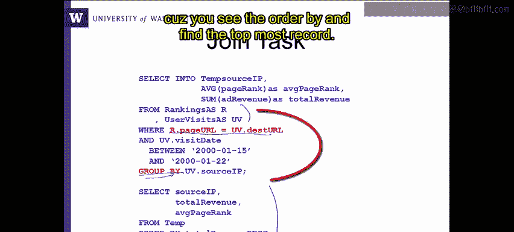
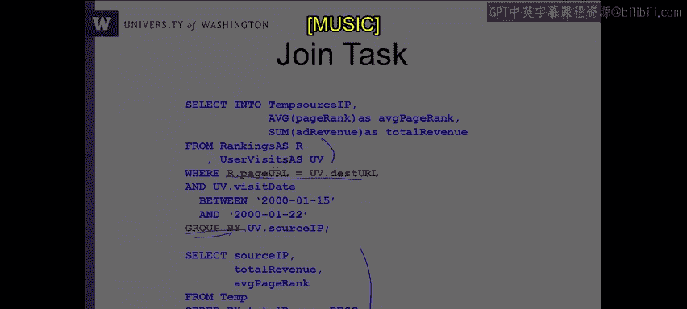

# 杜克大学《大规模数据科学（大数据操作，第1课／共3课有视频）｜Data Science at Scale》 - P72：71_RDBMS与Hadoop：选择、聚合、连接.zh_en - GPT中英字幕课程资源 - BV12s421T7tJ

。

A selection task where。Not having to scan every record necessarily， that is amenable indexing。

 as we discussed in the scalability segment。Well， the story is even you know， more extreme， right。

 the Hadoop results are just。Way， way， way higher than。

Both the database and in particular the verticalica results and so here。

The reason is because you can build an index on the pay rank。

Attribute and zoom in directly to the records that you're interested in。

 So those are sort of search and retrieval tasks， not arguably not exactly what Hadoop was designed for。

 Hadoop designed more for analytical tasks。 So now consider the。

 So here the data set is 600000 H documents。Which works out to be about 6 gigabytes of data per node。

Along with another data set is 15155 million user visit records and 18 million rankings records。

 So this is kind of a。Web data processing task。 And so a simple aggregate task here is to add up all the ad revenue。

Corresponding to a particular subdomain， so they apply this function substring to the source IP to pull out the first seven six characters。

Right the subnet mask of the first。Prefix of of the IP address， grouped by that。

And just add up the ad revenue。 Okay， so this is one thing that's point to point out is it's actually very nicely and simply expressed as a as a SQL query。

 know， you don't necessarily have to write a bunch of Java code and map produceduce to express it in this particular case。

And so here are the results， again， you see a rowiented database。Beating。Heyju and。

The reason here is maybe not quite so easy to explain。

 but essentially it's the internal representation in the database。Again， wins credit。

 there's no parsing that has to happen Okay， on this same schema， there's a join task。啊。

Which is to find the source IP that generated the most ad revenue along with its average page rank。

And so this is kind of a complicated thing involving step multiple passes over the data。

 you know to sort of compute the average pay rank and then find the source IP that find the maximum ad revenue。

 find that corresponding source IP， and then compute its average。

Pay rank and so the implementations here are a fairly complex SQL statement involving the use of temporary tables。

 and in Mareuce has to be three separate mapreduce jobs chained together。Okay。

And so for the complicated SQL， we won't go through this in too much detail。

 but just notice that there's a join。And then there's a group by， you know。

 we looked at some complicated SQL we were to show you how to break them down and this is no different。

 so there' you you see two tables which you should think yourself join。And then you see a group buy。

 So those are really the two。Tasks going on。And then the second step is to。U。

Do a big sort because you see the order buy and just find the。Topmost record。

