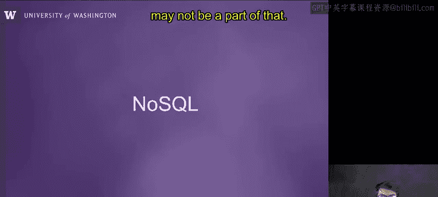
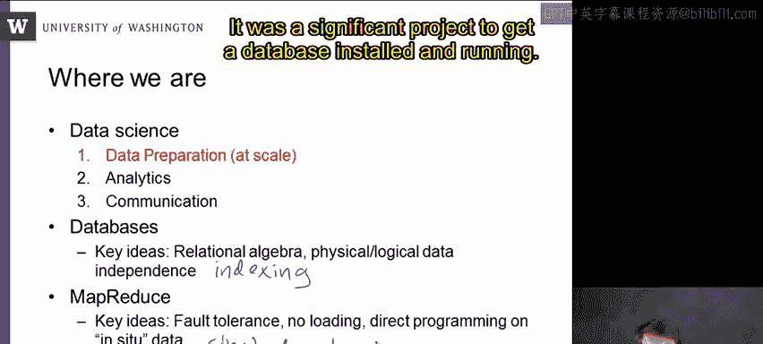

# 杜克大学《大规模数据科学（大数据操作，第1课／共3课有视频）｜Data Science at Scale》 - P73：72_NoSQL背景和路线图.zh_en - GPT中英字幕课程资源 - BV12s421T7tJ

。

So the next few segments， I want to spend talking about No SQL。

 And so these systems are typically associated with building very large scalable web applications。

 as opposed to analyzing data， which is really the focus of this course。 However。

 I think it's important to cover this topic for a few reasons。 One is， you know， as a data scientist。

 you'll be manipulating data that is increasingly found in。One of these variants of a nosQL system。

 the systems and the terminology in this space are really influencing people's thinking about how to deal with large scale data。

 And so being cognizant of the landscape here and being cognizant of the major trends in the history allow you to make informed decisions about this。

 you know， as a data scientist， you may be asked to make recommendations about what kind of platform to go with to do your kind of to do your analysis。

 And so understanding the pros and cons of the and how they work can be pretty important。 know。

 and then maybe third， the same concepts that we've been discussing。In other segments， you know。

 sort of relational algebra， logical data independence。You knowSple analytics going a long way。

 simple scalable analytics， indexing。These ideas come up in this space as well。

 and so you have another application of these concepts。And then maybe finally。

 the data scientist may be called upon to actually build some of the large scale systems as part of their work。

Unheard of， you know I mentioned in the first few segments。

That building data products was an important part of data science and so one that one。

Manifestation of data products is some of these large scale web applications， okay。

 and so no SQL systems may or may not be a part of that。

F， so let's get started。All right， so where we are so far is we've mentioned that data science maybe has these three steps。

 data preparation at large scale。All right and we' talked about manipulation and muning and data jujitsu and so on。

 and that's all this step one， and then step two is analytics are actually running the model and we're going to get that in the next week。

 and then third is communicating the results， interpreting and communicating the results and this will be visualization will be a big part of the way we talk about communication so we're still in this data preparation phase and we're spending a little bit longer on that then。

You knowSay a third of the course， more than a third of the course。

For the reason that I gave in the first few segments that really this is the part that keeps people up at night。

 so I want to make sure that you're armed with how to use databases to do this data mu。

 how to use map reduced to do this data mu， also make the point that a lot of times even analytics itself can be pushed into these systems。

 which you saw in。Hopefully in assignment two in the database assignment。

So then some of the key ideas from databases that we took away were this concept of the relational algebra comes up even outside of databases is not。

Only found。You know， with SQL systems and we'll see that again。

And this notion of physical logical data independence comes up over and over again。Maybe indexing。

And then we talked about MaRuce and we gave a lot of examples of some basic operations of MapRuce。

 and we started an assignment。Evolving writing your own map produce。Programs。

At least at the program model level。 and so here we saw that。

Part of the advantages of the system itself。Firstly。

 Google and then in the implementation Hadyoop was fault tolerance at scale。

 and another one was you didn't have to load the data。

You could just work with it as is unlike databases where you have to actually impose some sort of a scheme on it。

In order to even touch it for the first time， and so that first step can be a doozy。Okay。

Extending this point， you direct programming on insitu data。 So anything that comes at you。

 you can sort of， if you can write a program that can process it。

 you can probably write a map reduce program that can process to that scale。

 and that's very very powerful thing。 Maybe another way to put this is sort of single developer。

 right， You're kind of up and running within the hour with map reduce。

 And that was never really a property that。Databases had it was always a sort of difficult。

 It was a significant project to get a database installed and running。

