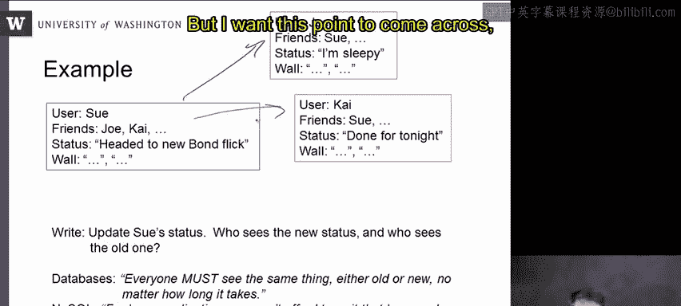

# 杜克大学《大规模数据科学（大数据操作，第1课／共3课有视频）｜Data Science at Scale》 - P75：74_放宽一致性保证.zh_en - GPT中英字幕课程资源 - BV12s421T7tJ

。

Okay， so we start with the same schematic that we were looking at when we were talking about mapreuce and scalability where we take a big data set and break it into chunks and send those chunks to different machines。

Okay。And here we are replicating this chunk to three different machines。

 which is the same thing we did for the Hadoop file system for fault tolerance。Purposes where。

 you know， if this machine dies， we still have two copies of the data to draw from。

 and we do this with every chunk， all right。But the the two requirements we need to speak to here is we need to ensure high availability so that when something goes wrong。

The data is still available。 And we also wanted to support updates in this context。

 which is different than we were talking about before。

 So instead of just read performance or fault tolerance in the context of reads。

 we also want to make changes to this data now and have them propagate to both other replicas and in some cases。

 to other。啊。Consumers of that change， right， There might be。Other blocks of data that are。

Refer to the same information， and I'll give you an example in the next slide。

So imagine a social networking application where people are updating their status and their friends get to。

Your friends get to see your status updates。And so the right operation here is Sue updates her own status and the question we ask is of her friends。

What happens， Who sees the new and， Who sees the old one， How do these。

 how does this status change propagate And the answer to this question from a database perspective was。

 well， look， you know， everyone must see the new change or no one does， right。

 either the transaction commits and all copies of the data everywhere。

Are synchronized simultaneously。And further， anybody attempting to read the value in a new immediate state is able to either read only the old value or has to wait until the transaction commences。

hi could be an arbitrarybit a pretty long time。Deadlockcan happens why I said arbitrarily。Fine。

 so that's the answer given by databases。 Everything synchronous， Everything must be updated。

 It's either all or nothing。 Okay， and the NosQl system sort of made this observation They said。

 well， look， for really large applications， we simply can't afford to wait arbitrarily long for this to happen。

 right， I mean， you need。Status updates to be able to。

Commit and respond so the user can go on and do other things。 right。

 They can't sort of look at an hourglas while。The synchronization is still occurring。

And then further the observation is well， maybe it doesn't matter anyway I mean。

 is it really that important that you know here if Sue's friend。

 Joe sees the new status while Kai still sees the old status， maybe who cares， right？

As long as Kai eventually sees the new status， maybe that's good enough。Okay。

 and so these observations suggested moving in a different。

Area of the design space in sort of high scalability， high availability and。Consistency。

 application consistency。That space of systems started。Be associated with kind of anti database。

 right， took a very different approach than databases did。 And so the term no SQL came into play。

 It's actually unfortunate that the。You know， the name that stuck was no SQL because it doesn't have all that much to do with SQL。

 right It has more to do with the。Transaction processing ci databases。

 which is not all that relevant for SQL， right， I mean。

 the model of transactions is sequences of reads and writes， nothing to do with a query language。

 But hey， that's whats stuck。Now， I don't mean to say the term no SQL。Only suggests。

These transaction models， it also sort of suggests a weaker data model and so on。

 And we'll talk a little bit about that。 But I want this point to come across， because this is。

One of the key ideas。