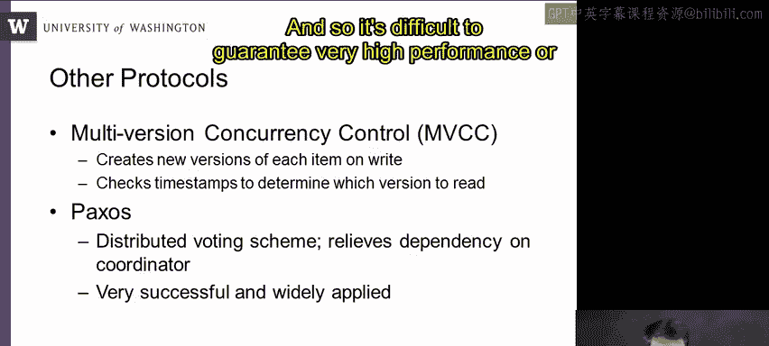

# 杜克大学《大规模数据科学（大数据操作，第1课／共3课有视频）｜Data Science at Scale》 - P76：75_两阶段提交和共识协议.zh_en - GPT中英字幕课程资源 - BV12s421T7tJ

。

Now， how did databases solve this problem or why did they take so long， Well， there's a。

Protocol called two phase commit that's。Fairly standard in these situations for synchronous processing。

 And so the motivation for why you want twopa commit goes like this。

 If you want to have a bunch of replicas or other kinds of subordinates。

 anybody that wants to see the change， you make your status update and your friends need to see it。

 the servers holding those different friends。Need to be told of the change。

 And so if you just go ahead and tell them， say， look， I made this change。

 go ahead and update your internal state to reflect Sue's new status。Then you could have， you know。

 some of them report back success， but one of them could fail。But now you're in trouble， right。

 because this one has the old value because it failed for some reason。

Either you didn't hear back from the server at all or it said， look， something's wrong with my disk。

 I can't do it。 So it responds with a failure regardless。

 And these two have already successfully applied the。I've got a checkmark。

 I've already successfully applied the transaction。And so now you're in an inconsistent state。

 subordinate3 has the old value and these guys have the new values。Okay。

So how you solve this problem？Is two phase command。

 And so the first phase here is the coordinator sends a prepared to commit message。

 and the subordinates make sure。They take action to make sure that they can。

Commit that transaction when asked no matter what， and so typically this means writing to a log。

The information related to the transaction so that even if the power goes out。

 when they wake back up， they can pull it from the log。Okay。And the subordinates reply with a yes。

 I'm ready to commit。 And then in phase 2， if all the subordinates say they're ready。

 then you'll go ahead and send the commit message。 And if anyone failed， if rather instead。

 anyone failed， then you send back an abort message and the individual can clean up。ok。

So this is fine。And here's a schematic of it in step one， they say prepare。

These guys all write ahead to the log and say， I'm about to write this or I'm going to commit this transaction。

 they respond with， yes， I'm ready to do so。The coordinator comes back with commitit and then finally all the work is。

Is done。 and I'm not going to show the schematic for what happens in a failure。

But essentially the coordinator needs to watch out for it and send back in aboard if something has gone wrong。

There's a couple of problems with this。 One is there's some dependencies on the coordinator here that if the coordinator fails it。

The wrong time， things can go kind of screwy。And a fully distributed。Protocol for ensuring。

Mutual commitment of transactions or other kinds of operations can be achieved one of the most successful and popular methods of doing this is an algorithm called Paxos that we're not going to talk about in detail。

 but you're going to see that term if you look at some of the readings for the NoSQL systems okay。

So thank。To phase commit on a local cluster for a database。

 think Paxos for a distributed sort of peer to peer kind of protocol。

 And just briefly what Paxos is essentially doing is it's a voting scheme。 So people sort of vote on。

 you know， the individual servers want have to self determine。

Whether or not they're supposed to commit the transaction or not。

 and the details can get a little bit subtle。But overall。

 it's pretty simple given the difficulty of the task gets involved。So fine， so that's one problem。

 the other problem is just with that pack of sort of shares is that。This can take a while。

 right if subordinates don't respond promptly， you might be waiting around if things fail multiple times and you need to sort of abor and retry transactions at the application layer。

 things can go slow。When there's it doesn't necessarily scale when there's thousands or millions of subordinates you need to do this。

 you're kind of dead in the water。So other protocols that I'm not going to talk about in too much detail include a multi version。

 but you will see in some of the papers mentioned multi version concurrency control where each right creates a new version of the data item and the legality of a read is。

Determined by checking the timestamp of the read transaction versus the current timestamp of the version that you're trying to read and if it's been updated since the time you're supposed to be reading it prior to into theCC。

 all you can do is aboardort the read and say， look you're looking at dirty data you're done but with multiversion concurrency control。

 you can actually keep multiple versions around and redirect the read to the potentially to the prior version that is correct and thereby avoid aorting certain transactions。

That mechanism still has a dependency on a coordinator role to administer timestamps。

A fully distributed scheme where。The decision to go forward to the transaction or to a board of transaction is made。

Through a voting scheme among peers is。Paxos and Paxos is。Very successful and very widely applied。

 and you'll see it mentioned some of the NosQL papers if you take the time to read them and they're on the reading list。

 and so this relieves the dependency on having a central coordinator。

 but is still synchronous and still has the potential for deadlock and can take some amount of time to reach consensus depending on what's going on on what kind of failures are happening and so it's difficult to guarantee very high performance of very low latency。

Response times。