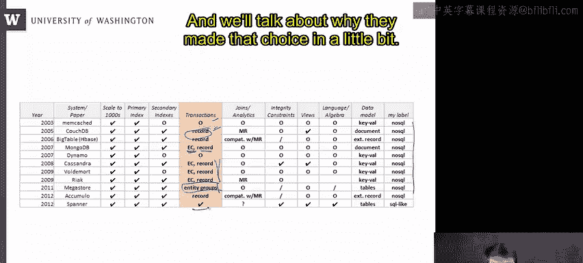

# 杜克大学《大规模数据科学（大数据操作，第1课／共3课有视频）｜Data Science at Scale》 - P77：76_最终一致性.zh_en - GPT中英字幕课程资源 - BV12s421T7tJ

。

So then the term eventual consistency。Was originally defined， not so much in the context of。

Its utility and allowing systems to scale to very large levels。

 but just in this argument that the right。The only。

Players in distributed systems that could make the appropriate decision about how to handle conflicts were the applications themselves。

 And so it was a。Version of this end to end argument that you may or may not have come across in the context of networking。

And so this was a paper in 1995 by Doug Terry where this term was coined and so he says。

 we believe that applications must be aware that they may have read weakly consistent data and that their right operations may conflict with those of other users and applications and that applications must be involved in the detection and resolution of conflicts and so these naturally depend on the semantics of the application。

I willll make the argument in a few couple of segments that I'm not sure I totally agree with these assertions that it actually is better for the system to take care of this。

When it can。But what I wanted to do is let you know that this is where the term comes from as opposed to the No SQL systems in the last 10 years or so。

 which is really what。We it increase in popularity， Okay， so what does it mean， Well。

 it means is in the absence of updates， all replicas will eventually converge towards identical copies。

 right so。As long as things don't continuously change， as changes settle down。

 we'll all eventually see the same value， right， All your friends will see your status。

 They won't be permanently stuck looking at an old one。

But you know what the application sees in the meantime， what's one of your friends。

 which which status one of your friends might be looking at is really sensitive to the internal details of whatever application you're building。

And is difficult and is therefore difficult to predict。Okay。

And so for this reason it's a little bit difficult to reason very precisely or formally about what eventual consistency means because it is so dependent on particular implementation details that are themselves difficult to formalize and in general。

 contrast this with what we've been talking about with relational databases and things like Paxos where they guarantee strong consistency。

 but there may be deadlocks。 And so you can prove that no system can be free of deadlocks and guarantee consistency。

And so relation databases and Paxos give up on this liveness property。

 meaning that they might allow deadlocks in favor of strong consistency now they've。

You can show that the cases where deadlocks can occur can be made sort of rare。

Three different design decisions。But they can still happen， okay？F。

 and so visually consistent models say we can't afford the cost of waiting for。

These protocols are run， and moreover， they may not be necessary in certain application contexts。

Right。So where we are now is we're looking at this column。

And I've already sort of marked this up a little bit， but what these words now mean。

 and we'll talk about these a little bit more when we talk about a few of these systems。

Is the scope of where。Strongly consistent transactions are supported。

 And so the scope here of a single record means that I can update multiple fields in one record。

 and either all the change will occur。 Change will occur， or none of them will occur。 By the way。

 I've filtered this list to only include no SQL systems。

 So relational databases support this across arbitrary records， right。

 you can have you can update a record over here。 and you can update a record over there and call that one transaction and the system will only see both of those changes or neither of those changes。

And that's what's not supported with these No SQL systems。

 So within individual record supported within some of these systems， nothing's even supported。

There's no guarantees at all， really。And what this E C means is eventually consistent。

 So it's not really strongly consistent。 it's just not a transaction。

 but they do have eventually consistent guarantees at the record level。

 And that's what all these systems sort of guarantee。

 And then this system mega store that's based on big table from。Google， it's also a Google system。

Defins an notion of entity groups， and this is a set of related records。

For which transactions are strongly consistent for that group。 Okay。

 so this is a little bit better than just one individual record is the only only guarantee we can give。

 And it's a little bit less than any arbitrary record in the database。 It's predefined entity groups。

That allow transactions。 Okay， so this is sort of a compromise。Fine。

 and then this most recent system from Google Spanner offers。True strong consistency across。

All the records and we'll talk about why they made that choice in a little bit。

