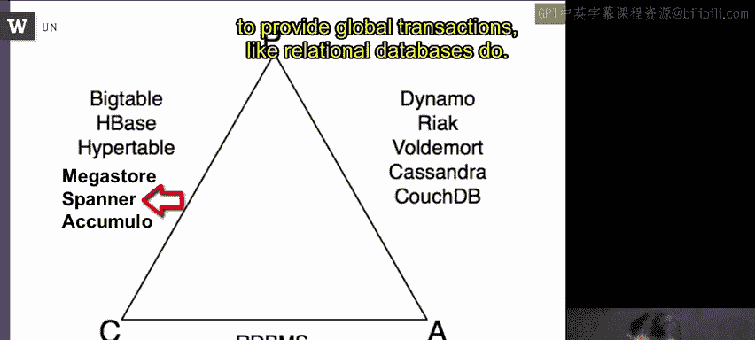

# 杜克大学《大规模数据科学（大数据操作，第1课／共3课有视频）｜Data Science at Scale》 - P78：77_CAP定理.zh_en - GPT中英字幕课程资源 - BV12s421T7tJ

。

so another concept I want you to be familiar with is this so-called cap theorem from Eric Brew in 2000 followup paper and by Lynch in 2002。

 where they define these three notions， consistency availability and partitioning and the way this is often described is you have to choose two of these。

 you know you can't get all three， you have to choose two or sacrifice。Performance。

 but I don't really like thinking of it that way。 And Eric brew has also sort of described that maybe that's not the right way to think about it。

 And the reason is because it's not clear what it means to choose consistency and availability at the expense of partitioning。

 Okay， so what is partitioning， partitioning means， well。

 if you've got a big distributed system with hundreds of nodes involved。

 hundreds of servers all communicating with each other。

 And some segment of them lose communication with the other servers。

Can those two segments still make forward progress in the application independently and sync up later。

 or does everything have to stop and wait， or certain notes have to stop and wait。

In order to reestablish communication， so for example。

 if you have a master node that controls everything and you have some worker nodes that lose contact with the master。

There are many designs at which you can't make any forward progress until you reestablish connections with the master node right you can do no useful work because you're waiting on communication you're waiting on that last message from the master to tell you what to do next。

啊。So in those cases， you've given up availability， right， You go down。

Those nodes are no longer accessible or doing useful work。In the context of a network partitioning。

On the other hand， if you do say， well， sure， we're going to continue doing useful work even independently。

Then it's not difficult to show that you can。Arrive in an inconsistent state， right？

Updates are coming into this partition and updates are coming to this partition of the network。

 and sometime down the road communications reestablish， you find out oops。You know。

 your replica has one value。 My replica has another。 which one's right。

 Well we're going to sort it out。 But meanwhile， we've already sort of exposed these values to the application。

 So in some sense， we're。Demonstrably inconsistent。 Okay， And so the point is， you can't。

Get all three of these。Alright， so you've either sacrificed availability or you' sacrificed consistency by allowing them to continue working。

 So conventional databases essentially assume that there is no partitioning。 And again， this。

 this is a function of them only operating on tens of nodes at a time。

 right they didn't go to this for 1 thousand0 node scale or planet wide distributed。systemsystems。

 and so you could kind of assume that there wasn't there wasn't really a need to worry about well。

 what if queries are coming into half my nodes and they can't talk to the other half my nodes and so on。

 they're all sitting there in a cluster that's in your in your data center or not even in your data center。

 in your server room to some extent And so that really was' an issue that they were thinking about too much。

Okay。And the no SQL systems do need to worry about this， they are very large。

 they are red distributedried。 There are different kinds of Byzantine failures happening all the time because of the sheer scale。

And therefore， they choose to sacrifice。Consistency， instead of availability。Okay。And so graphically。

 you can look at this in this sort of triangle。For mean。

 you can put different systems on sort of an edge here where relational databases assume consistency and availability。

But assume partitioning can never happen。While other systems need to tolerate partitioning。

 but give up on availability。啊。And they are。Ensuring that certain kinds of transactions are going to be consistent。

Okay， and then other systems say， well， we're going to give up on consistency。

But you can always do useful work， okay。So fine。 and really this is the important thing here is the scope of the interaction that I put in that table is sort of critical here too。

 it's not sort of。Nothing except for a spanner over here。Even tries to provide。

Global transactions like relational databases do。