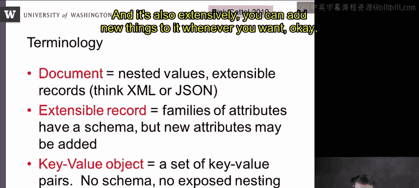
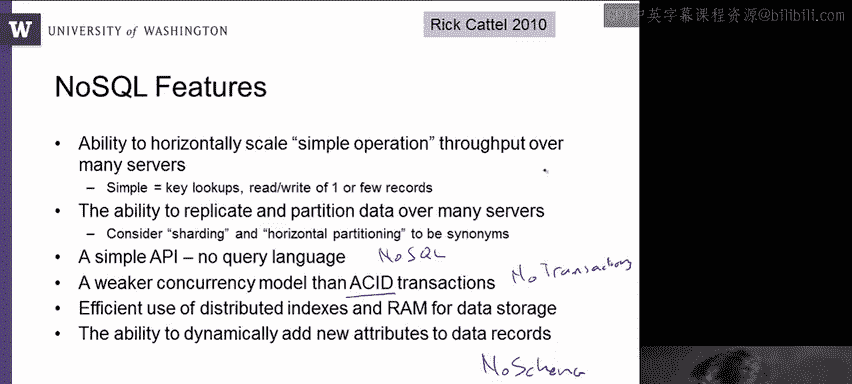

# 杜克大学《大规模数据科学（大数据操作，第1课／共3课有视频）｜Data Science at Scale》 - P79：78_NoSQL系统类型.zh_en - GPT中英字幕课程资源 - BV12s421T7tJ

。

So Rick could tell wrote a nice paper in 2010 about scalable SQL and No SQL data stores where he had a taxonomy of these systems and placed popular instances of these systems into that taxonomy。

 And so this slide corresponds to his。Grouping where each color is one of the groups that he defines。

 So he's sort to lump them into key value stores， document stores and extensible record stores。

 And so what he went in by that was a document is you know， an example。

 this is an XMl document or the J object that we looked at in the Twitter assignment where you can have sort of arbitrary arbitrary nesting。

And it's also exsible， you can add new things to it whenever you want。

 Okay so no top down schema being enforced。

An extensible record you can think of as much like a database record。

 except that new attributes can be added。 Okay， so there is some notion of a schema that's used for different various purposes。

 And in particular， there's sort of groups of attributes that are。Manipulated together。

 these families。But you can stick new attributes on an individual row。

 which you're not typically allowed to do with a relational database。 And then finally， a key value。

I'm using the term object here is a set of key value pairs。 So the difference here is that there's。

Typically not a scheme of any kind， so you don't care what keys there are could be any keys at all。

And there's no exposed nesting。 And what I mean by that is you know a value can be anything you want。

 so you might have some kind of complex object in the value。

 but it's not going to be sort of visible to the system。 It's just going to be a blob。

 a black box object that the system is know anything about。

 so there's sort of only one layer of nesting is aware of the system unlike a document store。

Or a document object that might have multiple layers of nest that are exposed to the system。Okay。

And so his characterization of no sequel。Features， you know， admitting that there's perhaps not a。

Formal definition of no well， there certainly isn a formal definition of NosQL。

 but the term tends to be applied in contexts of systems that have these features。

 So there some ability to scale simple operation throughput to many。

 many servers and by simple operation here we mean key lookups or maybe even attribute lookups or reads and write of just one or a few records right so these sort of needle and the Hastack kind of operations as opposed to these big analytic queries like we've been talking about with Mapreduce and with databases okay。

And second criteria is the ability to replicate and partition data over many servers here。

 so you know break a single large data set into multiple pieces。Automaically。

 if you don't to manage yourself。And here you might see the term sharding and horizontal partitioning。

 the difference between the two if there is any is not particularly important。

 so you can think of them as synonyms， whenever you see sharding think horizontal partitioning of a database table。

 you'll see the term horizontal partitioning use more in the database community and sharding use more in the No SQL community。

Okay， and then a simple API， so no query language， this course was the first bullet。

 these are the simple operation。Operations。And then critically。

 a weaker concurrency model than what I'm saying is asset transactions now。

 I we'll talk a bit about asset in the next。Slide I' not going to into a lot of detail here。 There's。

 you know， 40 years of research on。This topic， too much to cover in this course。

 especially when we're mostly focused on reading data and analyzing data as opposed to。

A concury control， but we will spend some time on some techniques of concurst control in a minute。

And then some efficient use of distributed he talk about efficient use of distributed indexes and Ram for data storage。

 so this is kind of minimizing latency is their emphasis as opposed to just throughput。

And then typically we have this ability to add new attributes to data records in various ways。

 as we talked about on the previous slide right so the lack of no schema is what you can think of here。

Right， so this is。No schema。No transactions and will'll go into more detail there。No query language。

 wouldn no SQL。Rightpe， and。High scale。

Okay。