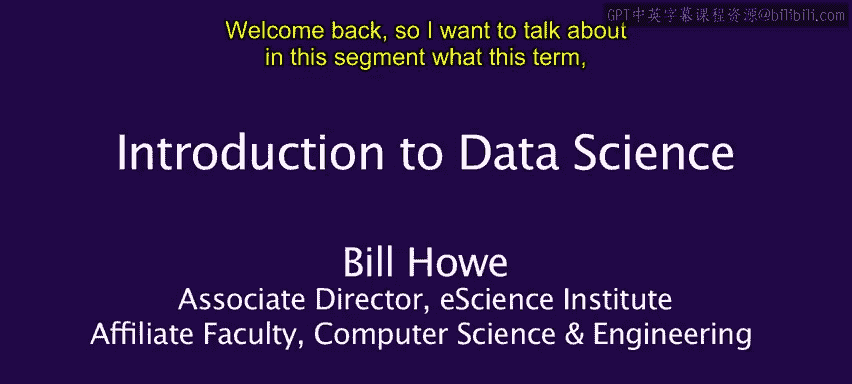
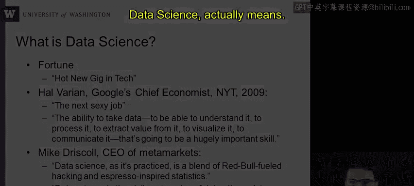
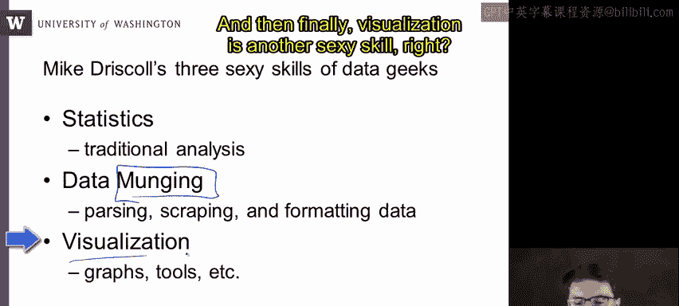

# 杜克大学《大规模数据科学（大数据操作，第1课／共3课有视频）｜Data Science at Scale》 - P7：6_数据科学的特征.zh_en - GPT中英字幕课程资源 - BV12s421T7tJ

。

Welcome back so I want to talk about in this segment what this term data science actually means so you know you'll see these quotes around the web so in Fortune magazine you talk about data science being the hot new gig and tech and howvariarian who is chief Google's chief economist in the New York Times in 2009 which is a while ago now talked about statistics being the next sexy job and described it as the ability to take data to understand it process that extract value from it and communicated that's going to be hugely important another person who's prolific in thinking and writing in this space is Mike Driscoll who's the CEO of a company called metamarkets and he talks about there the data science as it' practice is this colloquial view of it is a blend of red Bull fueled hacking and espresso inspired statistics。

And maybe another quote of his is the data sciences that is the civil engineering of data。

who acolytedes possess this practical knowledge as well as a theoretical understanding and so this balance between pragmatism and theory is something we'll come back to。

So another perspective on this that you should be familiar with is this binn diagram that made the rounds several years ago by Drew Conway and what he his point was that。

Data science is perhaps the mix of three different。Sort of areas， one is hacking skills。

 you know programming expertise， another is the academic。

Vi you know the math and statistics knowledge and then the third that he added is this notion of substantive expertise。

 And what do you mean by this is kind of a deep investment with the data。

 So if you think about your typical I shop， they're typically building tools for other people to use to actually analyze the data。

 but they don't necessarily do the analysis themselves and a data scientist in contrast may be a participant in tool building。

 but they're going to also sort of dive deeply into the data and do the analysis themselves and that's one of the ways that I like to interpret Drew's blue bullet here of。

Substantive expertise， Okay， and then he also sort of fills in the gaps between these talking about that。

啊。I'm not sure Id agree that this is necessarily traditional research， but perhaps it is。

 is applying the statistical knowledge to a particular domain is where research comes in and that some deep theory plus some pragmatic programming makes you a machine learning expert and then he sort of refers to this as the danger zone where you sort of know enough about the domain to be dangerous and you know know hacking to be dangerous but you don't know how to ground your analysis in。

Proper theory and you know some of my colleagues like to joke that computer scientists don't understand error bars right and that's maybe what they're referring to here。

So fine。So what do data sciences actually do？Some more quotes here from EMC who a company who acquired a company called Greenpllum and have a recently have a pretty significant initiative in data science both related to a product called Greenpllum as well as other products。

 so the need to find the nuggets of truth in data and then explain it to business leaders and I like this and then explain it to business leaders something else will come back to that I mentioned previously is that communicating the results is a critical part of this process it's not just getting the result。

And then another view of this which is sort of interesting is that DJ Patel talks about data scientists tend to be hard scientists。

 maybe coming from a physics background who have a strong mathematical background and computing skills and you know come from a discipline in which survival depends on getting the most from the data they're really used to sort of torturing the data to extract every last ounce of value out of it you know DJ has a applied math background so he's maybe。

Coming from that perspective， I think there might be a pretty broad mix of people。

Who can participate this as opposed to necessarily having to come from a hard science？But。

But it's a perspective worth considering。So Mike Driscoll also talks about the three sexy skills of data geeks which are statistics。

 this thing data muning and we'll kind of you know this funny word munging and we'll kind of return to this。

 you'll see a lot of this sort of colloquial language and I'll give my perspective on。

What I think that tells us about the state of the world in data science and but what he means by this is you can imagine is sort of parsing data and scraping data from the web and converting to between different file formats efficiently and not getting hung up on these the kind of friction that you deal with when you are working with large and heterogeneous data sets right so a data scientist is someone who's very comfortable in that environment is able to sort of work nimbly。

Even when things aren't very clean， okay， and then finally， visualization is another sexy skill。

 right， the ability to communicate the results through visualization。

