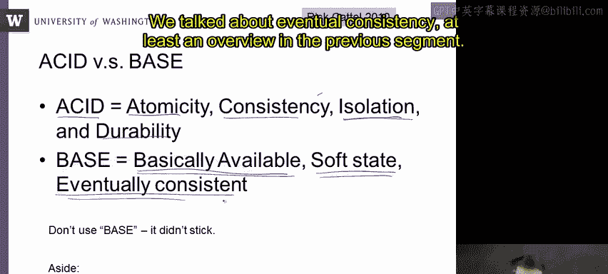

# 杜克大学《大规模数据科学（大数据操作，第1课／共3课有视频）｜Data Science at Scale》 - P80：79_ACID主要影响系统.zh_en - GPT中英字幕课程资源 - BV12s421T7tJ

。

Ad， and he talks about this term base that never quite caught on。

 I wouldn't typically use that this term。 And I'm not sure I recommend you do either。 Certainly。

 acid is。Much more permanent in the vernacular than than this base。 it's， it's okay。

 So acid is an acronym， saving for these four concepts， aity， consistency， isolation and durability。

 And just briefly， this is， you know， the context here is when we're。Modifying records in， let's say。

 a database。 And we can be modifying lots of different records across different tables。

 Anything we want。 And the point is， they're all lumped into one transaction。And so。

Each one of these refers that's the context we're in for each one of these concepts。

 So aimity means that the entire transaction either needs to succeed or needs to fail right you got't allowed to have partial transactions succeed。

Consistency is。The slipperiest one in my mind and this quote down here。Maybe captures that。

 So its sort of any data written to the database must be valid according to all defined rules。

 And the question is， well， where do these defined rules come from。

 Sometimes there're actually integrity constraints in the database。

 Other times they're just sort of business logic rules。

Perhaps enforced by the application or just assumed by the application。

 and so it's a little bit difficult to。Say prove a system is achieves application level consistency。

 but that's the goal。 The point is if there's only certain allowed states the database to have。

 you can't， you should not have a system that allows transactions to put you into an invalid state Okay。

 should go from working state to working state。Isolation means that while the transaction is occurring。

 other readers and writers can't。啊。Values of data items before the transaction is complete。

 they only get final states， and this one is the one most often relaxed in various ways。

In part because it's very expensive and also because it's not usually all that critical and the durability just means that if you report back that the transaction succeeded。

 it needs to have actually succeeded， meaning it needs to be written out to some kind of nonvolatile storage so that if the power goes out and the machine crashes。

 you don't say， hey， whoops， you know that transaction。Accepted yesterday or committed yesterday。

 Well， you need to do that again because it didn't it didn't take。 All right， So that's not allowed。

 So fine。 So these， these all make some sense with。

With a little bit of slippery ocean and consistency as I mentioned。

 and then the pun here is they tried to sort of force an acronym on base。

 and this isn't Rick to tell this came from elsewhere。 But the idea is well。

 it's basically available。 There's some notion of soft state and it's eventually consistent。

 we talk about eventual consistency。At least an overview in the。

Previous segment。Fine， that's all I'm going to say about。That so。

Something else I like about this paper is he sort of says， look， you know。

 the major impact systems here。Are these three this minC or minC D。啊。

Dynamo from Amazon and big table from Google。 And the reason he says these are a major impact is he can kind of trace the lineage and show that other systems are basically taking ideas from one of these three early systems。

 So Mimc is very， very simple。 And we'll talk a little bit about one particular technique that it。

Made popular。In a minute， but it's essentially just， hey， look， let's load everything into memory。

Scale it out across many， many machines。Right， and then we'll be able to serve read requests without having to go sort of query the database。

 we'll just be able to do it directly from memory。 And what's also made this very very popular is you can kind of install it on top of。

Your。Either scale out or non scale out database， and it sort of just works right。

 it just makes things faster。For for read heavy workloads and that was kind of a。A nice thing。

An older system sort to do on the scale 2003， but it's still very widely used。And very， very popular。

 and there's been all sorts of extensions to it， and so we'll talk about perhaps the most basic version。

Amazon's Dynamo paper， which has been somewhat more recently released as a cloud service called Dynamo DB。

 what they did was。They didn't invent the concept ofvinciual consistency。

 but they did sort of show that if you relax the consistency notion。

 that will allow you to scale way， way out。 Okay， and so data Fe are not be allowed or not guaranteed to be up to date。

 but updates are guaranteed to be eventually propagated。And where they need to be。

 And we give an example of why this was a good idea in the last segment。

 and then Google's big table that we'll spend some time on。You know， demonstrated that。

Record oriented storages could scale to thousands and thousands of machines。

 And that was something that。Databases have not shown。

