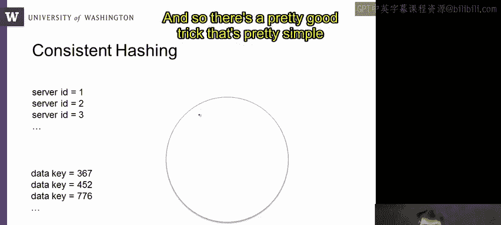

# 杜克大学《大规模数据科学（大数据操作，第1课／共3课有视频）｜Data Science at Scale》 - P81：80_Memcached一致性哈希.zh_en - GPT中英字幕课程资源 - BV12s421T7tJ

。

Let's how each one of these systems in T， so MIm cacheched。As we said。

 the main memory caching service， no persistence， the basic version is no replication。

 meaning that there not there's only one copy of every cached value， so if something goes down。

 if that goes down then it's gone， that's okay because it's of a cache it's not assumed to be the golden copy of anything。

That being said， there's been many extensions that provide various。TheseThese various features。

 including membrane and M base。 So there's a pretty mature system and still in wide use and an important concept that they adopted in this context was。

Consistent hashing。 So I want to explain a little bit about what consistent hashing is。

So that's one takeaway from from this lecture。 Okay， so first。

 just for those of you without necessarily。Having too much background in programming。

 what is hashing， So what is regular hashing well。The problem we're looking at here in this actually is a very very general concept very fundamental to all of programming。

 but in the context of what we're doing here， we're trying to assign data keys to a bunch of different servers。

Okay。And the simplest way you might do this is sort of a round robin thing， right。

 the first key goes to the first server， the second key goes to the second server。

 and you keep going until you run out of server and you start back over the first one。

 and that's implemented by this modulus function。Okay。

 so each of these data keys is placed somewhere on this on one of these servers。At various points。

Fine， that's how hashing works。What's wrong with that？

What happens if I want to add more servers to the mix， right？

 I want to scale out to I want to double the number of servers。Well。

Every existing data key now needs to beeval its location needs to be reevaluated by computing K mod2 in。

Instead of came out in。Which means。Every single data item is going to be remapped。At once。

 so every time you want to add a server， you end up having to move all the data that's already the system and you're dead in the water。

 Okay so what you want is some notion of consistent hashing where consistent means when I place something somewhere and I add more servers。

 it's typically going to stay right where it is。 And so there's a pretty good trick that's pretty simple to understand for doing this。

