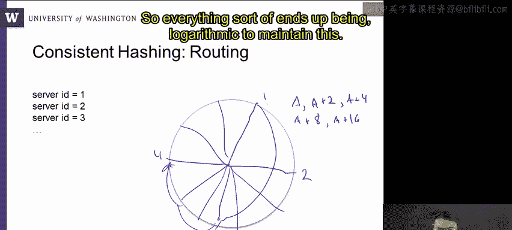

# 杜克大学《大规模数据科学（大数据操作，第1课／共3课有视频）｜Data Science at Scale》 - P82：81_一致性哈希（续）.zh_en - GPT中英字幕课程资源 - BV12s421T7tJ

。

So here's how it works。The first key idea is you're going to map the server IDs。

Into the same space as the key values themselves。Okay， so we apply a function。

Then I'm going to leave sort of unspecified。And map Ser one to some point on this circle。

And server 2， some point on this circle， and Ser 3， someplace on this circle。

And now what that does is divide this space up into three sections。Okay。

And now each key that comes around， I also map it into this circle， so this gets。K 1。

 and this gets key2， key3， key4， key 5， key6。Hes seven and so on。Okay， and now。This entire region。

One， server one， server two， server3。This entire region。Hes responsible for all of these data keys。

Sorry， this server is responsible for all these data keys and then this server。

Is responsible for all the data keys in this region。

And this server is responsible for all the data keys in this region。Okay。

And so what's nice about this is now when I add a new server server ID。Equals 4。

 let's say it comes around right here。Well， you just apply the same rule It should be responsible for every key in this region。

 which means that these two guys need to be moved。From server3。To Ser4。Right。

But you only have to move that one section of data。And so it splits。Ha most sort of K were in。

Date items。All right， so this is a nice trick and there's all kinds of extensions for。嗯。

Supporting replicas we you need to put data items in more than one place。

 well you just sort of hash it to two different places。

 so if you want to hash the same data into two different places，Compute H of。

Let's say D is the data key。And then also put it to。You know。

 put it all three places and you're done。Okay。Okay， so how do we serve requests in this？Set up， well。

 imagine the key space is divided。Across various servers in the same way we described。

And a request comes into the leader that may be elected among the servers or may just be assigned top down by the system。

Or could even be assigned。Randomly。And。The naive way of doing this as well。

 this server would check to see whether it has the key being requested。And if it doesn't。

 it would just forward the request on to the next guy。Okay。

But this is no good because there could be many， many servers。

 and this would incur sort of re latency every time you want to do a read。

So a better way of doing this。Is。For each。Server to memorize the locations of other servers in the ring and which servers it memorizes。

Is。Like this。So it knows where itself is。A plus2， a plus 4。A plus 8， a plus 16 and so on。

And what it does is it knows the key range。Being managed by each one of these servers。

And so what it can do is forward the request to the。Server。

That is closest to the key range is looking for。Okay。

And so this takes a logarithmic number of hops away。You imagine there's lots of servers here。

And keeping all this information straight when new servers come in is still each server only has to keep track of a logarithmic number of servers as well。

 so everything sort of ends up being logarithmic to maintain this。

