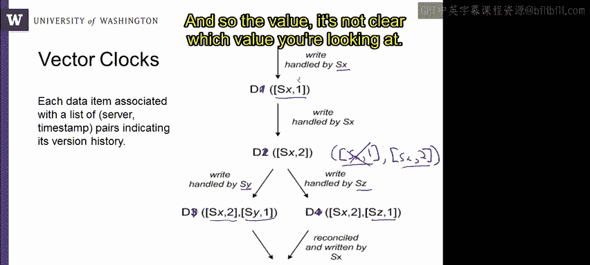

# 杜克大学《大规模数据科学（大数据操作，第1课／共3课有视频）｜Data Science at Scale》 - P83：82_DynamoDB向量时钟.zh_en - GPT中英字幕课程资源 - BV12s421T7tJ

。

Okay， so Dynamo from Amazon in。2007， which was a paper。 And again， a few years later。

 it's been released as a cloud service called Dynamo DB。 Okay， And so here we're looking at。You know。

 scales to thousands of nodes， you can look up things by primary index and basically nothing else is just a key value store just like Nimcsh。

Right。So what are some of the。Tricks it led to you。 well， so some key features are that it has。

So talking in terms of DynamoD， which is the implementation you can now go and use and pay for。

 one of the neat things here is that it offers a service level agreement on performance。

At the 99 percentile。You know， they promised to respond within 300 milliseconds for 99。

9% of its request。 and the reason they do this on the 99 percentile as opposed to some sort of notion of the average。

 the mean or the medians or the mean of the median is that that would。啊。

Artificialally penalize the people who are using it heavily， right。

 They would get a disproportionate number of。Failed requests right。

 it'd be easy to satisfy the average by only focusing on the lightweight users， for example。

So dynamo the system， it's a distributed hash table， that's what DHT stands for。

And each key is stored at。Or you start， each value is stored at to locations。

Multiple locations for replication purposes。And it's up to our replicationification factor of in。

 And so at location。K， K plus1， all the way have to k plus n minus1。

And they achieve eventual consistency through vector clocks。

 which I'll describe in the next couple of slides。 And so reconciliation of potential conflicts when things are being written read and written happens at read time。

 which is another maybe interesting feature of dynamo。 Okay， so rights never fail。

 And they cite in the paper that the reason for this is poor customer experience， right。

 So if you're sort of typing into your。Google Doc。Well。

 not Amazon if you' if you're building an application。

 a web application where you say you update your status on some social networking site and it comes back in the error message and says。

 sorry，'t couldn't commit， you know if somebody else was editing the same or you're editing the same status from somewhere else。

啊。Their claim is that that's more disruptive than。啊。Getting the wrong read。

 which just seems reasonable to me。All right， and so conflict resolution for many applications may be the most recent right is the one that wins。

 or you can actually have the application control this in some cases you may even sort of go back and ask the user to resolve the conflict manually okay。

Okay， so vector clocks。 So the goal here is to detect conflicts so that the application can resolve them。

 not to automatically resolve them at all。 we're just trying to detect things。 So in this scheme。

 every date item is associated with a list of server timestamp pairs that indicate its version history。

 And so in this diagram， I think the numbers associated with these。Items are a little bit confusing。

 so let's just ignore those。 So assume this is all the same date item。Well， first。

 a right request comes into a server called。SX， which appends the vector clock。

The pair SX at timestamp1， right， So this this item was written by server SX at timestamp1 a little while later。

The same server。Handles a right。And would create a vector clock。Sx 1。Ssx 2。But。

Sx 2 completely subsumes S X 1。 It's got the same server in a later timestamp。

 So you don't need to worry about Sx2 anymore。 And there's no other conflict。

 which we'll see in a second。 So you can just cross this out and just get S X 2。

 You can garbage collect the。Old。Version。Okay， but then independently as server SY and serverS。Z。

The item is written and so。The vector clock gets extended with another pair。SY1 and S Z1。

 timestamp 1 is S Z and times step 1 is SY， in addition to SX2 and Sx2。Then finally， a read request。

Comes。Comes in， and it sees that the vector clock has a conflict because this is the same timestamp at two different servers。

 And so it knows that they were independently writing to this。 And so the value。

It's not clear which value you're looking at。你们可。