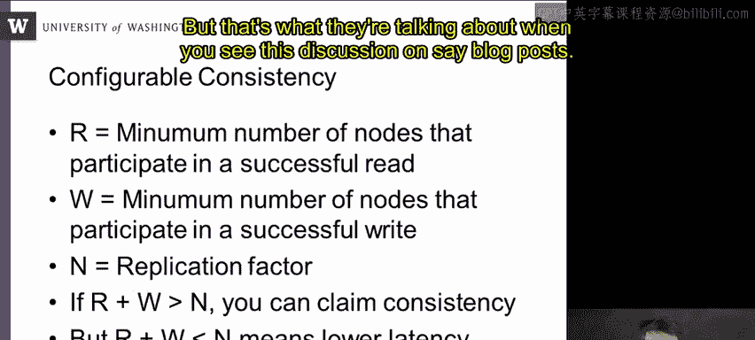

# 杜克大学《大规模数据科学（大数据操作，第1课／共3课有视频）｜Data Science at Scale》 - P84：83_向量时钟（续）.zh_en - GPT中英字幕课程资源 - BV12s421T7tJ

。

So in the example， just to sort of run through we just saw， a client writes D1 to server SX。

Increases value， another client reads D1 and writes back D2， also Hindu by SX。

And D1 was garbage collected。Then separate clients read D2 and write back D3 and D4 on two different servers SY and SZ。

And then another client reads D3 and D4 and notice it and finds that the system reports that there's a conflict to be handled。

So let's practice with these。Here's。Two different vector locks you need。

Figure out whether they represent a conflict or not。 So in this case。

 we have server Sx with the timet of 3 and on this data item server SX with the time of three。

And then。Each one is a different server with different timestamps。So is there a conflict？Well， yeah。

 there is because。On one version path。S Y made a series of changes。 And on another version path。

 S Z made a series of changes and they didn't talk to each other because they don't reflect each other's changes。

 So， yes， there is。And then this one said the same server。At a later timetamp。

 So is there a conflict here？Well， no， because they weren't handled by different servers。

 so really just this one subsumes that one。And we're okay。So on this one， we have server XX with 3。

 Server XX with 3。Server S Y with 6， server SY with 6。 So they agree so far。

 And then this one is an extra change S of server S Z with the timetable of 2。So no。

 there's no conflict here because。They agree wherever there's。On on。

This is just an extra change on top of this one， so this guy wins。And this next one。

Server SX with the times Sta of  three， Ser SX with the times Sta of three。

Server S Y with the timest of 10， and this says server SY with the timest of 6。

 and then some later change at S Z。So is there a conflict here？Well。

 there is because this one is later in time on SY。Right 10， then this one is， but then。

And if that was all there was， if it wasn't for this guy， if it wasn't for。This guy here。

 would I be okay， we would just pick this one because it's later。But。Because this one's here。

We now have some changes at SZ and some changes at SY that were both forward in time from the latest point that they agreed on。

 and so we don't know how to resolve that and so yes， there is a conflict。And then similarly here。

 Sx。And times Sam3 and S and times same 3。Well， here we have SY and SY。S。

 Y 10 is the same as last one， but here， instead of 6， it's 20。 And so it's later than this 10。

 And then further we have a change at S Z。 And so is there a conflict here。Well， no。

 because this one is strictly later than that one is on all the servers that they share。

 it has later timets。 so it strictly subsumes it。And so no， there is no conflict。Okay。So those are。

In the last time we talked about consistent hashing in this segment we talked about vector clocks these are two。

Little gadgets to be familiar with because they come up a time and again in these No SQL systems and in other systems in general。

All right， so Dynamo also talks about。A way to parameterize the level of consistency and this comes up occasionally in paper。

 so I just want to make sure you're exposed to it。The idea here is that you have two parameters R in W。

 and R is the minimum number of nodes that need to participate in a successful read。Okay。

And W is the minimum number node and you participate in a successful right。

 So this is sort of how many replicas you write to and how many replicas need to。

Respond from a pool to know that you sort of have all the information。Right。

 because if everybody's updating everything all the time。

 It might be that you have 20 different servers。 They all have a different version of the data item you're trying to read。

 And so the question is how many of these do you need to sample before you feel like you have the right one。

 And so for a replication factor of N， if R plus w is greater than n， then you can claim。Consistency。

 but often you want to set R plus W less than in。In order to achieve lower latency。

 so you don't want to have to actually contact。You know。

Too many servers return to in order to satisfy some read read request or write request。 Okay。

 so if you see that notation， this is what it means。

 But I'm'm not going to describe too much more about it， because I think the the sort of。

You know the formalism falls over a little bit under a little bit of scrutiny。

 but that's what they're talking about when you see this。Discussion on say blog posts。

