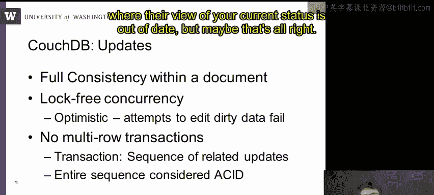

# 杜克大学《大规模数据科学（大数据操作，第1课／共3课有视频）｜Data Science at Scale》 - P85：84_CouchDB概述.zh_en - GPT中英字幕课程资源 - BV12s421T7tJ

。

Okay， so the next system we want to look at is couch D， which began in 2005。

 but is still has undergone a lot of updates and is still pretty popular today。

 and so this is an example of one of these document oriented stories that Rick could tell。

Talked about。 And so here， just to look at the features we're talking about here。We've got the scale。

 we've got primary index now now we start to see the requirement for secondary indexes。

 meaning that you can look up not just by the key， but by other kinds of values in the document and we'll see how that works。

Okay， and then transactions。Also， we're a little bit better。 We can。

What I mean by record here is that you can change multiple values within a single document object。

 which is a set of key value pairs。As opposed to just a single key value pair。

And then there actually is some support for analytics， and we'll see how this works too。

 This is all through the notion， this concept of views in couch Db。

 but you can actually run little map reduced scripts to compute。H。

Deriveve new values from existing document source。Rightright， and then the。

Other notion we have here is views， which is somewhat unique。

 You can see this column is fairly sparsely populated， and I hit the concept of views pretty hard。

 which are my relational databases and argued that it was pretty fundamental to not only the relational model。

 but a。Pretty important concept in general。 It gave you this notion of logical data independence。

 And so whenever you see views。That's a good thing， and so CalSDB has them as well。Allright。

So the data model here is documented or， as we said。

 where a document is a set of key value pairs and so here in this application。

These are perhaps blog posts where they have a subject。

 the key is subject and the value is some text string。

And they have an author and they have a date on which they're posted。

 and then they have a set of tags。 and this is sort of what makes it a document model。

 we said they can be sort of nested， so it's okay to have a list of objects here。

And then they have a body， which is another strain。F， you'll notice that this is actually。

Jason compliant we looked at Jason in the Twitter assignment and so it's another occurrence of this and one of the reason why I wanted to make sure you're working with Jason before is it does get popular and so CADB。

 all data represented in Jason and all the requests coming back are all represented in Jason as well。

So how to updates work in this context as we mentioned。They you know。

 you can meet you it is fully transactional within within a single document。

 so full consistency within a document， meaning that I can sort of grab hold of the document。And。

Logically， sort of lock it。And up making whatever updates I want。 Now。

 it doesn't actually take a lock because it uses what's called optimistic。Concurency control。

 meaning that it sort of assumes the conflicts aren't going to happen optimistically。

 And so now if I， if I check out that document and try to make updates to it anywhere I want all throughout it and then try to commit that change。

 And someone else is doing this thing has done this has committed their own changes。In the meantime。

 my changes will fail。But we assume that that doesn't happen that often。

 so it's okay to just sort of fail in those cases。And really。

 which all you have to do in that case is check out the new changes and make whatever changes you want。

Fine， but there's no multi row transaction。 I mean my multi row here is multi documentment， right。

 So you can't say， for example， when I update my status。

I have to update my document that describes my current state of the world。

 but maybe I also want to update all my friends。Walls， right。

 they're their pages to with that reflects my new status and you can't。

Guaranteed that that happens synchronously in CalTB， but you know。

 in this particular application and in many others， maybe that's okay。All right， you know。

 you can do it in two separate steps， you update your status and then you update theirs。

 and there'll be a period of time when their you know view of your current status is out of date。

 but maybe that's all right。

