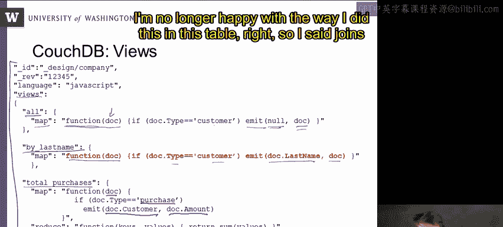

# 杜克大学《大规模数据科学（大数据操作，第1课／共3课有视频）｜Data Science at Scale》 - P86：85_CouchDB视图.zh_en - GPT中英字幕课程资源 - BV12s421T7tJ

。

All right， so this notion of。Views。Works like this， a view specification。

 which is itself a couch D B document， a set of key value pairs， but is sort of a special one。

Looks like this。 There's some metadata information here。 And then there's this key views。

 which is which is a dictionary of things。 And so this， this specification has three views in it。

 one called all， one called buy last name and one called total purchases。

 And each one of these views is going to be is implementing a。Set of key value pairs。

I just can to be implementing a dictionary。 And so the all view。Okay， and it so fine。

So how are these implemented？Speaking of recurring concepts。

 views are recurring from logical data dependence and relational databases。

And here map reduces recurring even outside the context of literally Hadyoop， okay。

And so here the map function reduce function actually written in JavaScript， again。

 everything in Cal T is JavaScript。And they look like this。 So the all view has just a map function。

 no reduced function。 And in Java， you can write these anonymous functions。

Like in this sort of syntax， so this function doesn't have a name It just says。

 hey I've got a function with no name with a single argument called Doc。And the body looks like this。

 It says if doc dot type equals customer， then emit a key value pair where the key is null and the value is dot。

 So we don't really care about the key in this case。 We just care about the doc。All right。

 so this is all customers。Fine。The by last name view。

 you can imagine the key is going to be last name in this case。

 And so here we have another anonymous function。If do type equals customer。

 then emit the last name followed by the entire document。 And so now this allows。

Clients to search efficiently by last name， and these views will are in be or computed。You know。

 they're materialized sort of eagerly and stored in these。Distributed B2 or index structures。

To support various lookups。 and so this is how they implement those secondary indexes in that column in our table。

So now we can look up my last name as well as by。Document I D。

And so you can even go a little further。 You don't have to just do simple key value pairs。

 You can even do a little bit of computation。 So total purchases here。 The map function again。

 takes in a document and says well， if docide equals purchase。 So I'm not on my customers anymore。

 just purchases。Then admit the key of docti customer and the value of dock amount。

 but then we're also going to define a reduced function and the reduced function。

Addds up all the values of the amounts。 And so here we have。Given if I give you a customer。

 you can return。It's the total amount of all of its purchases。Okay， and C Gb。

Maintains all these views as things change。With eventual consistency， sort of semantics。

We have a lot of things going on here with one concept。 We have secondary indexes。

 We have logical data independence。U。We have map reduced computation。Now。Im。

🎼Pause there for saying because I just realized I sort of misspoke。

 I no longer am happy with the way I did this in this table。 right， So I said joins analytics。

 And I said， yes， map reduce style。 But that's actually not quite true。 right？ You can do map reduce。

 but you can't do joins。

