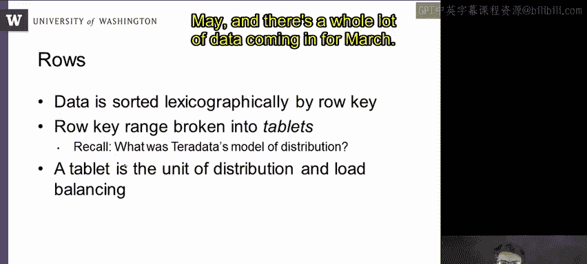
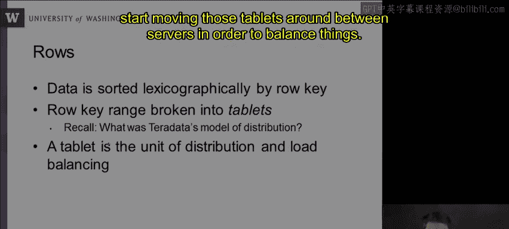

# 杜克大学《大规模数据科学（大数据操作，第1课／共3课有视频）｜Data Science at Scale》 - P87：86_BigTable概述.zh_en - GPT中英字幕课程资源 - BV12s421T7tJ

。

Okay。The third influential system that Rick mentioned in the paper is a big table from Google。

 which is a paper from 2006。 And so here we're looking at。Primary index， lookup。

 secondary index lookup， transactions are also at the sort of scale of an individual record。

Joins Analytic is not supported by Big D directly。In in H base。

 which is the open source implementation of it。In well， in Google's implementation as well。

 it was sort of designed to be compatible with Mareduce。

 And so you can run map reduced on over here over the same data that's stored in。Big tables。

 so they're sort of compliment。And then there's some notion of integrity constraints or schema here。

 And we'll talk a little bit about how that's implemented。 There's no views that I can see。

 and there's no sort of。Language level or algebra。Algebra level for manipulating these things they're all sort of no SQL style。

Micro interactions with individual records and cells， okay。

So this is a paper in OSDI from 2006 and some overlap with the authors of the mapreuce paper。

 And it was sort of designed from the start to be complementary of mapred。

 So if you can remember what was one of the main things that was missing from。

Map produceuce or maybe a few things we' missing well in particular。You couldn't look things up。

By index， you couldn't get these little sort of low latency accesses。 And so， for example。

 if you wanted to find all the records。You know， given a big data set。

 you want to find all the records and some other data set they correspond to。

 you wouldn't do some sort of a join。 the best you could do is process。

You had to touch every single record， there was no way to zoom into just the right ones you wanted。

And so Big G provides that。Fast key based lookup。But you can still process the overall data as a big set of。

Key value records with Mareuce， fine。The data model here is a sparse， distributed， persistent。

 multidimensional sortded map。 And what they mean here is that you can basically access any cell in a big table by giving a row Id。

 a column I a column name and a。Timet timestamp isn't really described in this English description here。

 it's for versioning， so when you have after you have updates you'll keep track of past versions of the same cell。

And so。If you provide these three parameters， the big table will return you a string quickly。

So each row is。嗯。Data is all sorted lexographically by the row key。

 which is this row I in this in this bit， right， So this is some sort of primary key in sort of relational language or just a key in kind of O SQL。

Framework， and then this key range， I say that the say the integers， then continuousig。

Subranges of this set of keys。Will be。Assigned to a tablet。Okay so。

This is a little different way of dividing up the data than we've seen in the past in at least one system。

 we talked about a parallel database model。 We happen to use the example from Terraadata。

 And so how did they break up data。Well。They did it by hashing， right。

 so every individual record would be sent to a server。According to a hash function， which。

You can generally just think of as sort of round robin。The point is is that。

Two keys that are next to each other in space， so sort of timest。5 PM and timestamp 501。

 There's no reason to believe that 5 o'clock and 501 are going to be on the same server in Teridadas model。

 Here they are。So what are the pros and cons with this？

If you're going to typically access a whole range of keys at once。It's pretty nice to be able to。

 you know， when you get one， you get the others two sort of for free because you're you're pulling them all back。

 however。Ha。If one particular。Key range is much more popular than the others。

 except using the time example again。嗯。The most recent data perhaps is the most popular。

 and so if all the requests are going to that。One key range。

 then you've got a bunch of idle servers hosting all the other tablets that are corresponding to older times。

And all the requests are going to this one tablet。And so for that reason。

Terriada sort of chooses to hash everything so that on every request。

 all the servers may have to be accessed， but that's good for scalability。Okay。So pros and cons。

Alright， so the tablet here is the unit of distribution and load balancing。

 so they'll move tablets between servers as things start to get unbalanced， right if you're。

 if your key range is you know。January， February， March， April May。

 and there's a whole lot of data coming in from March。

 they'll split that into multiple tablets and start moving those tablets around between servers in order to balance things。

