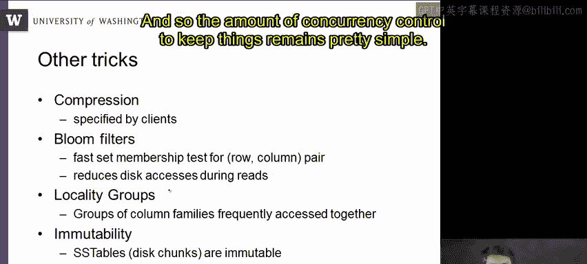

# 杜克大学《大规模数据科学（大数据操作，第1课／共3课有视频）｜Data Science at Scale》 - P88：87_BigTable实现.zh_en - GPT中英字幕课程资源 - BV12s421T7tJ

。

So within a single table， you can have these groups of columns called column families。

 And the column names have the family right in there as a qualifier。

And this family is the basic unit of access control so you can provide permissions on a group of columns。

Memory accounting in that they're sort of allocated as a unit in memory and then diskA accounting。

 so they moved around on disk。As a unit as well。Okay。

 and so I make this point that typically all columns in a family are the same type， which I。

Find it little unusual because they sort of talk about it in the basic unit of access control which suggest that there's you know things that go together for access control。

 sort of Social Security number and employee IDd or something。May or may not be the same type。

 So there's sort of a logical grouping。Requirement that they seem to be trying to meet。

 But then they're the same they have to be the same type， which is for a very technical reasons。

 specifically because they want to compress these things。 So if you have a whole bunch of integers。

 it's easier to compress。 And if you have a mix of integers and strings。 Okay。

 so I think they're trying to kill too many birds of one stone here。

Right and then each cell can be version， which is the third part of that key lookup， right。

 row ID column name and timestamp。And each new version increments that timestamp。

 here you can enact different kinds of policies where you only keep the latest in versions or you keep only the version since a given timestamp。

So。How these tablets are managed is a master will assign the tablets to tablet servers and the tablet server handles reads and writes from the tablets and controls and so clients communicate directly with the tablet server as opposed to having to go through the master every time。

 which helps with scalability。And then when a tablet starts to get through big， it'll split it。And。

Lad balance it。So。The metadata keeping track of where tablets are located。

Is organized itself in another tablet。 So there's a root tablet here。That describes。啊。A a a。

Each record in here describes a group of records， a group of location records in a。You know。

 bigger table。And then each one of these metadata tablets。

Gives the location of a particular user table。Okay。

 and so this is how you sort of keep track hierarchically of where everything is at one time。

 And so chubby that they mention。In the paper is a distributed lock service。

For controlling access to these things， I'm not going to talk too much about it。Okay。

 so how are reads and rights？Handled in the system。

 while there's a table in memory that stores a sequence of updates as they occur。Okay。And。

A right operation。Is low is。adds a record into the memory resident table。

 but it's also written to a log for fault tolerance purposes。Okay。

So if this server goes down and reads the tablet login can reconstruct what's going on and then read operations are served。

By reading these SS table files， the actual data itself。

 but then also by applying the updates from the MIM table。On the fly。So it stream it says。

 here's the value and then here's the stream of updates I need to apply to that value to get the true value。

Okay。And then there's two。 So so this is fine。 But， but you know。

 what happens when the M table gets bigger and bigger and bigger？ Well。

 there's two types of events that occur to。You know， do the bookkeeping here。

 so one is a minor compaction， and this is when the Mm table gets big。A。

getss written out into a new SS table file and the changes are merged。Okay。

 and then a major compaction is take all the SS tables。

And rewrite them all into one big one that may be split into multiple files。And also。

 clean up any deletes that have occurred。 So deletes are just appended as。

Instructions but aren't necessarily， it doesn't actually remove anything。

 So they're sort of garbage collected。Okay。So this way you can keep sort of the read throughput pretty high and sort of keep this up。

 keep going on in the background。All right， so there' a host of other tricks here too with a。

Can do various forms of compression specified by compant。

 which can be specified by the clients There some different different ways of doing it。

 They use bloom filters to speed up。Existence test。 So if you， if you， if I give you a row I。

 a column I D and a timestamp。And say， find me this value。

What these blue filters allow you to do is to very quickly determine whether that does not exist in the system。

So these bloom filter data structures are pretty cool and I'm going to walk through them in this course in a couple of weeks so they help you。

Quickly determine。Whether that key does not exist in the system and avoids disk accesses during reads。

All right。And then there's locality groups you can define which another layer of organization on top of families。

 and these are groups of column families that tend to be accessed together。Fine。

And then another trick here is is to make sure that the SS tables。

 these disc chunks are actually immutable。 They never get written directly。

 The only time they get written is when。These major compactions happen。

 and the whole thing is sort of reorganized。 And so that means that the only writeritable data structure is this MI table。

And so the amount of concurrency control to keep things down remains pretty simple。

