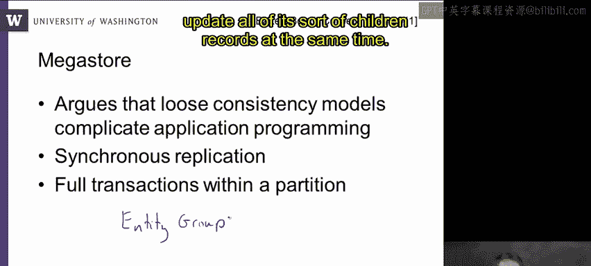

# 杜克大学《大规模数据科学（大数据操作，第1课／共3课有视频）｜Data Science at Scale》 - P89：88_HBase、Megastore.zh_en - GPT中英字幕课程资源 - BV12s421T7tJ

。

Google Big T again had a lot of influence and one of the major outcomes is just like Mareduce。

 it was taken up and implemented。Has an open source project。Called H base。 And so we。

Where big table was compatible with Mapperoo， Hspace was compatible with Hadoop。 and in one slide。

 there's not much difference here， but I just want to mention the terminology so you've seen it。That。

There's table at the top level and then region store and then Mm store and store file。

 And so the exact names of these structures are a little bit different。

 and they did insert one more layer of abstraction， which is this region。Fine。

 and then how this sort of is compatible with MaRduce is that。

 you know each one of your map functions will process a single tablet。

 and so it's sort of one to one with the blocks of data that we talked about when we talked about MaRduce。

And then I just sort of asked this。Question。Sort of open ended is that there's this notion of speculative execution in mapuce that we talked about whereby。

For fault tolerance reasons， it might kick off the same map task twice on two different replicas of the data。

And the reason for this is that if one fails， well。

 you have the other one so you don't just start over from scratch。But。

You know in this environment where you're now working on data that is being actively updated。

 and that's what HB and Big Tboard design support is updates。

It's not quite as clear to me what's going to happen when you have。You know， it's。

 it's possible because of eventual consistency that these two tablets will not always。

Agree instantly on the same record， they'll agree， but different records within the tablet may not。

 just an example of when you sort of mix these two systems。

 and there are no sort of system wide transactional guarantees。Or is system in white even properties。

That you can run run into trouble and I think that a general theme here with these sort of No SQL systems。

 including the ones in women designed by Google， is that you're kind of offloading some of this responsibility to the application to the programmer to sort of sort this out and make sure it's okay。

Okay， and we're going to come back to that in just a couple of minutes。After big table。

 several years later， there's a paper by a bunch of folks at Google about a system called megastore that I'm not going to spend a lot of time on。

 but it's。Basically。You know， they found this point I've sort of just made is that these loose consistency models can complicate application programming。

 And what they want to do is provide a little more。System support。For certain kinds of safe updates。

Okay， so here instead of full transactions。Being safe within an individual record。

 as they are in big table， they've extended it with this notion of entity groups。

 And so an entity group that should be on this slide。And an entity group is a。

Set of records that tend to go together， tend to be accessed together。Okay。So maybe again。

 this is the blog in all of its comments， for example。each one of these is a record。

 because six sensible record stores， so it's okay for them to have different schemas。

But they all tend to go together。Okay，And so what they've done is extend transaction support。

Over an entire entity group， a set of related records。Okay。

 so they still get the scalability by not requiring full system wide to global you know， synchrony。

 but they。Allow you to sort of get away from this problem of。You know very frequently。

 I might need to update one record and update all of its sort of children records at the same time。

And I can't do that in any kind of safe way。